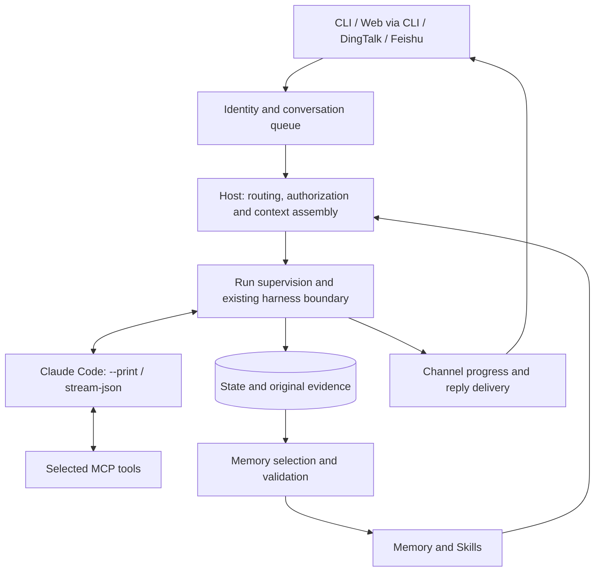

# Agent-Host implementation notes

The [managed Skills contract](managed-skills-design-detail.md) adds the proposed
agh catalog, proactive default-Agent loading and enabled-plugin usage guidance.
Its [main design](managed-skills-design.md) owns scope and rollout. Existing
memory publication and native Skill mounts described below remain delivered
behavior; they do not yet implement the unified lifecycle or readiness contract.

Companion to the [current architecture](architecture.md), reviewed on 2026-10-16.
The shared ACP proposal and first Claude implementation were added on 2026-10-20;
delivered behavior is separated from the remaining design below.
The main document owns scope; [progress](release-follow-up.md) owns priorities.
Feature-specific details retain historical schemas and bounded acceptance results;
they are not a claim that every current path passed live validation.

## Technical glossary / 技术名词

The [main glossary](architecture.md#key-objects--关键对象) introduces business and
memory objects. These terms explain how they are executed, authorized and stored.
[主文档](architecture.md#key-objects--关键对象)解释业务与记忆对象；这里补充执行、权限和存储术语。

| Term / 名词 | Meaning / 含义 |
| --- | --- |
| Harness / 原生执行引擎 | The application running the model/tool loop and native session, currently Claude Code. 负责模型推理、工具调用循环和原生会话的程序，当前为 Claude Code。 |
| Harness adapter / 执行引擎适配器 | Translates Host requests and engine events across their boundary. 在 Host 与执行引擎之间转换请求和事件，不接管引擎内部循环。 |
| ACP / Agent Client Protocol / 智能体客户端协议 | A shared Host-to-engine protocol, implemented for the pinned Claude bridge. Host 与底层执行引擎通信的统一协议，首版已支持 Claude；不替代钉钉、飞书等渠道接口。 |
| Routing / 路由 | Selects the Agent and project environment for a request. 为请求选择智能体配置和项目环境；选中项目本身不会增加权限。 |
| Context assembly / 上下文装配 | Prepares the instructions, eligible memory and tools for a run. 执行前准备指令、可用记忆和工具；不会预先读取所有资料正文。 |
| MCP / Model Context Protocol / 模型上下文协议 | A protocol exposing tool calls to the native engine. 让原生引擎调用资料检索、邮件等工具的协议；接入工具不等于授权任何操作。 |
| Jev / 决策组件 | The configured model-backed decision service used for routing and memory selection. 用于路由和记忆筛选的模型决策组件；其判断不是事实或业务成功的证明。 |
| Audience / 受众 | The private user or shared group a conversation and its records belong to. 对话及记录所属的私人用户或共享群体，是控制可见性的维度。 |
| Scope / 适用范围 | The project and identity boundaries within which records may be used. 记录可被使用的项目、身份等边界；内容相似不会自动获得访问资格。 |
| Source grant / 数据源访问授权 | An explicit configuration permitting a user or shared audience to use a named source. 明确允许某用户或共享受众使用指定数据源的配置；不能恢复执行配置已移除的工具。 |
| Execution profile / 执行配置 | The selected native model, tools, permissions and provider environment. 执行时采用的模型、工具、权限和服务环境；Owner 与成员可采用不同配置。 |
| Owner / 所有者; Member / 成员 | The configured owner and other authenticated channel users. 配置指定的所有者与其他已认证渠道用户；Host 根据可信身份选择权限，不根据消息自称。 |
| User profile / 用户档案 | A private user’s configured or initialized `USER.md` context. 私人用户的背景与沟通偏好文件；群聊不装入私人档案，自动学习偏好的完整管理流程仍待实现。 |
| Owner approval / 所有者审批 | A correlated, one-use authorization for a separate execution run. 与具体请求关联、仅使用一次的独立执行授权，不提升成员原生会话的权限。 |
| Runtime / 运行实例 | A running Host deployment with its configuration, state and native sessions. 带有自身配置、状态和原生会话的一套 Host 部署；开发与生产可分别运行。 |
| Publication manifest / 发布清单 | Selects the visible revisions of published file memory. 指定文件记忆当前可见版本的清单；目录里存在文件不等于它已生效。 |
| Retrieval index / 检索索引 | Rebuildable lookup data derived from published memory. 从正式记忆生成、便于查找的辅助数据；损坏后可重建，不是知识正文的权威副本。 |
| Current matter / 当前事项 | Evolving work state linked to selected source evidence. 从选定来源跟踪、随进展更新的工作状态；与可长期复用的知识分开管理。 |
| Worktree / Git 工作树 | A separate checkout for isolated repository work. 同一 Git 仓库的独立工作目录；Host 自动管理其任务归属和生命周期仍待实现。 |
| PR / Pull request / 合并请求 | A proposed code change submitted for review and merge; GitLab calls it an MR. 提交给他人审查和合并的代码变更，GitLab 称 MR；Host 自动交付流程仍待实现。 |

## Current implementation map

| Concern | Code / authoritative guide |
| --- | --- |
| Selected local checkout discovery and shared receipts | `internal/projectruntime`, `internal/cli/project_runtime.go`; [project records](development-projects-detail.md) |
| Verified private users and profiles | `internal/cli/users.go`, `internal/assembly/workspace.go`; [workspace contracts](workspace-layout-detail.md#multi-user-recording-and-retrieval) |
| Owner/member execution and one-use approvals | `internal/cli/channel_authorization.go`, `internal/approval`, `internal/harness/claude/restricted.go`; [authorization details](dangerous-operations-design-detail.md) |
| File-memory publication, source-linked objects and native Skills | `internal/state`, `internal/memory`, `internal/experience`, `internal/objectmemory`; [file backend](file-memory-design-detail.md), [procedural learning](procedural-learning-detail.md) |
| External evidence ingestion and installed memory skill | `internal/cli`, `skills/agent-host-memory`, `tools/install.py`; [external memory](external-memory-skill-design-detail.md) |
| Knowledge retrieval, Confluence writes and reply guidance | `internal/knowledge`, `internal/assembly/context.go`, `internal/harness/claude/knowledge_instructions.go`; [source tools](knowledge-sources-detail.md) |
| Selected-source matters and suggestions | `internal/discovery`, `internal/assistance`; [P0 implementation](personal-assistant-detail.md#p0-implementation) |
| Service lifecycle and independent runtime | `internal/cli/service.go`, `tools/service/autostart.py`; [runtime operations](service-install-detail.md) |
| Encrypted backup, restore verification and retention | `internal/backup`; [backup details](workspace-backup-design-detail.md) |

The supervisor uses one worker per enabled channel and a shared local workbench.
Runtime state and native sessions remain channel-local. Memory publication can
share file storage without merging Agent/audience visibility. Shared project
receipts exclude original request/response text and native context.

### Current execution path before ACP

The [main architecture diagram](architecture.md#core-architecture) shows the
chosen target and ACP delivery status. This diagram records the retained print baseline: entries
reach Host, and Host runs Claude's print/stream-JSON adapter. New Web chats
launch a separately configured Host CLI. Selecting an existing channel Session
uses the owning worker's private control socket; Host forks its exact completed
native context and preserves the original room and audience.



Business execution, acceptance, delivery and memory publication retain separate
outcomes. Source documents, remembered text and model output cannot grant
permissions. The shared Claude ACP alternative is described in
[the execution guide](acp-execution.md).

## Storage and context authority

- `config/`: user-maintained inputs, read-only during execution. Automatic first
  contact initializes runtime `users/<id>/USER.md`; explicit configured overrides win.
- `channels/<name>/state/state.db` and CLI state: operational evidence, source
  receipts, candidates and lifecycle records. These remain durable.
- `memory/`: versioned published knowledge and Skills for explicitly migrated
  runtimes. Source publication manifests own visibility; domain views are derived.
- `cache/`: rebuildable retrieval indexes, scoped task views and native Skill packages.
- `datasource/plugins/`: source snapshots and provider-owned runtime data.
- `projects/`: shared registry and per-run engineering receipts, not durable features.
- `backups/`: encrypted recovery archives; the decryption key is kept outside the root.

Migration is explicit per source and reversible. Startup cannot infer a backend
from an existing directory. A production relocation receipt identifies a separate
runtime: development builds and tests must not update or restart that bundle.
See [layout](workspace-layout-detail.md) and [migration](file-memory-design-detail.md).

## Code boundaries

The CLI composes channel and local execution through selected profiles. Local Git
discovery, automatic enrollment, routing, default-workspace execution and project-set
assembly are implemented. Remote discovery, managed clones and durable worktree/PR
coordination remain proposed. The Codex package remains a scaffold.

```text
Agent-Host/
├── cmd/agent-host/           CLI entry point
├── internal/
│   ├── cli/                 Commands and local ownership
│   ├── event/               Versioned execution events
│   ├── terminal/            Text and NDJSON renderers
│   ├── decision/jev/        Explicit company or official API
│   ├── host/                Task coordination and run supervision
│   ├── channel/             Channel input, identities, and delivery
│   │   └── dingtalk/        Application-bot Stream and session-webhook transport
│   ├── routing/             Explicit and tool-free registered-project selection
│   ├── assembly/            Workspace, instructions, and context preparation
│   ├── knowledge/           Source MCP retrieval and authorized Confluence writes
│   ├── harness/             Shared adapter boundary
│   │   ├── claude/          Claude Code protocol and process integration
│   │   └── codex/           Codex adapter scaffold (not executable)
│   ├── annotation/          Source-linked objects, aliases and topic applicability
│   ├── memory/              User-statement decisions and finalization
│   ├── experience/          Tool-free extraction and selected procedure publication
│   ├── evaluation/          Categorized fixture checks and evaluation reports
│   └── state/               Operational records and raw evidence
├── config/                 Example local channel configuration
├── evals/                  Versioned fixture suites
└── docs/                    Research and architecture documents
```

| Private package | Responsibility |
| --- | --- |
| `internal/host` | Business task lifecycle and execution coordination |
| `internal/harness` | Shared execution contract and capability reporting |
| `internal/harness/claude` | Claude-specific protocol and process integration |
| `internal/harness/codex` | Reserved scaffold; no runtime implementation |
| `internal/annotation` | Versioned source spans, service identities, aliases, topics and applicability checks |
| `internal/memory` | Source-linked user-statement decisions and finalization |
| `internal/experience` | Evidence-linked procedure extraction and Jev screening/comparison |
| `internal/evaluation` | Isolated fixture execution, expected/actual comparisons and structured evaluation reports |
| `internal/channel` | Durable input, source identity, conversation scheduling, attachment preparation and result delivery |
| `internal/channel/dingtalk` | Owner DM and enterprise group-mention admission, supported media/quotes, bounded media downloads, Stream lifecycle, safe ACKs and HTTP replies |
| `internal/routing` | Explicit identities and bounded tool-free project-set classification |
| `internal/assembly` | Task context, workspace, and agent configuration |
| `internal/knowledge` | Private source selection, pinned credentials, source MCP retrieval and Confluence page/blog writes with attributed receipts |
| `internal/state` | Durable state, atomic derived indexes, scoped retrieval and recovery bookkeeping |

Keep APIs private until external consumers justify public contracts. Add
concrete adapters, channels, and storage implementations below the component
that owns their behavior, as those implementations are developed.

`cmd/agent-host` composes the host through `internal/cli`. The host coordinates routing, assembly,
memory, operational state, channels, and the shared harness boundary. Native
adapters implement that boundary without importing host coordination code.
Routing and memory must not depend on Claude- or Codex-specific protocols.

Channel input retains source identity; routing and host policy use it when
selecting an agent and access scope. The first CLI loop uses one local owner and
project-scoped memory. The DingTalk channel accepts owner private messages and
verified enterprise group mentions. It resolves agent/audience identity before
automatic registered-project routing with default execution when no association
is reliable,
deduplication and independent delivery status. Chat exposes only `/new`, `/status`
and `/help` as Host controls; local interfaces own project and agent settings.
Historical manual pins are retained but do not determine new tasks. The empty
catalog path skips classification. No new Host project question or waiting
record is created; native execution asks for business details as needed.
Historical pending requests require their original requester's explicit
confirmation or cancellation and never replay automatically. Configuration,
selected-directory and provider failures remain explicit, and default execution
does not extend project or knowledge permissions.
[Runtime assembly](runtime-assembly-detail.md) separates stable memory scope from
physical cwd and preserves native session compatibility. Joint tasks carry an
explicit project set and additional directories, retrieve only those scopes and
pause automatic new memory/experience publication. New default-workspace handoffs
and continuations keep normal history, memory and experience processing even
with a populated catalog. Historical `MemoryAttribution=unresolved` runs keep
their skipped learning records but remain readable within their saved default
scope. Empty-catalog runs use the same normal memory flow. The
[routing details](smart-project-routing-detail.md) define that boundary.
Each state home retains a SQLite database for operational records and candidates.
The legacy backend also keeps versioned memory there; migrated file runtimes use
the publication and cache boundaries above. `internal/state` owns transactions,
with semantics in `internal/memory`, `internal/experience` and `internal/annotation`.
The schema descriptions below record historical migration steps, not the latest schema.
Schema v3
migration derives annotations and terms from existing memory text without
rewriting statements, immutable revisions, evidence or review decisions. Schema
v4 adds channel receipts, private reply capabilities and native-session bindings;
run provenance is derived atomically from an accepted receipt. Unfinished claims
and attempted replies are marked unknown on recovery instead of replayed.
The SQLite backend is implemented; no public plugin loader is provided.

The channel scheduler serializes each conversation binding and shared
agent/audience memory partition through execution, memory finalization and reply.
Independent private card tasks use separate bindings and skip automatic memory
writeback; they may overlap within the same audience. Quoted follow-ups stay
within their original task, while ambiguous confirmations ask for a target.
Other audiences use a bounded pool; SQLite transactions remain short and
single-writer. This protects memory read/decision/write ordering without
isolating shared checkout files. Queued commands follow the same lane, including
`/status`; the current channel implementation introduces no asynchronous memory
work or `/stop`. The ACP control path below is proposed separately.

Schema v11 adds protected `input_capabilities` alongside existing private reply
capabilities. Attachment and quote metadata remain in source-linked task input,
separate from the current sender's statement and reusable memory. Binary files
live under the private state home's `attachments` directory. Harness-neutral
image bytes cross only the execution boundary; the Claude adapter owns native
stream-JSON encoding. Download codes and image base64 stay outside public run
payloads and observations. Old queued receipts and claimed-task no-replay
semantics remain unchanged.

## Shared ACP execution — planned

**Delivery status, 2026-10-20:** the Claude ACP runner, profile selection,
native-binding persistence, tool patches, Web projection and execution cancellation
are implemented. See [configuration, boundaries and validation](acp-execution-detail.md).
The remaining design below includes warm process reuse, additional engines and
channel interaction controls; these are not delivered by the first increment.

Scope follows the [main architecture](architecture.md#shared-acp-execution).
Source inspection on 2026-10-20 found a shared `harness.Runner` contract in
`internal/harness/harness.go`; channel execution reaches it through Host.
`internal/harness/claude/adapter.go` currently launches `--print` with
`stream-json`, partial messages and native session continuation. Web reaches
the same Host CLI through `tools/run-viewer/chat_runtime.py`. The new
`internal/harness/acp` client can replace business print execution through the
same boundary. There is no warm channel ACP process pool or working Codex runner.

### Ownership and entry points

| Layer | Proposed responsibility |
| --- | --- |
| Web, CLI, DingTalk, Feishu and future channels | Authenticate input, preserve source/attachment identity, deduplicate intake and deliver replies using their platform APIs |
| Host and channel scheduler | Resolve Agent/project/audience, assemble authorized context and tools, serialize compatible turns, supervise execution, record outcomes and select memory |
| Shared harness boundary | Accept engine-neutral requests and publish attributed conversation events and terminal results; extend the current narrow observations for plans, patch updates and interaction requests |
| ACP execution adapter | Act as the ACP client, supervise the configured agent/bridge subprocess, negotiate capabilities, map sessions/prompts/updates and correlate cancellation and permission requests |
| Engine-specific bridge/profile | Supply the supported Claude/Codex executable, authentication environment, configuration and engine extensions; the native engine retains its model/tool loop |
| Delivery projection | Build Web timelines or bounded channel progress/final replies from the same saved events; retain delivery receipts separately |

Implement the ACP transport and session lifecycle behind `internal/harness`,
with engine-specific launch details kept behind their profiles/adapters. No
channel handler or browser launches Claude/Codex directly. The Web server may
continue to invoke the Host CLI during the first increment; using ACP does not
make it a client of an already-running channel service or share that service's
locked state. A later Web view of channel conversations must use an authorized
Host read/control API owned by that runtime.

The first implementation owns one ACP bridge process per turn and restores its
compatible session across turns. Warm reuse of a process within a conversation
binding remains planned, with bounded concurrency and idle cleanup. Process
ownership must continue to prevent cancellation from terminating another
conversation. A short-lived CLI invocation can
reconnect only through supported session loading/resume; do not promise persistent
in-process sessions across separate CLI invocations.

The intended configuration separates **engine** (Claude/Codex), **execution
transport** (ACP or explicit legacy print), and **model/provider**. A channel
binding chooses an Agent, which resolves that execution profile. Defaults and
advanced process/version settings belong in configuration; routine settings need
only expose supported choices. ACP/provider authentication remains server-side.
Changing an engine does not implicitly change the user's provider/account.

### Sessions, events and controls

Use a negotiated supported stable ACP version, initially v1; do not depend on
v2 draft behavior. Initialize the configured agent and check its capabilities
before creating a session. Supply the prepared workspace and selected MCP
servers through supported session setup; retain engine-specific instructions,
Skills, additional-directory and permission handling in the adapter. A missing
required execution constraint is an explicit incompatibility, not permission to
launch a weaker profile. See [ACP initialization](https://agentclientprotocol.com/protocol/v1/initialization).

The execution flow is `initialize` and required authentication, then
`session/new` (or supported load/resume), `session/prompt`, streamed
`session/update` notifications and the prompt result. Required authentication
failure is surfaced as a setup error; it does not switch accounts/providers.

Persist session bindings with runtime/channel account, conversation/audience,
Agent, project/workspace and execution-profile compatibility. Record the engine,
transport, adapter/protocol version and native session identity with each run.
Keep private conversations and shared groups separate; sharing authorized memory
does not share native sessions. Serialize prompts within a session and retain
the current ordering through memory finalization and delivery. Reuse an active
compatible session; after reconnect, use only a supported `session/load` or
`session/resume` path. Treat load-time history as replay, never as new business
output or a reason to redeliver replies or publish memory. Preserve replay
provenance and reconcile it before accepting fresh turn events. See
[ACP session setup](https://agentclientprotocol.com/protocol/v1/session-setup).

Map streamed message chunks, tool calls and their ID-addressed updates, plans,
notices and available configuration into engine-neutral conversation events,
retaining source order and raw protocol evidence under existing privacy rules.
The current `call`/`result` projection needs explicit patch semantics so that a
tool status update does not create a second tool call. Durable Host run IDs,
native session IDs, message IDs and tool IDs retain distinct meanings. Map ACP
stop reasons into Host's execution result; a transport close, answered permission
request or completed tool is not successful task completion. Acceptance, delivery
and memory publication retain their own outcomes.

Move engine-specific usage parsing behind the harness projection as well:
`internal/channel/format.go` currently calls `claude.SummarizeUsage`. Channel
footers should consume normalized, observed usage/model metadata. Missing usage
or cost stays unavailable; it must not appear as zero or be inferred from a
different engine's fields.

Only native-reported content is shown as engine activity. File-change cards
require actual adapter diff/location content or separately collected attributed
workspace evidence; ACP support alone does not supply complete Git statistics.
Host routing, knowledge preparation and memory extraction keep their own event
namespaces. Never present extractor output as the business reply. See
[ACP turn updates](https://agentclientprotocol.com/protocol/v1/prompt-turn) and
[tool calls](https://agentclientprotocol.com/protocol/v1/tool-calls).

Cancellation targets an authenticated conversation's active run through Host.
Send `session/cancel`, cancel outstanding interaction requests, keep collecting
terminal evidence and wait for the prompt outcome. A bounded timeout may require
terminating the adapter's owned processes and tools; record an unknown outcome
when it cannot be established. Do not kill unrelated sessions on a shared
process. The initial process ownership strategy must support this guarantee.
See [ACP cancellation](https://agentclientprotocol.com/protocol/v1/cancellation).
Channel stop actions need a verified route outside the busy conversation lane;
ordinary queued text cannot interrupt the run holding that lane. Existing
`/new`, `/status` and `/help` behavior remains current until these controls are
implemented and accepted.

Permission requests are correlated with the active run and evaluated under the
configured Host/native policy. Where human input is required, Web can present
an interaction and a channel can use a supported card or correlated reply.
Verify the actor and audience, expire stale requests and handle rejection or
cancellation explicitly. An unsupported interaction must fail or cancel clearly,
never become implicit approval. Introducing ACP does not reactivate suspended
owner/member approval workflows or change today's configured Beta permissions.

### Channel presentation and delivery

Web renders the saved event stream as Markdown, expandable activity and available
file changes. DingTalk/Feishu can coalesce progress into supported message/card
updates, then deliver the final reply through their existing delivery paths.
CLI uses its terminal renderer. Rich UI parity is limited by each channel and
the negotiated agent capabilities. A channel without streaming edits can still
use ACP execution and deliver a final reply; that is an explicit presentation
limit, not an alternate execution backend.

Keep tool arguments/results and private workspace paths in the authorized
inspector by default, following existing channel redaction and audience policy.
Publish only eligible progress and reply content to external channels. Record
platform rate limits, failed edits and final-send outcomes independently from
execution. Reconnect must neither replay native work nor resend uncertain
deliveries automatically.

### Migration and acceptance

1. Implement the shared ACP runner and capability checks. Exercise Claude with
   the existing Host routing/context/memory path through CLI and Web. Preserve
   existing provider selection, native instructions, scoped Skills, MCP access,
   attachments and permission constraints, or report unsupported combinations.
2. Select that same runner from DingTalk and Feishu Agent profiles. Validate
   private/group continuity, queues, channel progress/final replies and separate
   delivery receipts. Add usable stop/interaction routes without bypassing the
   conversation ownership checks.
3. Connect a second ACP engine and verify configuration-based switching. A new
   engine/transport uses a fresh native session; assemble only authorized Host
   context and memory. Existing Claude print session IDs are not assumed to be
   ACP session IDs, even for the same underlying Claude installation.
4. Keep legacy print explicitly selectable during rollout. Do not fall back to
   it, another engine or another provider after an ACP failure. Retire it only
   after required channel and auxiliary execution contracts pass acceptance.

Tool-free memory extraction and structured decision calls remain separately
configured. Migrating business chat to ACP does not prove that an adapter can
enforce extraction isolation or structured-output constraints. Validate those
contracts before moving the auxiliary path; keep Jev decision APIs distinct
from conversational harnesses.

Acceptance must cover actual streamed replies and tool-update ordering, compatible
continuation/reconnect without duplicate delivery, engine switching without
session reuse, cancellation of owned tools, channel/account/audience isolation,
explicit unsupported capabilities and distinct execution/delivery/memory results.
Current print-backend tests are regression evidence, not ACP acceptance. No
production runtime or channel is switched by this documentation change.

## Execution and memory

- Keep business task identity separate from an execution attempt and native
  harness session identity. A session can span multiple turns.
- Prefer supported structured lifecycle signals. A process ID or changed file
  is evidence, but is insufficient by itself to establish task success.
- Declare adapter capabilities explicitly, including streaming, cancellation,
  session continuation, and approval interaction. Do not silently emulate an
  unsupported capability or replace the requested execution engine.
- Retain observed terminal outcomes and provenance. Report unknown outcomes
  explicitly when completion cannot be established.
- Native harness permissions remain authoritative. Host policy may constrain
  execution further; retrieved content cannot enlarge execution authority.
- Separate raw evidence, temporary task progress, and durable knowledge.
  Update knowledge only under an explicit finalization policy, retaining links
  to supporting evidence and a distinction between claims and verified facts.
- Recovery must not automatically replay operations with external effects just
  because recording their result was interrupted.
- Pair native tool calls/results by their IDs and journal sequence before using
  them as experience sources. Tool-free extraction runs separately; its output
  cannot serve as evidence of business execution.
- Migrated file-memory runtimes publish Jev-selected experience automatically;
  legacy SQLite retains explicit review. Go
  validates source references, scope, compared revisions and exclusions before
  publication. Jev screening does not certify truth. A scoped blacklist must
  prevent both recall and equivalent re-admission. Expired, invalidated and
  conflicted memories remain excluded while evidence stays inspectable.

## External sources

The [external-source extension](knowledge-sources-detail.md) implements
Host-selected MCP configuration through assembly and harness adapters.
`internal/knowledge` owns private source configuration, credential pinning and
the source MCP process: Dokki/local Markdown reads and authorized Confluence
page/blog writes. Enabled datasource plugins provide a global source catalog for
owner execution; optional users.json applies explicit non-owner/shared grants.
The restricted member profile currently removes business MCP servers entirely.
Legacy standalone source selectors remain a compatibility path. Knowledge
results remain journal evidence but cannot support execution-experience candidates.
The separate [Host history implementation](conversation-history-detail.md) derives
a read-only search/read view from retained bot receipts and exact saved replies.
It binds each MCP invocation to the durable current receipt: administrative
channel inspection stays Host-wide even on a partitioned Store. Native MCP
mounting is reused without making history a remote knowledge provider or DWS cache.

`internal/discovery` owns optional exact-profile selected-source DWS polling and
tool-free topic extraction. Schema 12 stores its independent collection ledgers,
immutable message revisions, proposals and citations. Local review/acceptance
exports bounded owner-private evidence and creates no run or memory. Background
conversation learning remains planned; run-bound memory policies are unchanged.
Knowledge connector reuse does not change SQLite ownership, native permissions
or the distinction between reported outcomes and execution observations.
Source integration validation is recorded in its own details, separately from
the earlier validation below.

The [local-source details](local-knowledge-detail.md) specify canonical roots,
explicit relative file/directory entries, bounded search coverage, source-relative
references and digest-pinned reads. Local roots do not change business cwd or
native additional directories. Selected older notes remain immutable private
snapshots with an outside-repository provenance manifest; no run, user statement
or reviewed memory is manufactured from them. Source grants and learned-memory
audience partitioning are independent boundaries. Neither source
filtering nor native approval bypass provides filesystem isolation.

## First implementation validation

Use a controlled local workspace to verify one real Claude Code execution.
Observe completion, failure, and cancellation, and retain enough evidence to
explain the recorded outcome. Do not count CLI help, mocks, or compilation as
proof of a working native integration.

The [first MVP details](mvp-validation-detail.md) record the earlier persistence
and session validation. The [experience details](experience-memory-detail.md)
retain historical live evidence for file edits/tests, resume, explicit review,
fresh-session reuse and invalidation. File-memory and procedural-learning records
cover bounded automatic publication,
reuse, disabling and retry checks. Equivalent re-admission remains model-dependent
for arbitrary rewrites; broader usefulness and scale remain unmeasured. The
[CLI memory details](cli-memory-design-detail.md) remain the broader roadmap.
Add storage and protocol
dependencies only when the validated path needs them. After execution is
verified, prove memory finalization, independent recovery, and fresh-session
reuse before treating the first local product loop as delivered.

## Continuing regression

Evaluation consumes the real store, context assembly and decision components.
Both chat and recall evaluation use `Store.Retrieve`, then budget its accepted
matches and prefiltered persistent context with `assembly.Select`. Memory search
uses the same applicability rules. Deterministic cases use temporary SQLite state; live cases invoke the selected
Jev provider without native business execution. Keep these modes and their
results distinct. A passing fixture policy check is not evidence of model
accuracy or improved task outcomes.

Everyday failures become minimized, reviewed cases with stable IDs, categories,
expected outcomes and source references. Preserve their failing baseline and
subsequent results. The suite content fingerprint and per-case observations
make reports comparable across changes. Existing Go tests continue to own
native protocol, transaction, expiry, retry and other lifecycle invariants
that the JSON suite does not exercise.

## Project assembly storage

Schema v7 follows the phase-reaction migration and adds project registration and
durable conversation selection. Existing memory scopes and historical payloads
remain unchanged. Sessions/runs carry project, physical workspace and runtime
fingerprint separately from memory scope. Queue configuration identity stays
separate from stable authenticated conversation identity and resolved execution
binding. Host conversation controls are applied in the ordered message worker.

The earlier intelligent-routing migration extends descriptors, manual/automatic selection,
numbered choices and project-set execution snapshots on the latest merged schema.
Historical pending clarification survives restart without being a native execution claim.
Original task text and later source-linked user supplements remain separate;
claimed unknown execution and uncertain delivery retain the no-replay rule.
Current routing ignores old manual pins without rewriting their historical rows.
Unresolved new requests execute in the default environment without creating more
choice records. Existing waiting requests remain owner-confirmed only.
`/new` resets the compatible session for the latest actual project set and retains
memory. `/status` exposes only safe conversation/task state; `/help` lists the
three supported controls. Native interactive commands are not forwarded.
