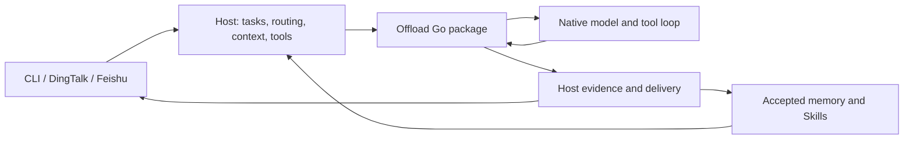

# Agent-Host architecture

Current source direction, updated 2026-11-02. Detailed component contracts and
historical implementation notes are in [architecture-detail.md](architecture-detail.md).
Historical acceptance reports apply to their recorded revisions.

## Goal and usage

Send a task through CLI, DingTalk or Feishu. Host selects the authorized Agent
and project, assembles context and tools, executes through Offload and retains
attributed evidence and reusable memory. Optional Web/Mac surfaces present the
same Host records and configured conversation entries.

`agent-host chat` follows the current configured Offload default when neither the
CLI nor the routed Agent selects a profile or model. Daily use should normally
inherit that default. Pin a selector only for an explicit user request or an
evidence-backed compatibility or troubleshooting need; selection never enables
silent backend fallback. ACP, direct Host-managed native execution and Offload
CLI compatibility are removed. Unbound routed Agents re-resolve the default for
each request and preserve runtime compatibility checks.
[Execution scope and migration](offload-execution-boundary.md) distinguish source
behavior from installed production adoption.

## Ownership

| Component | Responsibility |
| --- | --- |
| Channel | Identity, intake, queueing and result delivery |
| Host | Tasks, authorization, Agent/project routing, context, MCP/Skills, durable evidence, acceptance and memory |
| Offload package | Native execution, continuation, cancellation/cleanup, provider configuration and execution history |
| Native engine | Model/tool loop and native conversation state |

All execution requests identify `caller=agh`. Business attempts correlate with
`agh:<Host run ID>`; internal model operations have separate internal IDs.
Execution completion, business acceptance, delivery, Offload history persistence
and Host memory outcomes remain independent. Source content cannot grant access
or prove external success.

## Delivered scope

The [Codex owner path](codex-host-controls.md) opts into the native
app-server protocol through the pinned companion Offload implementation. It
supports explicit Host-managed Skill roots, MCP, observed-model evidence and
native thread continuation. Strict tool-free and restricted Codex requests fail
before dispatch. Deployment acceptance is separate from source validation.

Skills are explicit Agent capabilities: omitted, null or empty `native_skills`
selects none, including for the default owner Agent. Catalog profiles never
inherit global native Skills or settings. Each selected directory identifies
exactly its own `SKILL.md`; nested declarations require their own selection.
Codex configures native enablement before opening a thread and verifies that
the enabled paths equal the assembled manifest. Built-in, cloud, plugin and
unselected declarations are disabled; configuration failures stop execution.
Claude controlled plugins accept leaf Skills and reject a selected directory
containing nested Skill declarations until equivalent native enablement is
verified; they do not silently expand the selection.

Claude and Codex business execution use a private environment per stable Host
conversation. The native cwd is an empty Host-owned runtime workspace; the task
workspace and additional directories are explicit resource roots. Continuation
requires the original environment and compatible native identity. Native forks
are currently unsupported for both engines because the isolated child cannot
bind the parent's environment. See the [clean execution contract](clean-ops-agent-detail.md).

The full Host preserves supported Claude MCP, Skills, permissions, images,
structured extraction and streamed evidence through package native controls.
Tool-free memory extraction uses a separately selected compatible Claude profile,
not fallback after a failed business request. Unsupported combinations fail
explicitly; there is one native package execution boundary and no backend fallback.

Projects retain stable registered identities and attributed execution receipts.
Published memory and managed Skills use versioned files; SQLite retains runtime
records and caches remain rebuildable. Enabled plugins provide real tools and
matching usage guidance. Integration libraries have explicit configuration and
lifecycle; no generic loader or extra Host model/tool loop is introduced.

Historical native and ACP records stay intact, but sessions without a compatible
isolated environment are not silently adopted. Configuration or backend/model
changes start new compatible conversations rather than migrating native state.
Unsupported capabilities retain
their errors and evidence; they do not trigger provider fallback or automatic
replay of work with side effects. Production configuration, binaries and channel
identities remain separate from development tests. Existing channel authorization,
including `shared-execution-v2`, is unchanged by this execution path.

## Remaining work

Production rollout and broader live channel/model acceptance remain separate.
The [capability runtime direction](agent-capability-runtime.md) covers explicit
memory/knowledge mounting and AGH-root separation while retaining native login.
Richer channel controls, additional backend capabilities, durable engineering
missions and automatic conversation learning are not established by this change.
See [execution details](offload-execution-boundary-detail.md),
[file memory](file-memory-design.md), [managed Skills](managed-skills-design.md),
[plugin libraries](plugin-libraries.md) and [current priorities](release-follow-up.md).
