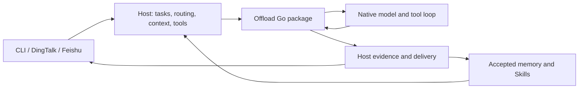

# Agent-Host architecture

Current source direction, updated 2026-11-02. Detailed component contracts and
historical implementation notes are in [architecture-detail.md](architecture-detail.md).
Historical acceptance reports apply to their recorded revisions.

## Goal and usage

Send a task through CLI, DingTalk or Feishu. Host selects the authorized Agent
and project, assembles context and tools, executes through Offload and retains
attributed evidence and reusable memory. Optional Web/Mac surfaces present the
same Host records and configured conversation entries.

`agent-host chat` uses the configured Offload default profile. An optional
`--offload-config` version 2 selector chooses another profile. ACP, direct
Host-managed native execution and Offload CLI compatibility are removed.
[Execution scope and migration](offload-execution-boundary.md) distinguish source
behavior from installed production adoption.

## Ownership

| Component | Responsibility |
| --- | --- |
| Channel | Identity, intake, queueing and result delivery |
| Host | Tasks, authorization, Agent/project routing, context, MCP/Skills, durable evidence, acceptance and memory |
| Offload package | Native execution, continuation, cancellation/cleanup, provider configuration and execution history |
| Native engine | Model/tool loop and native conversation state |

All execution requests identify `caller=agh`. Business attempts correlate with
`agh:<Host run ID>`; internal model operations have separate internal IDs.
Execution completion, business acceptance, delivery, Offload history persistence
and Host memory outcomes remain independent. Source content cannot grant access
or prove external success.

## Delivered scope

The full Host preserves Claude MCP, Skills, permissions, images, structured
extraction, native forks and streamed evidence through package native controls.
The lightweight text Host uses ordinary Claude/Codex package requests with
optional local memory. Full controls currently require Claude and unsupported
combinations fail explicitly. Consolidating the remaining Host orchestration is
pending; there is one native package execution boundary and no backend fallback.

Projects retain stable registered identities and attributed execution receipts.
Published memory and managed Skills use versioned files; SQLite retains runtime
records and caches remain rebuildable. Enabled plugins provide real tools and
matching usage guidance. Integration libraries have explicit configuration and
lifecycle; no generic loader or extra Host model/tool loop is introduced.

Existing native sessions and historical ACP records stay intact. Configuration
or backend changes start new compatible conversations rather than silently
adopting native state. Production configuration, binaries and channel identities
remain separate from development tests.

## Remaining work

Production rollout and broader live channel/model acceptance remain separate.
Richer channel controls, additional backend capabilities, durable engineering
missions and automatic conversation learning are not established by this change.
See [execution details](offload-execution-boundary-detail.md),
[file memory](file-memory-design.md), [managed Skills](managed-skills-design.md),
[plugin libraries](plugin-libraries.md) and [current priorities](release-follow-up.md).
