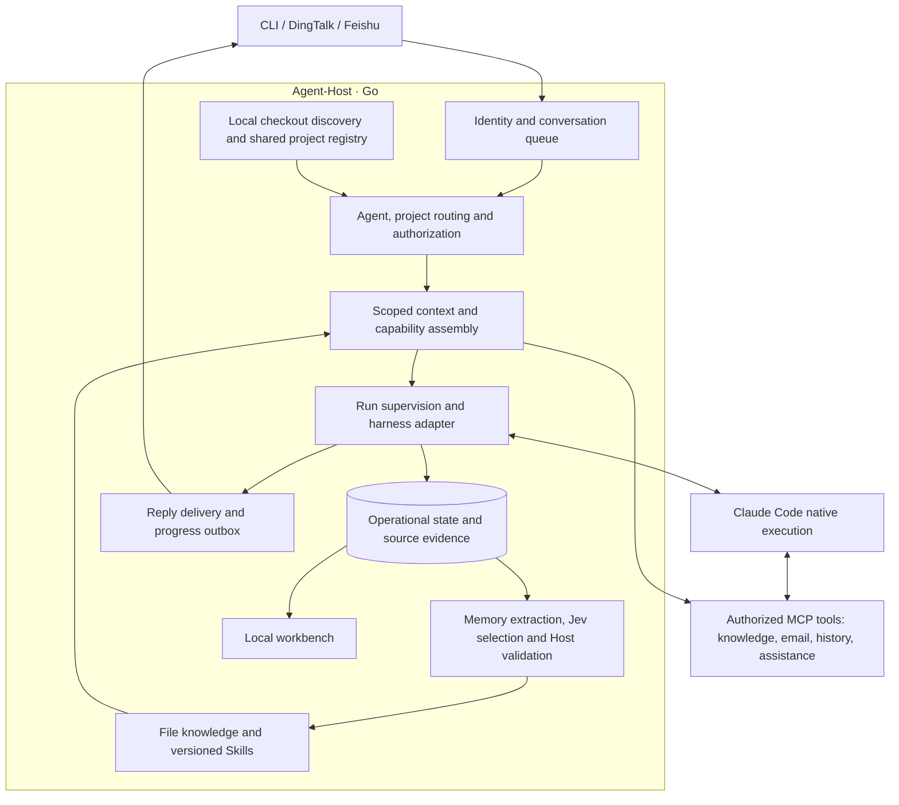

# Agent-Host architecture

Current technical direction and delivery status, reviewed against source on
2026-10-16. [Implementation notes](architecture-detail.md) map the components and
contracts; [progress and next steps](release-follow-up.md) own the remaining work.
Historical acceptance records describe their original revision, not every later change.

## Goal and usage

Give AI work continuity across conversations and projects. Send a request through
CLI, DingTalk or Feishu; Host selects the Agent and project, assembles authorized
context, runs Claude Code and retains evidence and reusable knowledge locally.

The technical route is **a Go host around native execution engines**. Host owns
business tasks, routing, context, delivery and durable memory. Claude Code owns
its model/tool loop and native conversations. Codex execution remains a scaffold;
installing the external memory skill into Codex does not implement that adapter.

## Core architecture

A native run, business acceptance, reply delivery and memory publication have
separate outcomes. Failure recovery preserves evidence and does not replay work.
Source documents, remembered text and model output cannot grant permissions.

## Delivered foundation

| Area | Current behavior | Boundary / next gap |
| --- | --- | --- |
| Execution and channels | Claude Code streaming/continuation; CLI, DingTalk and Feishu chat; Feishu meeting text; attachments, queues and failed-session handoff | Codex execution and meeting audio are planned; broader platform acceptance remains open |
| Project work | Bounded local Git discovery, selected-target enrollment, automatic routing and shared execution receipts | No durable feature/worktree ownership or PR/MR delivery lifecycle |
| Memory and Skills | Explicitly migrated file backend, source-grounded facts and procedures, automatic selected-experience publication, blacklist and scoped native Skills | Legacy SQLite experience requires review; general extraction quality and scale remain unmeasured |
| Knowledge and actions | Dokki/Confluence/local Markdown retrieval, authorized Confluence page/blog writes and managed Gmail/163 email tools | Source configuration and sender grants apply; Gmail onboarding and real mail send/reply acceptance remain separate |
| User context and permissions | Verified private-user identity/profile initialization, private profile selection and owner/member execution profiles; one-use owner approval runs | Group approval round trips and multi-person live acceptance remain pending; learned per-person preference controls remain proposed |
| Personal assistance | Selected DWS intake, cited current matters, private suggestions and user-selected preparation | Automatic conversation learning and proactive delivery remain planned |
| Operations | Shared workbench, automatic user-login services, independent production runtime and verified encrypted backups | Backup excludes external account sessions and complete external project directories |

The feature guides retain bounded native/platform evidence separately from
implementation. A passing automated check does not establish production quality.

## Recent architectural changes

- **Knowledge authority moved to files.** Published manifests select versioned
  documents and Skills in `memory/`. Runtime SQLite retains execution evidence;
  retrieval indexes and task context packages in `cache/` are rebuildable.
  Migration is explicit and reversible. See [file memory](file-memory-design.md).
- **Projects became a runtime capability.** Requests can discover local checkouts
  and enroll only the selected target into shared project records. Existing
  source stays in place. Receipts are per execution, rather than a completed
  feature-delivery system. See [project records](development-projects.md).
- **Identity now controls execution.** Verified owners retain configured native
  tools. Non-owners get restricted read tools and, where supported, an approval
  request tool. Approval creates a separate, one-use owner-authorized run;
  member sessions are never elevated. This is not OS filesystem isolation.
  See [permissions](dangerous-operations-design.md).
- **Profiles and source grants are explicit.** Optional `config/users.json`
  resolves private users and initializes runtime `users/<id>/USER.md`; configured
  private overrides take precedence. Private profiles do not enter shared tasks.
  Non-owner/shared source access needs explicit grants and is further constrained
  by the restricted execution profile. See [workspace details](workspace-layout-detail.md#multi-user-recording-and-retrieval).
- **Runtime and development are separated.** Editable config, channel state,
  datasource snapshots, memory and cache have distinct ownership. Production can
  run from an independent bundle; building the checkout does not deploy it.
  Encrypted backups retain recovery evidence. See [runtime setup](service-install.md),
  [layout](workspace-layout.md) and [backup](workspace-backup-design.md).
- **Answers use consistent guidance.** Each Claude turn receives concise reply
  and citation instructions. Relevant original article links belong in a final
  reference list; internal memory paths and note identifiers stay internal.
  This is model guidance, not a guarantee of answer correctness.

## Next direction

First close real member/owner approval and multi-user acceptance gaps, then
observe daily reliability and memory usefulness. The next proposed development
slice is a durable feature task with an owned worktree, validation/commit receipts
and authorized PR delivery. See the [current priorities](release-follow-up.md)
and [workflow proposal](development-workflow.md).

Keep concrete integrations behind private adapters. A public plugin SDK,
marketplace, custom Host model/tool loop and transparent migration of native
conversations between engines are outside the current implementation.
