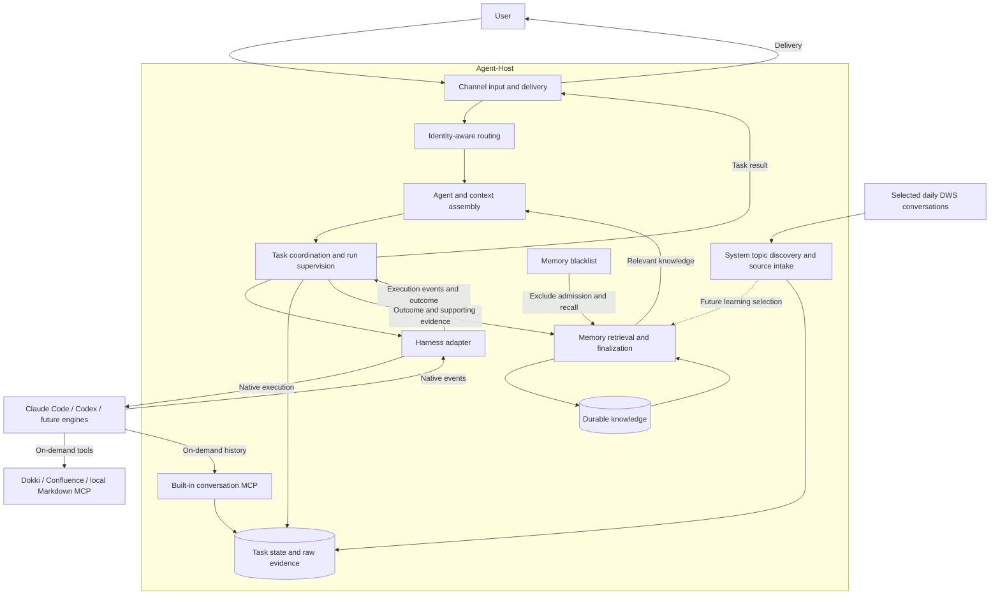

# Agent-Host architecture

The [file memory and experience Skill implementation](file-memory-design.md)
stores versioned knowledge in files, keeps operational evidence in state.db and
rebuildable retrieval indexes under cache, and supplies scoped Claude skills.
Explicit migration selects this backend; unmigrated SQLite behavior remains
available for compatibility. Source publication manifests own atomic visibility;
domain views and native packages are derived. Historical migration, cache rebuild,
rollback and one real native Skill invocation passed; local channels have been
migrated and restarted. General scale remains unmeasured.
The [workspace layout](workspace-layout.md) assigns user-maintained Agent
instructions and profiles to read-only runtime configuration, learned knowledge
and skills to memory, source snapshots to datasource plugin storage, and scoped
task context views to cache. It removes the separate top-level knowledge directory
in the target layout while preserving execution cwd and channel state.

The [datasource plugin configuration](datasource-plugins-design.md) loads local
Markdown, Dokki, Confluence and Email from separate `datasource.plugins.*.json`
files, with namespaced sources and preserved Host memory boundaries.

The next proposed priority is [project development through worktrees and pull
requests](development-workflow.md): recognize implementation intent, keep a
feature's work in one owned worktree, verify and commit it, then deliver an
authorized PR/merge. The Host owns this durable delivery lifecycle; native
harnesses retain their model/tool loops. This workflow is not implemented.
Its [engineering records and workspace layout](development-projects.md) now
implements bounded local Git discovery, automatic selected-target enrollment
across CLI/common channel routing and shared source-linked execution receipts
under `.agent-host/projects/`. Existing checkouts stay in place; no manual
enablement or registration is required. These receipts describe execution,
acceptance and memory separately, not a durable feature-task or PR lifecycle.
Managed clones/new projects, owned worktrees and PR/MR delivery remain proposed.
Shared records exclude original conversation text/context and do not combine
private conversations or memory.

The [configuration and plugin startup](configuration-layout.md) centralizes
editable configuration, separates channel/plugin runtime data and loads enabled
built-in capabilities at startup. DingTalk bot and DWS are independent channel
options. Migrated default memory scopes are retained; new channels use stable
default identities. Validation is recorded in the linked details.

Status: architecture and roadmap, with a local CLI MVP, manual-review experience
extension plus migrated file-memory publication/Skills, DingTalk private/group-mention channels with configurable Agent
instances, and a Feishu meeting text channel implemented. The
[Feishu IM increment](feishu-channel.md) adds owner private and group-mention
text; its assembled checks and one private greeting/reply passed. Group and
multi-turn IM acceptance remain pending. The
[DingTalk guide](dingtalk-channel.md) separates offline validation, the verified
first live owner turn and remaining platform checks. The [first MVP validation](mvp-validation.md) and
[experience design](experience-memory.md) separate implementation, test evidence,
and remaining work. The experience extension passed its bounded synthetic
live loop on 2026-10-10; general accuracy and scale remain unmeasured.
The revised [memory design](experience-memory.md) removes required human
acceptance: Jev-selected memory becomes effective automatically, with a blacklist
for later disabling. File-memory runtimes implement automatic experience
publication and bounded blacklist admission checks; legacy SQLite runtimes retain
human acceptance. Equivalence remains model-dependent for arbitrary rewrites.
The [evaluation guide](evaluation.md) introduces categorized cases and recurring
regression checks. The [object retrieval extension](object-retrieval.md) resolves
the two initial retrieval cases and passes the expanded 26-case recall set.
One historical live Jev admission mismatch remains unresolved; that decision
suite was not rerun for the retrieval change.

## Goal and usage

Give AI work continuity across tasks and execution engines. A user submits a
task through a channel; the host selects an agent configuration, supplies
relevant knowledge, supervises execution, and records the outcome for later use.

The product is Agent-Host. Go is its implementation language. A harness adapter
is one component inside the host, responsible for integration with an execution
engine.

## Core approach

The host owns business tasks, cross-session knowledge, routing, and delivery.
Each native harness owns its model/tool execution loop, native conversation
state, and native permission enforcement. Adapters expose the capabilities and
limitations of each harness explicitly.

The memory loop participates before and after execution: retrieve eligible
knowledge, then retain attributed user statements and experience from observed
tool results. The host keeps original evidence, processing proposals and durable
memory separately. A tool-free model extracts procedures; Jev selects useful,
supported proposals and compares existing memory. The target policy publishes
selected memory automatically after Host validation, with no required human
acceptance. Later disabling preserves history and blocks both recall and
equivalent re-admission within the same scope. The current code automatically
saves user statements. File-memory tasks also publish selected experience
automatically; legacy SQLite tasks retain `memory accept`.
Experience retains conditions and evidence strength; it is not independently
verified truth. Execution completion, task acceptance, selection and memory
persistence remain separate outcomes.
The current retrieval path links requests and saved memory through source-linked
service identities, explicit scoped aliases and bounded property/topic rules.
SQLite object/topic indexes, current alias associations and full-text candidates
feed applicability checks before context assembly. General entity/event
understanding remains planned. Similarity alone does not establish applicability.

Raw execution evidence and operational state are kept separate from reusable
knowledge. Routing chooses a configuration; assembly prepares its workspace,
instructions, knowledge, and available capabilities.

The [external knowledge and everyday experience extension](knowledge-sources.md)
defines two entry paths. Dokki and Confluence are implemented as runtime MCP tools;
the native agent searches and reads documents when needed, without preloading
their content. Knowledge lookups retain source receipts and are excluded from
execution-experience publication. Optional selected daily DWS conversations feed
an independent bounded system collector, immutable evidence and local topic
review. Explicit acceptance exports owner-private citations without creating a
run, sending a message or publishing memory. Conversation-derived learning is
planned. Real selected-DM discovery passed on 2026-10-11: four messages produced
one native topic with four original citations, reviewed and explicitly accepted
for owner-private use. Reopening the overlap added no duplicates; a three-message
partial window completed all four after its limits were raised. The
acceptance report (private validation evidence)
records no task execution, message sends or memory publication. Continuous
polling, group noise quality and account-wide coverage remain unverified.
The [conversation-history routes](conversation-history.md) also implement
on-demand read-only retrieval of saved messages addressed to the Agent and its
replies. They need no DWS identity. Each task receives only its current
conversation, Agent, audience and project grants. DWS is not mounted as a general
chat-reading task MCP. Topic discovery, task acceptance and memory publication
remain distinct.

The [personal-assistant proposal](personal-assistant.md) extends this foundation
with evolving current matters, cited private recommendations and an explicit
owner-private memory domain. It keeps temporary work state separate from reusable
memory and uses general types with people/project/topic associations. The
implemented [P0 release scope](release-follow-up.md#p0-contextual-assistance-and-accessible-memory)
adds matter tracking, scoped AI read access and a private
recommendation-to-preparation loop. Personal-domain expansion and conversation
learning follow later. The [validation notes](personal-assistant-detail.md#p0-validation)
separate bounded native and selected-source evidence from unmeasured general quality.

The [local knowledge increment](local-knowledge.md) adds explicitly selected
project Markdown and retained owner-private snapshots through the same on-demand
tools. Source selection intersects project grants, the Agent's configured subset
and optional audience grants. Default-workspace authorization lets an ordinary
question consult project material without a manual directory hint. Source roots
remain separate from execution cwd; retrieved notes keep provenance and do not
automatically become learned Host memory. Its validation is tracked separately.

The [CLI memory-loop proposal](cli-memory-design.md) narrows the first milestone
to terminal chat through the native Claude CLI. It uses one local owner and one
configured harness, without requiring external channel integration. SQLite remains the authority for operational evidence and processing candidates.
Migrated memory files own versioned knowledge, with rebuildable FTS5 and
object/topic indexes under cache; the historical SQLite backend remains compatible. Pending/rejected candidates, quarantined memories,
expired records and invalidated records are excluded from recall. Formal Markdown documents and Skills are implemented in the file backend;
direct document-edit import remains planned. A versioned
event journal drives terminal text and NDJSON output. The local
[execution and memory viewer](../tools/run-viewer/README.md) reads saved events,
database memory and archived reports. Owner-local controls publish or reject
existing experience drafts and disable memory through the running Host, which
keeps database ownership and validation. Web task submission remains planned.

The first external channel accepts the configured owner's DingTalk private
messages and same-enterprise group mentions using an application bot. The
[agent instance extension](agent-instances.md) selects a default or group-bound
role before project routing. Group members share one conversation while agent
and audience partition native sessions and learned memory. Business instances
use explicit native approval bypass. Owner private requests have no added Host
permission or disclosure restrictions; group prompts judge requests and replies
for the shared audience without adding member permission roles;
this is not an OS isolation boundary. Ordinary CLI policy remains unchanged.
The [conversation/input extension](channel-conversations.md) keeps each group
or DM and shared agent/audience partition ordered through memory and reply
completion, while different audiences use a bounded pool (default four).
Pictures, files and callback-provided quotes remain source-linked task material;
native Claude receives images directly and reads files with tools. No historical
conversation or quoted media is fetched automatically. On-demand Host history
tools query authorized saved receipts and replies across native resets. Shared
project files
remain shared and may conflict under concurrent execution. These additions have
separate validation from the earlier text-only platform records.
The [runtime assembly increment](runtime-assembly.md) adds locally registered
projects, local CLI selection and native sessions bound to project, directory
and shared configuration. The startup workspace remains the default. Durable message receipt,
source-linked runs, native session binding and final reply delivery remain
separate from task acceptance. A durable reaction outbox updates progress on
the original message independently of native execution and final answer delivery.
The [intelligent routing extension](smart-project-routing.md)
implements automatic selection over registered projects and project-set execution.
Request-time bounded local Git candidates now extend this catalog; only selected
targets enter the shared Runtime registry and entry-local compatibility mirror.
Reliable project associations select their registered environments; all other
valid requests run in the configured agent's default workspace. An empty eligible
catalog after local lookup skips the classifier and starts execution directly.
No new Host project question or waiting task is created. The native assistant
asks for business details when
needed. Default execution does not expand project or knowledge access; invalid
configuration, unavailable selected directories and provider errors still fail
explicitly. Default-workspace handoffs and empty-catalog execution keep normal
history, memory and experience processing. Historical unresolved runs retain
their original skipped learning records while remaining readable in their saved
default scope.
Every channel task routes automatically; historical manual project pins no
longer affect new tasks. Project registration and agent configuration stay local.
Chat exposes only `/new`, `/status` and
`/help` as Host controls: reset the current compatible conversation while keeping
memory, show a safe overview, and list supported controls. Only standalone
controls are handled; quoted and attached commands are task material. `/status`
waits in the conversation queue. These do not forward
native interactive commands. Earlier pending project requests remain recorded
without replay; only their original requester may explicitly confirm or cancel them.
Source-linked natural follow-ups can retain the latest task's project without
fixed continuation words when its scope is unchanged.
For a new channel message, a failed or interrupted native session is replaced
automatically with a brief notice. Saved project memory and old execution
evidence remain; recovery never replays the prior task.
The recovered turn receives bounded, source-linked context from the prior task;
short follow-ups review available conversation context before asking for a
restatement. This context does not enlarge project or history grants.
Other fresh native sessions receive a bounded handoff of same-scope recent user
questions, excluding prior replies and execution results.
Pending or failed memory finalization also remains inspectable without blocking
a new conversation.
Parallel project sets use a neutral cwd;
unassociated tasks retain the configured default workspace. Bounded local
checkout discovery and shared enrollment are implemented; remote discovery,
clone preparation and the managed worktree/PR workflow remain planned.
Earlier routing revisions passed separate automated, bounded native and
live-DingTalk acceptance recorded in the routing guide;
those records do not establish acceptance of the current default-execution policy.
Historical live owner messages using the former project-switch commands verify
project switching, native continuation, project-local reset and scoped memory
recall in an isolated runtime using the existing bot; the
[platform record](runtime-assembly-detail.md#live-dingtalk-acceptance-with-dws)
keeps this separate from production state and remaining live scenarios.
Production latency remains to be evaluated.
The [project-local runtime](service-install.md) starts through `make run` in
the foreground. The Go CLI scans private `.agent-host/config/channels.*.json` configurations and
supervises Feishu and DingTalk concurrently in separate worker processes.
Their credentials, state, logs, workspace and native profiles live
under `.agent-host/channels/<name>`, with editable configuration in
`.agent-host/config` and shared email operation state in `.agent-host/datasource/plugins/email`. The former system service was removed; historical data was
retained in the ignored project area. Ordinary CLI uses `.agent-host/cli-state`. Deployment evidence remains distinct from offline tests.

The [Feishu meeting text increment](feishu-meeting-channel.md) uses a local
`lark-cli` profile to connect authorized meetings to the same host execution path.
It supports fixed-meeting delivery and optional automatic entry from meeting
invitations or permitted private cards, links and numbers. Invitation/end events
use the CLI event connection; meeting questions remain on polling. Each meeting
has its own public audience and cancelable runtime, while DingTalk's webhook and
reaction behavior remain intact. Automated checks, the passing fixed-meeting
two-turn owner acceptance and a later private-entry rejoin/fresh reply are
tracked in that guide. Other lifecycle acceptance cases, pushed meeting text
and bidirectional audio remain separate work.
The [combined Feishu text channel](feishu-channel.md) shares one event connection
and one Host worker across owner private text, same-tenant group @mentions and
optional meetings. Owner DMs use owner context; each group and meeting keeps its
own public audience and authorized history. An IM-only configuration performs
no meeting reads. The new IM path's validation is recorded separately from the
meeting evidence.

The [issue #1 plan](release-follow-up.md#issue-1-delivery-plan) includes native
skills from eligible execution procedures and explicit per-person reply
preferences. File-memory Claude Skill mounting is implemented; broader per-person
profiles remain planned. Optional owner USER configuration is a narrower binding. They reuse scoped, source-linked memory and
depend on the publication/blacklist increment; native skill execution remains
inside the harness, and profile data cannot broaden identity or audience grants.

## Initial scope and order

1. Establish the Go CLI, component directories, and product boundary.
   **Delivered.**
2. Implement CLI chat and validate local Claude Code execution: input,
   observable completion, failure, cancellation, and retained evidence.
   **Implemented; test evidence is in the MVP document.**
3. Add durable memory finalization, independent recovery, and indexed context
   retrieval. Demonstrate source-linked reuse in a fresh conversation and
   validate multilingual retrieval as data grows. **User-statement loop and
   bounded, explicitly reviewed experience are implemented. The experience
   extension passed its bounded live loop. Automatic Jev-selected experience publication and bounded blacklist
   admission checks are implemented in the migrated file backend; general
   extraction, quality and scale work remain planned. Bounded service/alias/property retrieval and categorized
   regression are implemented. The original retrieval failures remain preserved
   as historical baselines; a live Jev admission gap remains unresolved.**
4. Prioritize the first everyday channel: DingTalk owner private messages through
   an application bot. **Implemented and tested offline; the owner has authorized
   the existing-bot cutover. Current startup uses
   project-local `make run`; the runtime guide retains historical deployment evidence.**
5. Add explicit project routing and runtime assembly. **Implemented: stable
   project identity, real cwd, shared native configuration, scoped memory and
   per-project compatible sessions. Validation is in the runtime assembly guide.**
6. Add intelligent project routing. **Automatic registered-project inference,
   project-set execution and default execution without a Host project question.
   Earlier automated, native and live private-chat validation is preserved in the
   [routing guide](smart-project-routing.md).
   Bounded local Git checkout discovery and shared selected-target enrollment
   are implemented; remote GitHub/GitLab discovery remains planned.** Joint tasks
   retain scoped existing knowledge; automatic new memory attribution is deferred.
7. Add external knowledge and everyday experience: first Dokki/Confluence
   runtime search/read tools, then bounded DWS conversation intake and reviewed
   lessons. **Dokki/Confluence tools and optional bounded DWS collection/topic
   review implemented; conversation learning remains planned. See the
   [source guide](knowledge-sources.md). Knowledge tools do not eagerly populate
   task context. Local Markdown and owner-only retained snapshots use the same
   boundary, with acceptance tracked in the [local knowledge guide](local-knowledge.md).
   Independent [Host history tools](conversation-history.md) supply conversation
   recall without daily-chat collection.**
8. Add a Codex adapter and verify cross-engine knowledge reuse. Keep native
   histories separate. **Planned.**
9. Expand channels and execution profiles. **Enterprise group mentions,
   configurable default/group-bound instances, concise public replies and
   partitioned conversation/memory are implemented. Validation is tracked in
   the [instance guide](agent-instances-detail.md); bounded single-group round
   trips passed separately from offline tests and installation. Cross-group,
   alternate-instance and multiple-sender platform checks remain. Concurrent
   conversations, input attachments and callback quotes are implemented in the
   [conversation increment](channel-conversations.md), with their validation
   tracked separately.**

Build adapters around demonstrated engine capabilities. A general-purpose
plugin platform, a custom model/tool loop, and transparent session migration
between engines are outside the initial scope.

The [email capability](email-plugin.md) adds Gmail and 163 accounts
through one registered email MCP server. AI discovers managed accounts and
selects an account ID for read/send tools, with provider behavior behind email
adapters. The unified tools and provider adapters are implemented; one 163
account passed bounded live reads. Gmail onboarding and real send/reply acceptance
remain separate from the offline checks.

The [built-in DingTalk workspace](dingtalk-workspace.md) embeds the official Go
CLI package in isolated workers behind one owner-private MCP. It provides
on-demand business command discovery and execution without a separate DWS
installation. Selected-source collection can use the same embedded worker;
owner-authorized message tools require the separately enabled `chat` service.
Task reads are bounded and do not enable general IM administration or events.
Automated checks and real
owner login/business acceptance are tracked separately in that guide.

See [implementation notes](architecture-detail.md) for proposed code boundaries
and the first validation target, and [research conclusions](research.md) for the
reasoning behind the host boundary.
