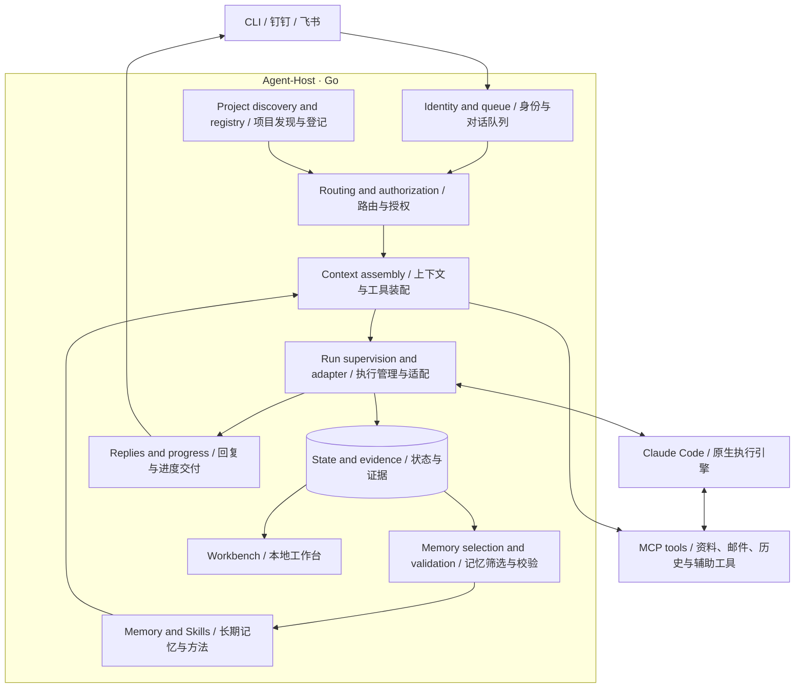

# Agent-Host architecture

Current technical direction and delivery status, reviewed against source on
2026-10-16. [Implementation notes](architecture-detail.md) map the components and
contracts; [progress and next steps](release-follow-up.md) own the remaining work.
Historical acceptance records describe their original revision, not every later change.

## Goal and usage

Give AI work continuity across conversations and projects. Send a request through
CLI, DingTalk or Feishu; Host selects the Agent and project, assembles authorized
context, runs Claude Code and retains evidence and reusable knowledge locally.

The technical route is **a Go host around native execution engines**. Host owns
business tasks, routing, context, delivery and durable memory. Claude Code owns
its model/tool loop and native conversations. Codex execution remains a scaffold;
installing the external memory skill into Codex does not implement that adapter.

## Key objects / 关键对象

Read these as separate responsibilities, even when they work on the same request.
这些对象可能参与同一次请求，但各自管理不同的内容。

| Object / 对象 | Meaning / 含义 |
| --- | --- |
| Host / 宿主 | Coordinates tasks, access, context and durable records. 负责组织任务、权限、上下文与长期记录，产品名是 Agent-Host。 |
| Agent / 智能体配置 | A configured role, model and project policy used for requests. 一套角色、模型和项目配置，例如“运维助手”；不是一个独立模型或进程。 |
| Channel / 渠道 | An entry and reply path, such as DingTalk, Feishu or CLI. 接收请求并交付回复的入口，例如钉钉、飞书或终端。 |
| Task / 任务 | The business work requested by the user. 用户希望完成的工作，例如“修复登录测试”；跨多轮的持久功能任务仍待实现。 |
| Run / 执行记录 | One execution attempt with its own events and outcome. 一次执行尝试及其过程、结果；执行结束不等于业务验收通过。 |
| Conversation / 对话 | Related channel messages and replies within an authorized binding. 授权范围内关联的渠道消息与回复；群成员可以共享同一对话。 |
| Native session / 原生会话 | Conversation state maintained by Claude Code across compatible turns. Claude Code 自己保存的连续执行上下文；可重置或替换，Host 的长期记忆另行保留。 |
| Project / 项目 | A stable registered identity for a repository and its execution environment. 仓库及执行环境的稳定登记身份，用于路由和关联记录。 |
| Workspace / 工作目录 | The filesystem location where execution works on files. 执行时实际操作文件的目录；项目身份与目录路径分别记录。 |
| Context / 上下文 | The instructions and information available to the engine for the current work. 引擎处理当前工作时可用的指令与信息；长期记忆只是其中一种来源。 |
| Evidence / 证据 | Attributed source material and observed execution results. 带来源的原始材料与执行观测，例如消息、工具输出；保留它不代表内容已被证实。 |
| Memory / 长期记忆 | Eligible facts, preferences, decisions or procedures retained for later tasks. 可供后续任务使用的事实、偏好、决策或方法；与聊天原文、执行日志分别保存。 |
| Skill / 方法技能 | A reusable procedure delivered as `SKILL.md` with conditions and evidence. 保存适用条件、步骤与证据的可复用方法；记住方法不代表已经执行成功。 |
| Datasource / 数据源 | A configured source the assistant can consult, such as Confluence or local Markdown. 可按需查询的资料来源；读取资料不会自动把它变成长期记忆。 |

For example, “fix the login test” arrives through a **Channel**, selects an
**Agent** and **Project**, then creates a **Run** in the project's **Workspace**.
Claude Code may continue a compatible **Native session**. Host records **Evidence**
and separately decides whether a useful correction becomes **Memory / a Skill**.

例如：“修复登录测试”从钉钉进入，Host 选择运维助手和目标项目，在项目目录执行。
执行记录回答“做了什么、结果如何”，长期记忆回答“以后可以复用什么”。
任务完成、用户验收通过和经验保存成功分别记录。

Execution-engine, authorization and storage terms are explained in the
[bilingual technical glossary](architecture-detail.md#technical-glossary--技术名词).
执行引擎、权限和存储相关术语见同一份详细稿中的双语解释。

## Core architecture

A native run, business acceptance, reply delivery and memory publication have
separate outcomes. Failure recovery preserves evidence and does not replay work.
Source documents, remembered text and model output cannot grant permissions.

[Task ownership and completion feedback](task-feedback.md) binds a demand owner
and result destination at intake. Configured CLI/channel executions persist this
plan before native work; channel workers deliver queued results using verified
bot accounts and retain delivery evidence independently from execution.

## Delivered foundation

| Area | Current behavior | Boundary / next gap |
| --- | --- | --- |
| Execution and channels | Claude Code streaming/continuation; CLI, DingTalk and Feishu chat; Feishu meeting text; attachments, queues and failed-session handoff | Codex execution and meeting audio are planned; broader platform acceptance remains open |
| Project work | Bounded local Git discovery, selected-target enrollment, automatic routing and shared execution receipts | No durable feature/worktree ownership or PR/MR delivery lifecycle |
| Memory and Skills | Explicitly migrated file backend, source-grounded facts and procedures, automatic selected-experience publication, blacklist and scoped native Skills | Legacy SQLite experience requires review; general extraction quality and scale remain unmeasured |
| Knowledge and actions | Dokki/Confluence/local Markdown retrieval, authorized Confluence page/blog writes and managed Gmail/163 email tools | Source enablement and upstream account permissions apply; Gmail onboarding and real mail send/reply acceptance remain separate |
| User context and permissions | Verified private-user profiles; shared enabled datasources during Beta; all channel senders currently share Owner-equivalent execution with bypassPermissions | Owner-only execution and approval requests are temporarily suspended; learned per-person preference controls remain proposed |
| Personal assistance | Selected DWS intake, cited current matters, private suggestions and user-selected preparation | Automatic conversation learning and proactive delivery remain planned |
| Operations | Shared workbench, automatic user-login services, independent production runtime and verified encrypted backups | Backup excludes external account sessions and complete external project directories |

The local workbench also provides a [settings console](settings-console.md) for
saved Agent, execution, provider, channel and datasource configuration. Checked
saves retain private previous versions; applying service changes still requires
a restart. The console does not turn CLI chat into a client of a running channel
Host.

The feature guides retain bounded native/platform evidence separately from
implementation. A passing automated check does not establish production quality.

## Recent architectural changes

- **Knowledge authority moved to files.** Published manifests select versioned
  documents and Skills in `memory/`. Runtime SQLite retains execution evidence;
  retrieval indexes and task context packages in `cache/` are rebuildable.
  Migration is explicit and reversible. See [file memory](file-memory-design.md).
- **Projects became a runtime capability.** Requests can discover local checkouts
  and enroll only the selected target into shared project records. Existing
  source stays in place. Receipts are per execution, rather than a completed
  feature-delivery system. See [project records](development-projects.md).
- **Execution is temporarily shared.** All channel senders use the Owner-equivalent
  native execution profile. Verified owner identity and private audience boundaries
  remain recorded; owner-only execution and approval requests are paused.
  See [permissions](dangerous-operations-design.md).
- **Profiles remain private; Beta tools are shared.** Optional `config/users.json`
  resolves private users and initializes runtime `users/<id>/USER.md`; configured
  private overrides take precedence. Private profiles do not enter shared tasks.
  All enabled sources are shared across users and Agents during Beta. See
  [workspace details](workspace-layout-detail.md#multi-user-recording-and-retrieval).
- **Runtime and development are separated.** Editable config, channel state,
  datasource snapshots, memory and cache have distinct ownership. Production can
  run from an independent bundle; building the checkout does not deploy it.
  Encrypted backups retain recovery evidence. See [runtime setup](service-install.md),
  [layout](workspace-layout.md) and [backup](workspace-backup-design.md).
- **Answers use consistent guidance.** Each Claude turn receives concise reply
  and citation instructions. Relevant original article links belong in a final
  reference list; internal memory paths and note identifiers stay internal.
  This is model guidance, not a guarantee of answer correctness.

## Next direction

The next proposed product increment is [Owner Answering Beta / Owner 代答 BETA](owner-answering-beta.md):
answer supported routine questions addressed to the owner, wait silently on
incomplete or complex requests, and learn from owner conversations. Start with
selected private chats and visibly marked AI replies. It is not implemented.

Owner-only execution and approval remain suspended; multi-user acceptance gaps remain open.
Durable feature tasks, owned worktrees and authorized PR delivery remain a
separate [engineering proposal](development-workflow.md). See
[current priorities](release-follow-up.md) for delivery order.

Keep concrete integrations behind private adapters. A public plugin SDK,
marketplace, custom Host model/tool loop and transparent migration of native
conversations between engines are outside the current implementation.
