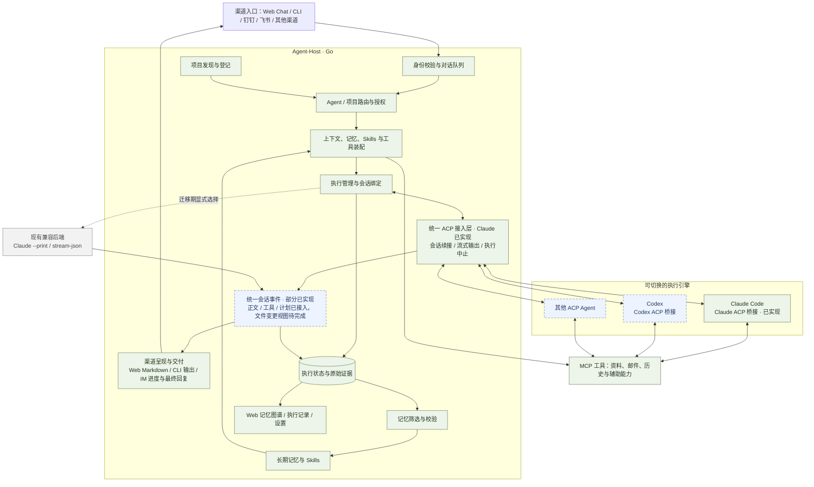

# Agent-Host architecture

Current technical direction and delivery status, reviewed against source on
2026-10-16, with the first shared Claude ACP backend implemented on 2026-10-20.
[Implementation notes](architecture-detail.md) map the components and
contracts; [progress and next steps](release-follow-up.md) own the remaining work.
Historical acceptance records describe their original revision, not every later change.
The [2026-10-20 acceptance review](architecture-review-2026-10-20.md) records
current cross-entry, tool/Skill and automatic-memory checks and remaining limits.
The [2026-10-21 channel rollout](acp-channel-rollout.md) adds real owner-private
DingTalk/Feishu ACP intake, replies, tools, memory and continuation acceptance.
The [2026-10-22 managed Skills implementation](managed-skills-design.md) adds
authored publication, all-entry default-Agent discovery and enabled-plugin usage
guidance. Local native acceptance uses isolated read-only fixtures; production
adoption and platform rollout are separate.

## Goal and usage

Give AI work continuity across conversations and projects. Send a request through
CLI, Web, DingTalk or Feishu; Host selects the Agent and project, assembles authorized
context, runs the selected execution engine and retains evidence and reusable knowledge locally.

**Humans only hand over tasks.** AI classifies, judges and closes out work end to
end; people are not required to label tasks or confirm acceptance. Judgments must
cite concrete evidence, and insufficient evidence means unresolved. Execution,
business acceptance, delivery and memory persistence remain independent.
[AI closeout details](reply-closeout-detail.md#ai-task-classification-and-acceptance)
describe the delivered run metadata and aggregate success-rate contract.

The delivered route is **a Go host around native execution engines**. Host owns
business tasks, routing, context, delivery and durable memory. Native engines own
their model/tool loops and conversations. Claude Code can use the shared
ACP backend or the existing print/stream-JSON backend through explicit configuration.
The direct Codex Host adapter remains a scaffold; installing the external memory
skill into Codex does not implement that adapter. Offload independently owns the
backend selected by an Offload profile.

An opt-in lightweight path delegates execution to **Offload**, with optional
channel and memory components. It supports DingTalk and Feishu text
conversations, using Offload profiles and native sessions. Memory is disabled
by default; the [optional memory plugin](offload-memory-plugin.md) adds local
retrieval and explicit Jev-based user-statement processing without a legacy
Claude extractor or another native agent loop.
Existing execution remains the default until the opt-in prototype is accepted;
no installed service or conversation is migrated automatically. See
[Offload channel plugins](offload-channel-plugins.md) for scope and limitations.

## Core architecture

**Current delivered path: channels → Host → shared ACP adapter → native engine.**
The opt-in Offload prototype above evaluates a lighter execution boundary;
this diagram describes the existing ACP implementation.
绿色为现有 Host 职责，蓝色虚线框为待实现或待扩展部分，灰色为迁移期兼容后端。
Claude ACP 已实现，可按配置启用；Codex、完整交互控件与文件变更视图仍待完成，生产实例未自动切换。

ACP 会话事件驱动各渠道呈现；Host 的路由、记忆处理与引擎活动分别记录。
执行完成、业务验收、回复交付和记忆发布保留独立结果。引擎切换使用新原生会话，
延续所需信息由 Host 按授权范围装配；兼容后端只按配置选择，不因 ACP 失败自动回退。
当前运行路径见[实现说明](architecture-detail.md#current-execution-path-before-acp)。

## Key objects / 关键对象

Read these as separate responsibilities, even when they work on the same request.
这些对象可能参与同一次请求，但各自管理不同的内容。

| Object / 对象 | Meaning / 含义 |
| --- | --- |
| Host / 宿主 | Coordinates tasks, access, context and durable records. 负责组织任务、权限、上下文与长期记录，产品名是 Agent-Host。 |
| Agent / 智能体配置 | A configured role, model and project policy used for requests. 一套角色、模型和项目配置，例如“运维助手”；不是一个独立模型或进程。 |
| Channel / 渠道 | An entry and reply path, such as DingTalk, Feishu or CLI. 接收请求并交付回复的入口，例如钉钉、飞书或终端。 |
| Task / 任务 | The business work requested by the user. 用户希望完成的工作，例如“修复登录测试”；跨多轮的持久功能任务仍待实现。 |
| Run / 执行记录 | One execution attempt with its own events and outcome. 一次执行尝试及其过程、结果；执行结束不等于业务验收通过。 |
| Conversation / 对话 | Related channel messages and replies within an authorized binding. 授权范围内关联的渠道消息与回复；群成员可以共享同一对话。 |
| Native session / 原生会话 | Conversation state maintained by the selected execution engine across compatible turns. 所选执行引擎自己保存的连续上下文；切换引擎不自动迁移，Host 的长期记忆另行保留。 |
| Project / 项目 | A stable registered identity for a repository and its execution environment. 仓库及执行环境的稳定登记身份，用于路由和关联记录。 |
| Workspace / 工作目录 | The filesystem location where execution works on files. 执行时实际操作文件的目录；项目身份与目录路径分别记录。 |
| Context / 上下文 | The instructions and information available to the engine for the current work. 引擎处理当前工作时可用的指令与信息；长期记忆只是其中一种来源。 |
| Evidence / 证据 | Attributed source material and observed execution results. 带来源的原始材料与执行观测，例如消息、工具输出；保留它不代表内容已被证实。 |
| Memory / 长期记忆 | Eligible facts, preferences, decisions or procedures retained for later tasks. 可供后续任务使用的事实、偏好、决策或方法；与聊天原文、执行日志分别保存。 |
| Skill / 方法技能 | A reusable procedure delivered as `SKILL.md` with conditions and evidence. 保存适用条件、步骤与证据的可复用方法；记住方法不代表已经执行成功。 |
| Managed Skill / 纳管技能 | A versioned, reviewed and enabled catalog entry governed by agh, covering authored methods, eligible experience and plugin usage. 可复用处理方法统一以技能交付；安装、发布、装载和执行结果分别记录。 |
| Plugin / 插件 | A configured capability whose adapter supplies tools and whose adapter also supplies matching usage guidance. 插件启用后应同时让 Agent 知道可用能力及使用方法，不因此获得业务操作授权。 |
| Datasource / 数据源 | A configured source the assistant can consult, such as Confluence or local Markdown. 可按需查询的资料来源；读取资料不会自动把它变成长期记忆。 |

For example, “fix the login test” arrives through a **Channel**, selects an
**Agent** and **Project**, then creates a **Run** in the project's **Workspace**.
Claude Code may continue a compatible **Native session**. Host records **Evidence**
and separately decides whether a useful correction becomes **Memory / a Skill**.

例如：“修复登录测试”从钉钉进入，Host 选择运维助手和目标项目，在项目目录执行。
执行记录回答“做了什么、结果如何”，长期记忆回答“以后可以复用什么”。
任务完成、AI 业务验收和经验保存成功分别记录。

Execution-engine, authorization and storage terms are explained in the
[bilingual technical glossary](architecture-detail.md#technical-glossary--技术名词).
执行引擎、权限和存储相关术语见同一份详细稿中的双语解释。

## Shared ACP execution

The [first Claude ACP backend](acp-execution.md) is implemented behind Host's
shared harness boundary. Agent, CLI and managed service configuration can select
it for all current conversation entries. Real Claude streaming, tool execution,
session continuation and cancellation have bounded local evidence. Owner-private
DingTalk/Feishu intake, replies, tools, memory and native continuation now have
live acceptance. Broader group/meeting checks and a second engine remain open.

Every conversation entry uses the same Host execution boundary. DingTalk and
Feishu receive the same engine events as Web; each channel presents them using
its supported reply format. ACP is a Host-to-engine protocol, and channel APIs
continue to handle user identity, messages and delivery.

- **One execution path for all channels.** Start with Claude through ACP, then
  connect a second engine to prove switching. Keep direct Claude print execution
  as an explicitly selected compatibility backend during migration.
- **One conversation timeline.** Preserve streamed replies, real tool activity,
  plans and file-change evidence when available. Web can expand details; chat
  channels use supported progress updates and a final answer. Host routing and
  memory phases remain separate from the engine's activity.
- **Safe continuity and switching.** Preserve channel/audience isolation. Reuse
  only compatible sessions; changing engines starts a new native session with
  authorized Host context and memory. Switching never silently retries work.
- **Simple configuration.** Agent configuration selects an execution engine and
  connection. Channel bindings select the Agent. Users do not configure separate
  ACP implementations for each channel. Advanced launch options stay in config.
- **Shared controls.** Host coordinates cancellation and permission requests under
  Host/native policy, with each entry supplying its supported controls. Channels
  without interactive approval support cannot silently approve a native request.

Claude ACP now executes through the common boundary. Richer channel controls,
other engines remain to be implemented. The Web Session picker now attaches
CLI, DingTalk and Feishu conversation history and continues compatible native
contexts through their owning execution paths.
Existing channel services and the standalone Web CLI
destination remain separate today. The [ACP implementation notes](architecture-detail.md#shared-acp-execution--planned)
define the boundary and acceptance checks.

[Task ownership and completion feedback](task-feedback.md) binds a demand owner
and result destination at intake. Configured CLI/channel executions persist this
plan before native work; channel workers deliver queued results using verified
bot accounts and retain delivery evidence independently from execution.

[Answer delivery and closeout](reply-closeout.md) makes a durably completed
Agent answer available before built-in memory and experience processing.
Closeout stays owned by the same Host invocation; its failures remain separate
from execution and delivery, and do not trigger task replay or a second answer.

## Delivered foundation

| Area | Current behavior | Boundary / next gap |
| --- | --- | --- |
| Execution and channels | Claude Code streaming/continuation; CLI, DingTalk and Feishu chat; Feishu meeting text; attachments, queues and failed-session handoff | Codex execution and meeting audio are planned; broader platform acceptance remains open |
| Shared engine interface | Configurable Claude ACP runner shared by CLI/channel workers and the Web Host CLI destination; streamed events, native continuation and cancellation implemented | Codex, interactive approval UI, channel Stop controls, warm bridge reuse and broader group/meeting acceptance remain open; native sessions do not migrate across engines |
| Project work | Bounded local Git discovery, selected-target enrollment, automatic routing and shared execution receipts | No durable feature/worktree ownership or PR/MR delivery lifecycle |
| Memory and Skills | Explicitly migrated file backend, source-grounded facts and procedures, automatic selected-experience publication, blacklist and scoped native Skills | Legacy SQLite experience requires review; general extraction quality and scale remain unmeasured |
| Knowledge and actions | Dokki/Confluence/local Markdown retrieval, authorized Confluence page/blog writes and managed Gmail/163 email tools | Source enablement and upstream account permissions apply; Gmail onboarding and real mail send/reply acceptance remain separate |
| User context and permissions | Verified private-user profiles; shared enabled datasources during Beta; all channel senders currently share Owner-equivalent execution with bypassPermissions | Owner-only execution and approval requests are temporarily suspended; learned per-person preference controls remain proposed |
| Personal assistance | Selected DWS intake, cited current matters, private suggestions and user-selected preparation | Automatic conversation learning and proactive delivery remain planned |
| Operations | Shared workbench, automatic user-login services, independent production runtime and verified encrypted backups | Backup excludes external account sessions and complete external project directories |

The local workbench opens a [Web interface](web-workspace.md) on the memory graph,
with execution records, settings and right-side Chat execution through the configured
CLI destination. Chat renders streamed Markdown and expandable native Claude activity,
and can cancel the owned Host process. Attached active CLI/channel runs also
refresh output automatically and support per-run cancellation through an
owner-private Host control capability; older running binaries remain observation-only.
[Independent CLI/Web conversations](cli-concurrency.md)
execute concurrently in the configured CLI state home, with one owner per native
conversation. The conversation canvas is temporarily
disabled. It also provides a [settings console](settings-console.md) for
essential Agent, native model, provider and existing channel choices. Other
options retain their configuration-file defaults. Checked
saves retain private previous versions; applying service changes still requires
a restart. New Chat conversations use the configured CLI destination; selecting
a channel Session continues through that channel Host's private control socket.

The feature guides retain bounded native/platform evidence separately from
implementation. A passing automated check does not establish production quality.

## Reusable methods and enabled-plugin guidance

**Every reusable handling procedure should ultimately be delivered as a Skill,
registered and governed by agh.** The default Agent automatically receives the
effective Skill catalog and proactively loads the applicable instructions before
related work; users should not need to name or manually mount each Skill.
Full bodies and environment-specific references load as needed, without dumping
the entire catalog's procedures into every prompt.

An enabled plugin must expose both its real tools and instructions explaining
their supported use. Its usage Skill participates in the same catalog and
configuration snapshot. Disabled plugins supply neither active guidance nor
tools; unavailable dependencies produce explicit readiness failures. Native
harnesses retain their own loading and tool execution loops.

Facts, preferences, decisions and evidence retain their separate roles. Existing
experience review is not bypassed, and plugin enablement grants no permission
for a particular approval, message or mutation. See the
[main design](managed-skills-design.md) for scope and rollout, and its
[technical contract](managed-skills-design-detail.md) for lifecycle and acceptance.

## Recent architectural changes

- **Knowledge authority moved to files.** Published manifests select versioned
  documents and Skills in `memory/`. Runtime SQLite retains execution evidence;
  retrieval indexes and task context packages in `cache/` are rebuildable.
  Migration is explicit and reversible. See [file memory](file-memory-design.md).
- **Projects became a runtime capability.** Requests can discover local checkouts
  and enroll only the selected target into shared project records. Existing
  source stays in place. Receipts are per execution, rather than a completed
  feature-delivery system. See [project records](development-projects.md).
- **Execution is temporarily shared.** All channel senders use the Owner-equivalent
  native execution profile. Verified owner identity and private audience boundaries
  remain recorded; owner-only execution and approval requests are paused.
  See [permissions](dangerous-operations-design.md).
- **Profiles remain private; Beta tools are shared.** Optional `config/users.json`
  resolves private users and initializes runtime `users/<id>/USER.md`; configured
  private overrides take precedence. Private profiles do not enter shared tasks.
  Enabled sources are shared by default during Beta; explicit Agent knowledge selections narrow the mounted sources. See
  [workspace details](workspace-layout-detail.md#multi-user-recording-and-retrieval).
- **Runtime and development are separated.** Editable config, channel state,
  datasource snapshots, memory and cache have distinct ownership. Production can
  run from an independent bundle; building the checkout does not deploy it.
  Encrypted backups retain recovery evidence. See [runtime setup](service-install.md),
  [layout](workspace-layout.md) and [backup](workspace-backup-design.md).
- **Answers use consistent guidance.** Each Claude turn receives concise reply
  and citation instructions. Relevant original article links belong in a final
  reference list; internal memory paths and note identifiers stay internal.
  This is model guidance, not a guarantee of answer correctness.

## Next direction

The [managed Skills increment](managed-skills-design.md) is implemented and locally
validated. Explicit operator adoption and production/platform rollout remain
separate from the source implementation and isolated native acceptance.

The next execution increment evaluates the [Offload channel plugin
prototype](offload-channel-plugins.md). Both existing channels share one slim
execution adapter, while their current authentication and delivery remain outside
the model loop. Optional memory processing now runs after answer delivery;
richer tool injection still requires an explicitly supported contract.
Existing ACP and print paths remain available during this opt-in evaluation.

[Owner Answering Beta / Owner 代答 BETA](owner-answering-beta.md) has a disabled-by-default
source implementation for selected personal DingTalk chats. It handles supported
requests with the configured Agent's capabilities, marks AI replies, and privately
asks the owner about blocked requests while remaining silent to the peer.
Production activation and live acceptance are pending. Account-wide new-contact
discovery and learning from owner conversations remain proposed.

Owner-only execution and approval remain suspended; multi-user acceptance gaps remain open.
Durable feature tasks, owned worktrees and authorized PR delivery remain a
separate [engineering proposal](development-workflow.md). See
[current priorities](release-follow-up.md) for delivery order.

[Persistent engineering missions](engineering-missions.md) are proposed in
ClawFlow, which owns README-driven objectives, scheduling, workspaces and
engineering acceptance. Host supplies unified user intake, scoped context,
native execution and result delivery. A private ClawFlow-to-Host execution
contract remains to be implemented; Host does not add a competing engineering
mission or PR controller. This revises the earlier Host-owned mission proposal.

Reusable provider integrations follow the [plugin library boundary](plugin-libraries.md).
The Feishu meeting control/text library is an independent Go module used by Host
and intended for GTMGoPlay; application policy and persistence stay in their
own adapters. A separate speech library provides streaming ASR/TTS adapters;
callers retain Agent execution and turn policy. Live meeting audio still needs
the verified Feishu audio protocol and integration acceptance. A generic plugin
loader/marketplace, custom Host model/tool loop and
transparent migration of native conversations remain outside this increment.
