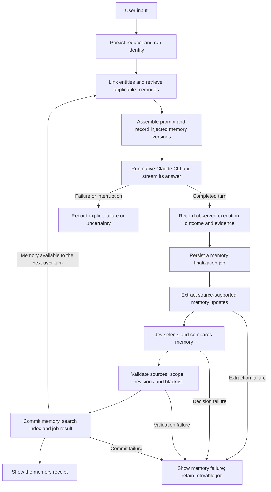

# CLI chat and the memory loop

The [file memory and Skill implementation](file-memory-design.md) supersedes the
storage choice below for migrated runtimes. Versioned files own knowledge and
cache SQLite indexes are rebuildable. The SQLite-authoritative sections below
remain the historical, unmigrated compatibility baseline.

Status: broader CLI memory roadmap. The [MVP 1 baseline](mvp-validation.md)
and [experience design](experience-memory.md) describe the implemented
subset: native chat, structured events, attributed statements, reviewed tool-based
procedures, SQLite recall and independent memory retry. The
[revised memory policy](experience-memory.md) makes Jev-selected memory effective
automatically and uses a blacklist for later disabling. User statements already
save automatically; migrated file-memory tasks also publish selected experience
automatically and apply bounded blacklist admission checks. The
[object retrieval extension](object-retrieval.md) implements bounded service names,
scoped aliases and property/topic matching. General entity/event extraction,
pronoun resolution and verified outcome promotion below remain planned.
The [DingTalk owner DM extension](dingtalk-channel.md), implemented on 2026-10-10,
now connects the existing loop to the first external channel. It is tested
offline; live platform acceptance remains open.
The [architecture](architecture.md) sets the host boundary. See the
[implementation details](cli-memory-design-detail.md) for execution, storage,
recovery, and validation decisions.

## Goal and usage

Validate one complete local loop: ask a question, use relevant past knowledge,
run Claude Code, preserve evidence, save useful memory, and reuse it in a fresh
conversation. The initial milestone preceded external channels; the later
DingTalk extension uses this same loop. Configurable routing remains planned.

Agent-Host provides a small terminal chat interface. It calls the native Claude
CLI in programmatic mode; it does not embed or scrape Claude's interactive UI.
The first version uses one configured Claude adapter and one local owner, with
the current project directory defining the default memory scope.

```sh
agent-host chat
agent-host chat --resume <session-id>
agent-host chat -m "What did we decide about this project?"
agent-host memory search "deployment"
agent-host memory show <memory-id>
agent-host run show <run-id>
agent-host run retry-memory <run-id>
```

Each submitted message creates a run within a host conversation. The answer
streams to the terminal, followed by a short memory receipt: saved, unchanged,
or failed. The receipt links to the supporting run and affected memories.
For the first version, memory processing finishes before the next input prompt.
A separate, tool-free model call proposes memory updates; the host validates
and commits them. This adds model cost and a visible wait after the answer but
keeps completion easy to verify. Only one chat executes per host home initially;
saved records remain available to read-only inspection commands.

## The loop



Execution success, business acceptance, and memory persistence remain separate.
A completed Claude turn is evidence of execution completion, not automatic
proof that the requested real-world outcome happened. A failed save remains a
visible failure even when an answer has already been displayed.

## What becomes memory

Keep reusable preferences, project facts and decisions, and supported work
outcomes or procedures. Every memory identifies its subject, applicable scope,
observation time, and source. User statements and observed results retain their
different evidence types. An assistant's unsupported claim is not promoted to
a verified fact. Some turns legitimately produce no new durable memory.

Requests, tool events, unfinished work, and full conversation history remain
operational records. An explicit correction updates the applicable memory and
preserves its history; unresolved contradictions are shown as unresolved.
The user can inspect what was saved and which memories a run actually received.
The revised experience workflow removes required human acceptance. People use
the blacklist to disable wrong or obsolete memory afterward; later extraction
must not revive the same lesson. Unselected or unresolved proposals retain their
decision record without becoming an approval inbox. Original evidence, proposals
and durable memory remain separate.

## How structured recall works

The delivered [object retrieval extension](object-retrieval.md) applies the same
source-grounded service, alias and topic rules when saving memory and reading a
question. It checks object/property applicability before context assembly and
exposes unresolved identities. Its expanded fixed recall set passes 26/26 cases;
this does not establish general language coverage or performance at scale.

The broader roadmap below extends that bounded subset: process saved evidence
and new requests against shared entity identities and action vocabulary. The host uses known project/task references, scoped aliases,
and limited language rules to identify objects, actions, conditions, and time.
Keep the user's request separate from historical events and outcomes: asking
about deployment, requesting deployment, and prohibiting deployment differ.

For example, "deploy it the same way as last time" needs the correct project,
the referenced deployment, and any later correction to its procedure. A similar
deployment from another project is insufficient. Store these associations when
saving memory, preserve the original evidence, and clarify unresolved references
when they change the work. A query may legitimately need no saved memory.

The revised first proposal uses host-owned structured matching and full-text
retrieval, with no separate query-planning or selection model calls. The
post-run memory-extraction call remains a separate design choice in the loop
above. Start with known workspace objects and a small set of supported actions;
unknown language remains visibly unresolved. Compare accuracy and coverage
against lexical and model-assisted baselines before claiming an improvement.
Vectors remain a later option. See the
[retrieval design and evaluation](cli-memory-design-detail.md#structured-memory-retrieval).

Jev is a candidate for a separate comparison: the host finds eligible objects
and memories, and Jev selects or scores those candidates.
This could reduce the language rules we need to maintain. It is not a required
dependency or a validated retrieval improvement. The
[small live evaluation](jev-evaluation.md) passed bounded Chinese selection
cases but did not beat its simple lexical baseline; evidence checks depended
on precise rules. See the [Jev research](research.md#jev-as-a-decision-component).

## Storage choice

For this new project, use one local SQLite database as the authoritative store
for operational records and versioned memories, in separate logical tables.
Use rebuildable FTS5 and derived object/topic indexes for retrieval. Large artifacts remain
files referenced by the database. Markdown is a readable export, not a second
editable source of truth; an export command is outside the first milestone.

This makes the memory update and its completion receipt one transaction. SQLite
is suitable for the proposed local, low-write-concurrency workload. Query shape,
indexes, document sizes, and write contention matter more than a universal row
limit. Capacity and retrieval quality must be measured with the actual driver
and representative Chinese and English text. See the [performance plan and
official references](cli-memory-design-detail.md#sqlite-and-growth).

## Implementation order and acceptance

1. Implement terminal input, native execution, observable completion, failure,
   cancellation, and durable run inspection.
2. Add source-linked memory finalization and independent retry after a failed
   save or restart. Never rerun business operations to repair a memory save.
3. Extend the delivered service/alias/property preprocessing and indexed
   retrieval toward broader entity/event coverage. Recorded context assembly and
   bounded fresh-session reuse are implemented; general coverage remains planned.
4. Continue validating corrections, scope boundaries, interrupted saves, Chinese
   recall and representative data growth. The DingTalk extension now provides
   the first external entry point for daily validation; scale remains unproven.

The milestone is complete when a second conversation can use a supported fact
from the first, its source is inspectable, and failures cannot masquerade as a
successful memory save. Multi-Agent orchestration, a daemon, vector search,
and external channels are outside this first milestone.
