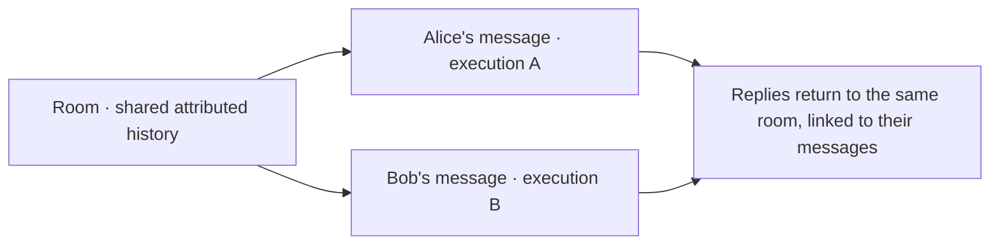

# Room conversations and concurrent execution — proposal

Status: design only. This replaces the earlier task-branch interaction proposal.
[Implementation details and evidence](conversation-branches-detail.md).

## Goal and boundaries

Use the room entry to identify the conversation, and authenticated user identity
to attribute each message. Host does not infer task boundaries from message text.
A group, private chat or explicitly opened Web Chat is a room. Group members
share that room's history; their identities remain distinct.

## Interaction

- Messages enter their actual room, with the sender's verified ID and available
  display name. One person's messages do not form a separate group conversation.
- Each received request gets its own execution record. Requests may overlap,
  including requests from the same person, without classifying them as new
  tasks or continuations.
- Each execution sees a fixed snapshot of available room history. Running peers'
  unfinished results are not presented as completed facts.
- Replies remain linked to the original message in that room. Native quotes add
  the explicitly referenced context; they do not select a hidden task branch.
- Later messages use that room's history and speaker labels. Host does not guess
  which earlier task “continue” refers to. If the request itself is unclear, AI
  can ask an ordinary clarification in the room.

## Execution approach and scope

Reuse a native session sequentially when possible. For overlapping requests,
fork from a verified completed history point into separate native sessions.
These are internal execution branches, not user-managed task conversations.
Keep one writer per native session and return every result to the room record.
Forking does not isolate simultaneous edits to the same file or remote resource.

Web keeps ordinary Chat input and message-linked progress/replies. There is no
task classifier, task selector, “New task” action or automatic task merge.

First stabilize persistence/startup checks, then verify ACP checkpoint/fork and
speaker preservation, and finally connect room-based intake across Web and IM.
This proposal does not implement those changes or replay existing requests.
