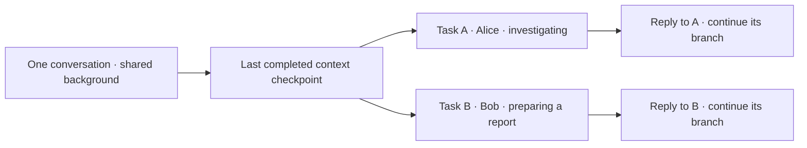

# Conversation branches — proposal

Status: design only. Independent CLI conversations already run concurrently;
forking a conversation into task branches is not implemented.

## Goal

Let people start several tasks in one Web Chat, group or private conversation
without losing shared background or mixing their answers. Each task gets its
own execution history and can continue independently.

## How people use it

| Action | Proposed behavior |
| --- | --- |
| Start an independent task | Create a branch from the latest completed shared context; run alongside existing tasks. |
| Reply to a task message | Continue that branch, including when another group member replies. |
| Add a follow-up while its branch is busy | Queue it for that branch's next turn; other branches keep running. |
| Say “continue” with several possible tasks | Ask which task; do not pick another person's most recent task. |
| Ask to combine results | Create a synthesis task with attributed result references. |

Web shows task names, initiators and status in the same Chat, with an explicit
“New task” action and a task selector for follow-ups. Group replies quote the
original task message so answers remain attached to the right question.

## Core decisions

- **Share the starting context; give each branch a distinct native session.**
  `resume` continues one branch. `fork` creates a new branch. Multiple executions
  do not write concurrently to the same native session.
- **Fork from a completed checkpoint.** If the parent is still running, use its
  last completed point and show that its in-flight result is not included. Do not
  wait for unrelated work or copy half-finished tool activity.
- **Keep people distinguishable.** Every request carries the authenticated
  speaker and an available display name. Task initiator, current speaker and
  result recipient remain separate. A message written by Alice about Bob is
  still Alice's message.
- **Keep results attributed.** Completed branch results appear in the shared
  conversation as linked summaries. Sibling histories are not silently merged;
  a running branch keeps its original context until an explicit follow-up.
- **Separate context from effects.** Forking conversation history does not undo,
  repeat or isolate file edits, deployments or account changes. Parallel writes
  to the same resource need coordinated ownership or separate workspaces.

## Delivery order and scope

1. Resolve the observed persistence/startup regression checks, then verify native
   fork and stable checkpoint behavior through the configured ACP
   adapter, plus speaker attribution on real resumed/forked turns. If unsupported,
   report that limitation; do not silently change engines or emulate full history.
2. Deliver explicit fork/new-task and reply-to-branch routing across Host and CLI,
   with distinct execution, context and delivery records.
3. Add Web task controls and group/private reply routing with readable speakers.

First delivery includes parallel task branches, branch-local follow-ups and
correct reply attribution. Automatic topic splitting, automatic history merging
and mid-tool-call forks are outside this increment.

Current group handling already supplies authenticated sender IDs in per-turn
Host instructions. Readable names and durable per-message speaker envelopes
need verification and extension; this proposal does not claim them delivered.

[Implementation details and evidence](conversation-branches-detail.md).
