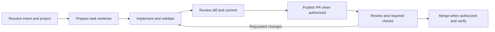

# Project development through worktrees and pull requests

Status: the managed worktree/PR delivery workflow remains proposed. Local
checkout discovery, automatic selected-project enrollment and source-linked
execution receipts are implemented. Current [project routing](smart-project-routing.md)
selects directories and compatible native conversations; it does not yet own a
durable business development task or PR/MR lifecycle.
See the [implementation notes](development-workflow-detail.md) for boundaries,
recovery and validation.

The proposed [persistent engineering missions](engineering-missions.md) build
on this lifecycle for README-driven repository stewardship and bounded research
across runs. They add objective ownership and wakeups, not a second PR workflow.

The [engineering records](development-projects.md) retain shared project records
and execution receipts under `.agent-host/projects/`, with no manual enablement.
Managed clones/new projects and multi-run feature progress are proposed next.
Agents retain their own native conversations and private memory.

## Proposed goal and usage

Tell Agent-Host what to build in a project. It identifies the requested change,
develops it in a dedicated Git worktree, verifies the result, and delivers a PR
for review and authorized merge. Follow-up changes stay with the same worktree
and PR. You can inspect progress or stop work without losing the changes.

For example: “Add CSV export to Agent-Host, verify it, and open a PR.” The Host
reports the project and intended result, then starts. “Use UTF-8 with BOM” updates
the same feature. “Merge this PR” authorizes its current reviewed revision.

## Recognize the intended action

Project selection and permission to change code are separate decisions.

| Request | Intended behavior |
| --- | --- |
| “How should CSV export work?” | Discuss a design; no development worktree yet. |
| “Find why export fails; do not change anything.” | Investigate with read access. |
| “Fix export in Agent-Host.” | Create a development task after resolving the repository. |
| “Continue, and add an export test.” | Update the clearly referenced active development task. |
| “Review PR #42.” | Inspect that PR; editing requires a request to change it. |
| “Fix export” with several plausible projects | Investigate the target or ask one focused business question before editing. |

Resolve the target from the current request, runtime-known projects and applicable
conversation references. Pasted documents and memory cannot grant permission.
An uncertain target can be investigated; editing waits for a bound repository.

## Delivery flow

One feature has one development task, one owned branch/worktree and one PR,
across multiple messages and execution attempts. Independent features get
separate worktrees; each has one writer. A new feature after merge gets a new task.

Agent-Host owns the task, worktree, checks, commits, PR and recovery. The native
Claude or future Codex adapter implements the change. Every managed editing
attempt starts in its verified worktree. Worktrees separate files and branches;
native permissions govern tool access. Runtime must verify the native profile's
operation controls before dispatching managed edits.

## Rules that affect the user

- Start from the resolved target branch; preserve the original checkout and
  unrelated local changes.
- Keep adjustments in the same task. Changed code needs fresh checks and review.
- A development request permits local implementation, checks and commits.
  Publishing the branch/PR needs a user request or applicable standing authorization.
  Default merge policy waits for a user instruction on the concrete PR.
- Respect required reviews, remote checks and branch protection. Repair conflicts
  in the worktree, then validate again.
- Distinguish “locally verified,” “PR awaiting checks/review,” and “merged.”
  Native completion and saved memory do not prove feature delivery.
- Preserve failed or canceled work. Clean up an owned worktree only after its
  changes and recovery needs are accounted for.

Progress replies identify the feature, current phase, validation result, PR link
when present and any next action. `/status` can show the development task without
requiring new workflow commands. A conversation reset leaves its work intact.

## First scope and implementation order

Start with one bound Git repository per task, GitHub and the current Claude
adapter. Existing task entries feed the same Runtime coordinator; a development
request automatically binds its resolved target. Prefer a local checkout and
prepare a needed clone/new project under the hidden Host root. Resolve the target
branch and checks from the project and request; no enable configuration is needed.
GitHub is proposed first because this repository uses it.

1. **Intent and continuity:** bind the feature, project and acceptance conditions.
2. **Local development:** prepare worktrees, implement, validate and commit;
   verify follow-ups and restart recovery.
3. **PR delivery:** authorized push, draft PR, required checks and revisions.
4. **Merge and closeout:** authorized merge, verify the result and clean up safely.
   Validate the full path in an authorized test repository before rollout.

Local-repository lookup and automatic enrollment are delivered foundations.
The proposed managed-development release adds all four steps and needed
clone/new-project preparation. GitLab MR delivery, broad remote discovery,
cross-repository development, automatic merge policies, multi-contributor collaboration and
multiple coding agents follow later.
