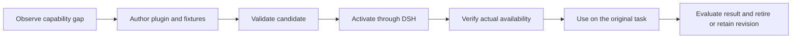

# Runtime-authored plugins through DeepSeek Harness

Research date: 2026-10-23. Status: documentation review and proposed evaluation,
not an implemented feature or a validated business improvement. This note extends
the [earlier framework research](research.md) and follows the responsibility
boundaries in the [Agent-Host architecture](architecture.md).

## Question and conclusion

Can the main Agent recognize a missing capability during a task, implement a
plugin, activate it through DeepSeek Harness (DSH), and use it to finish that
same task? This is **runtime capability creation (运行时动态实现能力)**. Choosing
an already prepared scenario Agent does not demonstrate it.

DSH provides relevant extension and reload mechanisms. The unresolved question
is whether generating a runtime extension improves a real task enough to justify
its authoring, verification and lifecycle costs. No recurring Agent-Host scenario
with that demonstrated benefit has been established in this research.

The strongest candidates need capabilities that remain active across Agent
steps: event collection, evolving task state, or consistent processing of later
tool results. A one-time data conversion or API call is a weak reason to introduce
DSH. Start by establishing a real baseline failure, then evaluate a plugin against
the simplest working alternative.

## What the proposed behavior means

Consider a request to determine whether a release has fully taken effect. During
investigation, the main Agent discovers that the answer requires combining rollout
events, instance versions and health observations that existing tools expose
separately. It writes a task-specific collector and reducer, tests them against
captured examples, and activates them as a DSH plugin. The plugin maintains the
release's observed state and exposes a query tool. The Agent uses that tool during
later steps, checks the source evidence, and completes or reports the task blocked.

The intended sequence is:

The generated implementation must not exist before the task. Record the source
revision actually used. Compilation, activation, successful invocation, correct
business output and later reuse are separate outcomes. A generic extension
template is acceptable; hiding the scenario's solution inside it is not evidence
of runtime authoring.

## What DSH contributes, and what remains unproven

| Evidence | Implication |
| --- | --- |
| DSH documents tool registration, event hooks and prompt contributions as plugin extension points. | A generated plugin can potentially add behavior that participates in subsequent Agent execution. This does not establish generated-code correctness. |
| Plugin Manager exposes management operations to Agents and can install local bundles. Its changes affect the profile's sessions, and plugin code executes in the runtime process. | Task-local behavior needs deliberate isolation; a separate profile is configuration separation, not an OS security boundary. |
| DSH HMR supports configuration and module reloads, with limits and explicit failure behavior. | A generated source file is not automatically an activated capability. Build output, loaded modules and actual activation must be checked. |
| Shipped ACP and SDK profiles disable HMR; profile patches can enable it. | Same-process hot activation requires a deliberately configured integration and verification. Restarting with a generated plugin proves a weaker, restart-based path. |

Sources: [extension cookbook](https://github.com/deepseek-ai/deepseek-harness/blob/master/docs/cookbook/extension-cookbook.md),
[Plugin Manager](https://github.com/deepseek-ai/deepseek-harness/blob/master/packages/boot/plugin-manager/README.md),
[HMR](https://github.com/deepseek-ai/deepseek-harness/blob/master/packages/boot/hmr/README.md),
[ACP profile](https://github.com/deepseek-ai/deepseek-harness/blob/master/packages/bundle/acp-app/README.md),
and [SDK profile](https://github.com/deepseek-ai/deepseek-harness/blob/master/packages/bundle/sdk-app/README.md).
These are mutable upstream documents; a runtime experiment must pin its tested
DSH version. This review did not install or run DSH.

HMR documentation distinguishes replacement paths and describes cases where an
activation failure leaves the prior implementation stopped. Do not assume that
failed replacement automatically restores a working plugin. Reverting plugin
code also cannot undo business operations already executed.

## Where the main Agent runs matters

If the main Agent runs inside DSH, a plugin can contribute directly to that
runtime's tools and events. This is the most direct interpretation of extending
the main Agent while it works, but adopting DSH as that executor is a separate
architecture choice.

If the main Agent remains in Claude Code or another harness, it can author a
plugin for a DSH process and call the resulting capability through a bridge.
DSH plugins do not automatically change the other harness's tool inventory or
intercept its execution events. A stable bridge could expose discovery and
invocation, but that integration is proposed, not delivered. A DSH tool plugin
need not start another model loop; adding a scene-specific Agent is optional.

Agent-Host's current [ACP adapter](../internal/harness/acp/adapter.go) checks the
Claude bridge identity and uses Claude-specific metadata. DSH cannot be connected
by changing only the command. Host should continue to own task identity,
authorization, acceptance and durable records; the selected harness owns its loop.

## Candidate scenarios and their actual value

These are hypotheses for selecting real cases, not measured benefits or existing
customer requirements.

| Candidate | Capability authored during the task | Potential benefit | Strong competing baseline |
| --- | --- | --- | --- |
| Release outcome tracking | A collector and state reducer derived from the actual release topology and available event formats; a query tool retains source references and freshness. | Later steps share a consistent view across multiple event streams, with task-owned cleanup. | A generated polling script or existing deployment dashboard. Prefer DSH only if ongoing Agent interaction benefits. |
| Evidence capture during a long investigation | A result-observation plugin that extracts task-specific identifiers and timestamps from subsequent tool outcomes, retaining original evidence references. | Repeated evidence bookkeeping becomes consistent across later calls. | Existing Host observations, a post-processing script, or native hooks. DSH must add something these lack. |
| An unfamiliar internal API | A typed tool generated from an authorized API description, handling pagination and response normalization. | Repeated invocations may become easier to validate and reuse. | A generated CLI or MCP tool. Usually weak evidence for DSH-specific value. |

For release tracking, use a real case with multiple resources and delayed or
conflicting observations. For evidence capture, first establish a concrete gap in
the existing Host evidence path. Merely collecting the same logs twice adds cost.

Avoid greeting tools, invented calculators, simple format converters and fixed
workflow routing as the main demonstration. They can test plumbing, but cannot
justify this improvement. If all available real tasks are already handled well
by scripts and Skills, retain the research and defer the runtime integration.

## How to evaluate improvement before building a platform

Select one recurring task with recorded difficulty: missed evidence, repeated
manual reconciliation, or state lost between steps. Establish its acceptance
criteria before the Agent generates any code. Use independent expected results
or a reviewer; tests invented by the authoring Agent alone are insufficient.

Compare the same inputs, model where possible, account scope and task budget:

1. The existing executor with its current Skills and tools.
2. That executor allowed to generate and reuse an ordinary script or CLI.
3. Runtime-authored plugins through DSH, with the chosen main-Agent placement
   recorded. Report model and harness differences as confounding factors.

Include a first task, related follow-ups with changed inputs, and a changed input
format that requires revision. Measure verified task success, source coverage,
human corrections, elapsed time and model usage. Include generation, compilation,
repair, activation and cleanup costs; report unavailable cost data as unavailable.
Do not assume future reuse will repay initial cost without observing reuse.

For the dynamic mechanism itself, require evidence that the new tool became
available and ran at the recorded revision during the original task. Report
whether the process and native session survived. Exercise an invalid candidate,
a failed activation and cancellation; check that the main task retains its
evidence and that plugin resources stop. Replacing a shared runtime or changing
unrelated sessions would invalidate the intended isolation claim.

Proceed only if the plugin approach improves verified completion or reduces
total effort on the selected real cases without weakening evidence or control.
Set any numeric threshold from the observed baseline before comparing results.
If the script baseline performs equally well, choose it. Successful loading
alone is a mechanism demonstration, not a product improvement.

## Recommendation

Keep runtime-authored plugins as a research direction. The next decision is
which existing task has a capability gap requiring persistent participation in
Agent execution. Release outcome tracking is a plausible candidate to investigate;
it is not yet a validated requirement. Do not commit to a plugin platform or
claim improved autonomy until a real case beats the script baseline.
