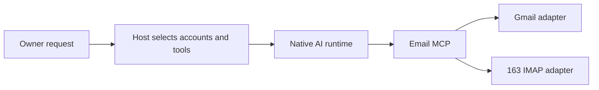

# Email capability through MCP

Status: proposal only. No email provider, account registration, or live mailbox
connection has been implemented or verified. See the
[technical notes](email-plugin-detail.md) and [Host architecture](architecture.md).

## Goal and usage

Let the owner ask Agent-Host to find and read messages across Gmail and 163
accounts, inspect selected attachments, summarize relevant mail, and prepare a
reply. Example: “Find this week's invoices across my mailboxes and summarize
which need attention.” Each result identifies its account and original message.

The initial account count is awaiting clarification: one Gmail plus one 163,
or one Gmail plus two 163 accounts. The design supports either through separate
account registrations; credentials and real addresses are not stored in this document.

## Core approach

Use a Host-managed email MCP capability. Register accounts locally, then let
Host assemble the eligible email tools into each native AI run. The existing
Claude adapter already accepts explicit MCP registrations. Native execution
continues to own reasoning and tool calls.

Gmail uses its API with account authorization. The 163 adapter uses IMAP for
reading and a client authorization password (客户端授权码). Sending, when added,
uses Gmail's API or SMTP for 163. One consistent tool interface hides routine
provider differences but reports unsupported operations explicitly.

Keep this a focused built-in integration using MCP registration. A general
plugin marketplace or public plugin SDK is unnecessary for these accounts.
The Gmail connector available in this Codex chat does not automatically supply
credentials to the separate Agent-Host service.

## Proposed first scope

- Register multiple accounts and check each account's connection independently.
- List folders or labels, search messages, read bodies, and retrieve selected
  attachments on demand. Reading should preserve unread state.
- Prepare reply text in the current owner conversation. Saving a provider draft
  is a separate mailbox write, outside this initial read path.
- Report account-specific failures and incomplete search coverage explicitly.
- Make the configured mailboxes available to the owner's selected Agent instances,
  including their default workspace. Do not mount personal mail in group tasks
  by default. Mail content remains attributed source material, not instructions
  or automatically published shared memory.

The first scope is a recommendation pending the owner's answer about writes.
Sending, mailbox draft persistence, read-state changes, move/archive/delete,
background monitoring, and automatic replies are later increments. Existing
user authorization should be reused when applicable; enabling a plugin alone
does not authorize arbitrary outgoing messages.

## Implementation order

1. Add account configuration, connection checks, and per-run MCP registration.
2. Deliver Gmail search/read, then 163 search/read behind the same tools.
3. Verify each real account and one combined AI request, including an unavailable
   account and attachment retrieval. Record offline and live evidence separately.
4. Add requested write operations with explicit account selection and durable
   operation receipts. Unknown send outcomes require reconciliation before retry.

Live connection requires Gmail authorization and a 163 client authorization
password for each account, installed through a private local setup flow. These
secrets must not be pasted into chat or committed to the repository.
