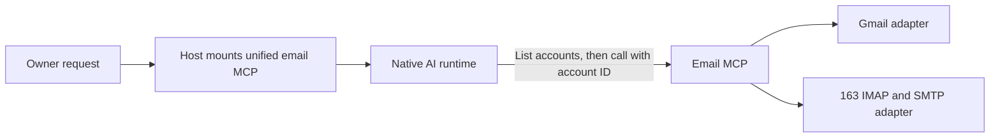

# Email capability through MCP

Status: proposal only. No email provider, account registration, or live mailbox
connection has been implemented or verified. See the
[technical notes](email-plugin-detail.md) and [Host architecture](architecture.md).

## Goal and usage

Let the owner ask Agent-Host to find and read messages across Gmail and 163
accounts, inspect selected attachments, summarize relevant mail, and send or
reply to messages from a specified account. Example: “Find this week's invoices across my mailboxes and summarize
which need attention.” Each result identifies its account and original message.

The initial account count is awaiting clarification: one Gmail plus one 163,
or one Gmail plus two 163 accounts. The design supports either through separate
account registrations; credentials and real addresses are not stored in this document.

## Core approach

Register one unified email MCP server with the Host. AI lists the managed
mailboxes through a tool, then passes the chosen account ID to search, read,
send or reply tools. Host manages configuration and credentials; it does not
choose the mailbox for a business request. The existing Claude adapter already
accepts MCP registrations. Native execution owns reasoning and tool calls.

Gmail uses its API with account authorization. The 163 adapter uses IMAP for
reading and a client authorization password (客户端授权码). Sending
uses Gmail's API or SMTP for 163. One consistent tool interface hides routine
provider differences but reports unsupported operations explicitly.

Keep this a focused built-in integration using MCP registration. A general
plugin marketplace or public plugin SDK is unnecessary for these accounts.
The Gmail connector available in this Codex chat does not automatically supply
credentials to the separate Agent-Host service.

## Proposed first scope

- Register multiple accounts; let AI discover their IDs, addresses, providers,
  enabled operations and connection status through one account-list tool.
- List folders or labels, search messages, read bodies, and retrieve selected
  attachments on demand. Reading should preserve unread state.
- Send new messages and reply from the explicitly selected account, including
  attachments. Ask for the sending account only when user intent remains ambiguous.
- Report account-specific failures and incomplete search coverage explicitly.
- Make the configured mailboxes available to the owner's selected Agent instances,
  including their default workspace. Do not mount personal mail in group tasks
  by default. Mail content remains attributed source material, not instructions
  or automatically published shared memory.

Mailbox draft persistence, read-state changes, move/archive/delete, background
monitoring, and automatic replies are later increments. Existing
user authorization should be reused when applicable; enabling a plugin alone
does not authorize arbitrary outgoing messages.

## Implementation order

1. Add account configuration, connection checks, and a unified MCP registration.
2. Deliver account discovery and Gmail/163 search, read, send and reply tools.
3. Verify AI account selection, each real account, a combined search, attachment
   retrieval and an explicitly authorized send/reply. Include an unavailable
   account; record offline and live evidence separately.
4. Retain durable send receipts. Reconcile unknown send outcomes before retry.

Live connection requires Gmail authorization and a 163 client authorization
password for each account, installed through a private local setup flow. These
secrets must not be pasted into chat or committed to the repository.
