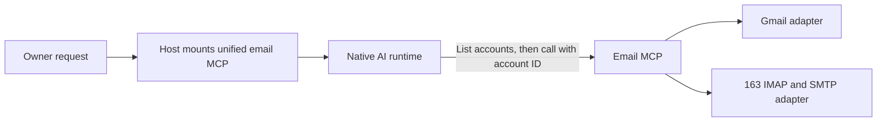

# Email capability through MCP

Status: unified MCP and Gmail/163 adapters implemented. One owner-provided 163
account passed live authentication, folder listing, search and body reading with
unchanged message flags. Native AI acceptance and production rollout are recorded
in the technical notes. Gmail requires separate OAuth setup; real outgoing mail
and live attachments remain unverified. See the
[technical notes](email-plugin-detail.md) and [Host architecture](architecture.md).

## Goal and usage

Let the owner ask Agent-Host to find and read messages across Gmail and 163
accounts, inspect selected attachments, summarize relevant mail, and send or
reply to messages from a specified account. Example: “Find this week's invoices
across my mailboxes and summarize which need attention.” Each result identifies its account and original message.

One 163 account is configured locally. Add Gmail or further 163 mailboxes to the
same registry; AI discovers them through `list_accounts`. Credentials and real
addresses remain outside this repository.

For local chat, pass `--email-config /absolute/path/accounts.json`. The managed
service accepts the same file through `email_config` in its private service
configuration. [Setup and tool details](email-plugin-detail.md#configuration-and-commands)
include the local-only check and optional live connection check.

## Core approach

The Host registers one unified email MCP server. AI lists the managed
mailboxes through a tool, then passes the chosen account ID to search, read,
send or reply tools. Host manages configuration and credentials; it does not
choose the mailbox for a business request. The existing Claude adapter already
accepts MCP registrations. Native execution owns reasoning and tool calls.

Gmail uses its API with account authorization. The 163 adapter uses IMAP for
reading and a client authorization password (客户端授权码). Sending
uses Gmail's API or SMTP for 163. One consistent tool interface hides routine
provider differences but reports unsupported operations explicitly.

Keep this a focused built-in integration using MCP registration. A general
plugin marketplace or public plugin SDK is unnecessary for these accounts.
The Gmail connector available in this Codex chat does not automatically supply
credentials to the separate Agent-Host service.

## Delivered scope

- Manage multiple accounts; let AI discover their IDs, addresses, providers,
  enabled operations and connection status through one account-list tool.
- List folders or labels, search messages, read bodies, and retrieve selected
  attachments on demand. Reading should preserve unread state.
- Send new messages and reply from the explicitly selected account, including
  attachments. Ask for the sending account only when user intent remains ambiguous.
- Report account-specific failures and incomplete search coverage explicitly.
- Make the configured mailboxes available to owner-private runs of the configured runtime,
  including the default workspace. Group tasks and tool-free extraction receive
  no email MCP. Per-Agent account subsets are not implemented. Mail content remains attributed source material, not instructions
  or automatically published shared memory.

Mailbox draft persistence, read-state changes, move/archive/delete, background
monitoring, and automatic replies are later increments. Existing
user authorization should be reused when applicable; enabling a plugin alone
does not authorize arbitrary outgoing messages.

## Validation and next steps

The implemented tools include account discovery/checks, folders, search, body and
attachment reads, sending, replies, and durable operation-status lookup. Automated
checks cover routing, read-only IMAP behavior, MIME, TLS SMTP, Gmail account
identity and duplicate-send prevention. Provider acceptance means submission,
not recipient delivery. Pending/unknown sends are never automatically repeated.

The connected 163 account has been read without sending mail. Next, authorize
Gmail for the Host and validate real send/reply behavior using a specified
recipient and message. This Codex chat's Gmail connection does not automatically
provide Host OAuth credentials. Background monitoring and automatic replies
remain outside this increment.
