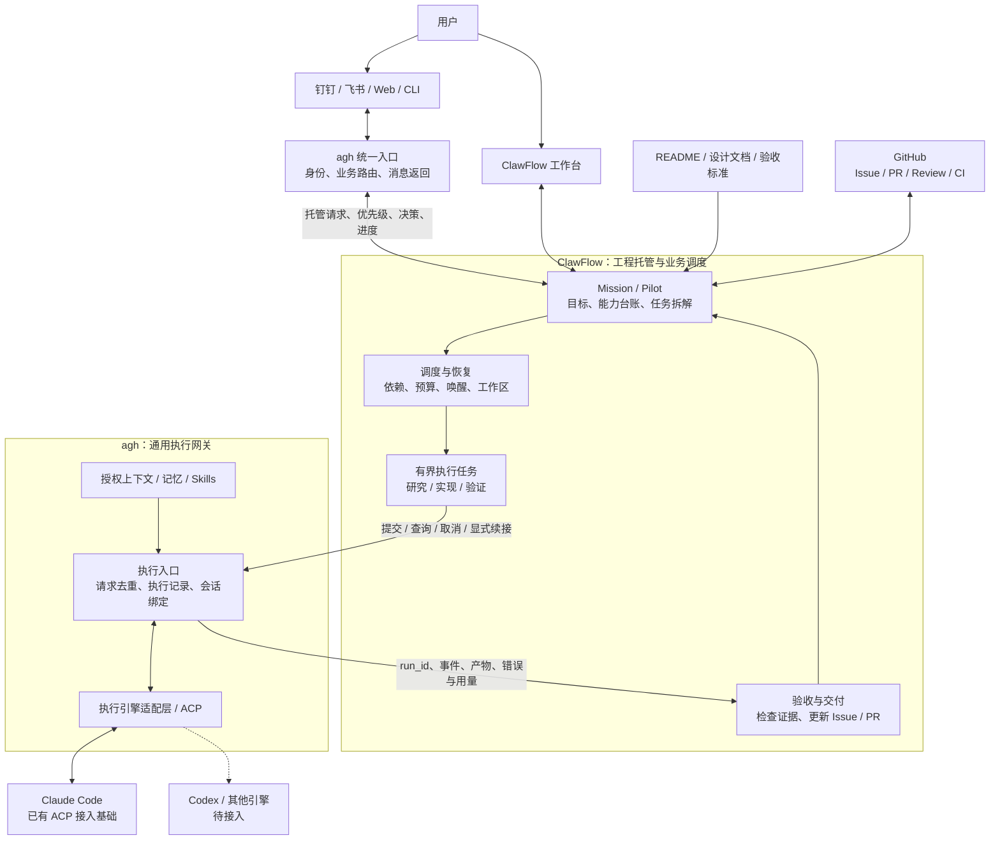

# ClawFlow 常驻工程托管与 agh 执行接入

状态：**架构提案，待评估**。2026-10-23 根据用户反馈调整：常驻工程任务在
ClawFlow 中实现；agh 保持统一入口、执行接入和通用上下文能力。本文取代上一版
“Host 主导 Mission”的建议；不表示已经完成集成或开启托管。
[调研证据与接口设计](engineering-missions-detail.md)。

## 核心判断

建议采用这个分工。ClawFlow 已经积累了 Pilot、Issue 流转、worktree 和 PR 跟进能力，
常驻工程研究和迭代属于它的业务范围。agh 提供统一的执行网关，让 ClawFlow 可以使用
同一套执行引擎接入、会话续接、证据记录和消息返回能力。

**ClawFlow 决定做什么、何时做、何时算完成；agh 负责把一次执行可靠地送达引擎，
并返回事实。** agh 可以管理运行槽位和会话互斥，但不再维护一套工程优先级和迭代计划。

## 目标架构

下图是目标分工；ClawFlow ↔ agh 的结构化接入仍待实现。

图中的两个 agh 入口属于同一个产品的不同职责，不要求部署两个服务。
用户请求经业务路由进入 ClawFlow；ClawFlow 发来的执行请求直接进入执行层，
不能再次被路由成一个新 Mission。

## 职责边界

| 内容 | ClawFlow | agh |
| --- | --- | --- |
| 长期目标与 README 驱动 | 解析目标，维护能力缺口、里程碑和任务 | 提供必要的授权上下文 |
| 调度 | 决定下一项工作、依赖、周期、优先级和任务预算 | 按资源容量接收执行，管理会话互斥 |
| 工程状态 | 持久保存 Mission、Issue、worktree、PR 和验收状态 | 保存一次 Run 的执行状态、原始事件和会话引用 |
| 工作目录 | 创建、拥有和回收任务工作区 | 校验并使用传入的工作区，不另建工程任务 |
| 失败恢复 | 查询原执行和外部事实，决定是否继续或重试 | 报告运行、失败、中止或未知状态；不自行重做任务 |
| 对外动作 | 管理 Issue / PR、合并与发布授权和执行 | 把进度、结果、待决策事项送回正确用户 |
| 知识 | 保存项目结论与验收依据 | 按需保存可复用记忆和 Skills；不能替代工程状态 |

原生执行引擎仍然拥有自己的模型/工具循环和原生会话。
“Run 执行结束”“工程验收通过”“PR 合并”“通知送达”保持独立结果。

## 一次托管如何运转

例如用户说：“接管 easyeda-agent，按 README 推进离线求解器质量，完成验证后提交 PR。”

1. agh 识别用户和目标服务，将请求及其授权来源交给 ClawFlow。
2. ClawFlow 建立 Mission，关联 README、已有 Issue 和验收规则，选择当前能推进的一项。
3. ClawFlow 准备工作区，把目标、输入、检查要求和本次限制提交给 agh。
4. agh 调用配置的原生引擎，流式返回工具活动、结果、产物和实际执行状态。
5. ClawFlow 核对改动与检查证据，推进原 Issue / PR，或安排下一次研究实验。
6. 有实际结果或需要决策时，通过 agh 返回用户；没有新条件时由 ClawFlow 保持等待。

研究任务可以得出“方案不可行”或“仍缺证据”，无需强行产出代码。
README 是需求入口，具体设计和验收仍需跟随其链接；任务不能通过降低验收标准来宣称完成。

## 第一版范围

先在 ClawFlow 增加一个 **agh 执行后端**，把已有 operator 的一次执行接到 agh。
沿用已有 Pilot/调度链路，再逐步补齐长期目标、版本化证据和业务验收。
不要把整个 `clawflow run` 丢给 agh 执行，否则内部仍可能自行启动 Claude，无法形成统一执行路径。

实施顺序：

1. **单次执行接通**：ClawFlow 提交一个只读任务，能够查询、收取事件、取消并取得最终结果。
2. **持久跟进**：ClawFlow 关联任务与 agh Run；任一侧重启后能查回原执行，不重复启动。
3. **离线工程试点**：用 easyeda-agent [#273](https://github.com/zhoushoujianwork/easyeda-agent/issues/273)
   验证研究、修复、检查和获授权的 PR 交付。
4. **持续迭代与现场验收**：补齐 README 能力台账、依赖唤醒，再接入明确授权的 EDA 环境。

保持现有直接执行后端可供显式选择，切换后端不能自动重放任务。
第一版只做同机、一个仓库、一个执行任务；多机调度和更多引擎等最小闭环验证后再扩展。

agh 的现有 ACP、执行记录和消息交付可以复用，但面向 ClawFlow 的持久异步接口、
请求去重、跨系统恢复和受限执行环境仍需实现并验证。工作区路径和提示词本身不能保证隔离。

本次仅调整设计；ClawFlow 的代码、配置和自动化未变更。
