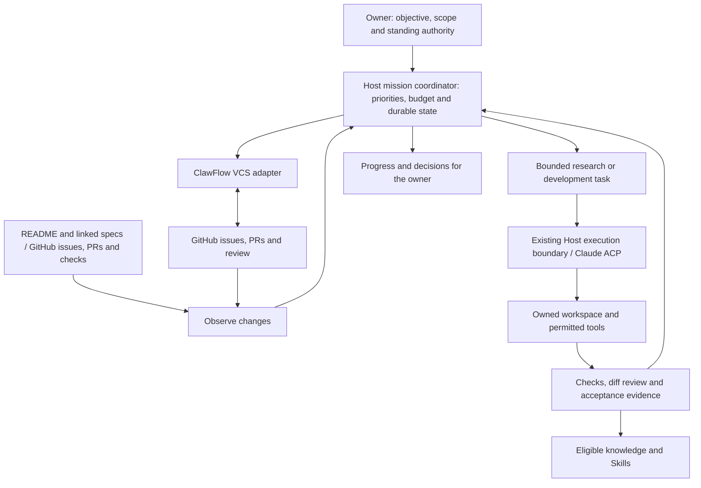

# Persistent engineering missions

Status: **proposal for evaluation**, researched on 2026-10-23. No mission,
automation, GitHub write or EDA operation was enabled by this investigation.
The [research and implementation notes](engineering-missions-detail.md) contain
source revisions, evidence, recovery rules and acceptance scenarios.

## Recommendation

Add an **engineering mission (工程托管任务)** to Agent-Host: a durable objective
that keeps selecting and completing useful work across runs, restarts and days.
The user sets direction, scope and authority once; the mission handles routine
research, implementation, validation and follow-up within those bounds.

Agent-Host should own the mission and scheduling; GitHub should hold the shared
issues, PRs and review discussion; ClawFlow should supply VCS operations and
reusable engineering procedures; the native harness should execute each bounded
assignment. Reuse Host's shared execution boundary, starting with Claude ACP.

**The persistent part is the responsibility and its records.** Each model run
has a finite question, evidence requirement and stopping condition. When there
is nothing actionable, the mission sleeps without spending model tokens.

## What the investigation found

| Component | Already present | What this proposal adds |
| --- | --- | --- |
| Agent-Host | Project discovery, native execution and continuation, run evidence, memory/Skills, result delivery | Durable objectives, wakeups, owned engineering work and evidence-based acceptance |
| ClawFlow | Label-driven operators, issue decomposition, worktrees, project Pilot wakeups, PR/merge handling and run records | A narrow integration with one scheduling owner; do not run two autonomous managers on the same repository |
| easyeda-agent | README workflows, detailed acceptance rules, offline solver cases and CI | A reconciled work queue connecting those promises to actual evidence and unresolved issues |

The local ClawFlow `eda` project already contains easyeda-agent. Both its Pilot
automation and repository execution are disabled. GitHub currently has six open
issues and no open PRs. Local `dev`, remote `dev` and remote `main` have different
revisions; enrollment must choose the intended baseline rather than assuming the
default branch contains the latest development. These are dated observations,
not ongoing health claims.

## How the user would use it

An example instruction, **not an activation performed by this proposal**:

> Manage easyeda-agent against its README and linked design/acceptance documents.
> Start with offline solver reliability. Investigate existing issues, implement
> bounded fixes, run the required checks, and open/update PRs. Use the agreed
> managed-branch workflow based on dev. Ask me about product direction, changes
> to acceptance rules, live EDA access and merges. Keep working on other eligible
> tasks while one item is waiting.

The same mechanism supports three scopes:

| Scope | Work performed | Completion |
| --- | --- | --- |
| One issue | Reproduce, investigate, fix, verify and follow the PR | Its actual acceptance conditions are met |
| Engineering research | Compare hypotheses and experiments against fixed cases | An accepted conclusion, including a supported negative result; unresolved blockers remain waiting |
| Repository stewardship (项目持续托管) | Maintain priorities, address defects and propose the next useful increment | Continues until paused/retired; individual milestones still finish |

The workbench shows the objective, current work, evidence, PR, resource use,
next wake condition and decisions needed. Normal conversation can change
priority, pause, resume or narrow scope. Notify on useful results, failures and
needed decisions; an optional scheduled digest can summarize progress.

## README-driven development

Use the README as the product entry point, then follow its links to the actual
design, implementation and acceptance documents. Build a small **capability
ledger (能力台账)**: each promise links to its source revision, implementation,
tests, known limits and issue/PR.

For example, “complete a PCB” becomes separate claims about connectivity,
geometry, DRC, save/reload and manufacturing output. A successful offline test
does not certify the real EDA workflow. README examples do not automatically
authorize operation on an open board or publication of a release.

On a source change, update only affected claims and work. Existing issues take
priority over creating duplicates. Conflicting or old evidence is retained with
its version. The mission must not improve its completion rate by weakening
tests, editing away requirements or declaring its own output accepted.

## Architecture and operating loop

Each wake observes changes, reconciles unfinished actions, chooses the highest
value eligible task, reserves resources, executes one bounded step, checks the
evidence, and records the next action or wait condition. The coordinator handles
business state; it does not replace the native harness's model/tool loop.

Research uses the same lifecycle: question → baseline → experiment → independent
check → conclusion. For algorithm work, compare under the same input, budget
and verifier, including counterexamples. A failed hypothesis is useful progress
when it removes an option with reproducible evidence.

## Important choices

| Choice | Recommendation |
| --- | --- |
| Scheduling owner | Agent-Host for managed missions. Leave ClawFlow Pilot/operators off for that repository. Reuse individual CLI/API operations and adapt useful Skills. |
| Autonomy | Approve a bounded charter once. Routine work inside it proceeds automatically; scope, authority or acceptance changes return to the owner. |
| Delivery | First deliver verified local changes and authorized draft PRs. Merging requires the agreed owner decision; publishing a release is separate. |
| Concurrency | Start with one active work item per mission. Later add independent offline work; keep one writer per worktree and one owner per EDA window. |
| Cost | Persist run/time/action limits and a mission spending ceiling where metering supports it. Report unknown monetary cost honestly. |
| Recovery | Reconcile the worktree, process and remote operation before resuming. A timeout is not permission to repeat a write. |
| Waiting | No repeated model calls for unchanged blockers. Wake on changed evidence, a dependency, available environment or owner response. |

ClawFlow-only automation is the fastest route if issue-to-PR service is the
entire goal. However, building both a ClawFlow Pilot and a Host manager would
duplicate decisions and complicate recovery. The recommended Host route costs
more initial development but matches this project's native execution, memory
and cross-channel architecture. The detail document records the reuse boundary.

## First pilot: easyeda-agent

Start with [#273](https://github.com/zhoushoujianwork/easyeda-agent/issues/273),
the schematic-layout search-budget problem. It supplies frozen offline inputs
and explicitly forbids weakening geometry or connectivity constraints. First
reproduce on the chosen current `dev` revision; the issue's historical failure
does not prove that revision still fails.

The first milestone should produce a reproducible baseline, one bounded
improvement or supported research conclusion, regression evidence and, when
authorized, a PR. It should also survive a Host restart without duplicating work.
This tests research and development continuity without depending on a live board.

Then extend to typed-action work such as
[#284 manufacturing export](https://github.com/zhoushoujianwork/easyeda-agent/issues/284),
with a separate live EDA check. Keep
[#55 page rename](https://github.com/zhoushoujianwork/easyeda-agent/issues/55)
open until its actual live result is established: its `agent-implemented` label
already demonstrates why “a patch exists” and “the issue is solved” differ.

easyeda-agent currently defaults to direct development on `dev`. Adopting task
branches/worktrees and PR delivery is an explicit pilot decision, scoped to
managed work. Existing layout confirmation and release-version approval remain
part of its workflow. Blocked live work must not occupy the offline queue.

## Implementation order and evaluation

1. **Mission continuity:** durable objective, source snapshots, one bounded
   read-only research task, finite wakeups, budgets, pause and restart recovery.
2. **Local engineering:** implement the existing development-workflow proposal's
   task/worktree/check foundation; complete the offline #273 pilot locally.
3. **GitHub follow-up:** authorize and reconcile issue/PR writes, CI and review
   changes; prove recovery after an uncertain publication result.
4. **Live engineering:** add an explicitly bound EDA environment and its actual
   acceptance checks. Consider limited automatic merging only after the earlier
   stages have evidence and a separately agreed policy.

Judge the pilot by accepted outcomes per owner intervention, reproducibility,
time/cost per accepted result and reliable recovery. Also measure duplicate work,
false completion claims and unnecessary wakeups. PR count and model activity
alone are not success metrics.

The main decisions for evaluation are **Host as the scheduling owner**, the
**offline #273 pilot**, and **bounded automatic development with PR delivery**.
Precise internal schemas can be settled during implementation. This proposal
does not claim that unattended managed execution is already available: Host's
current broad execution profile needs a verified restricted environment before
the proposed publication and workspace boundaries can be enforced.
