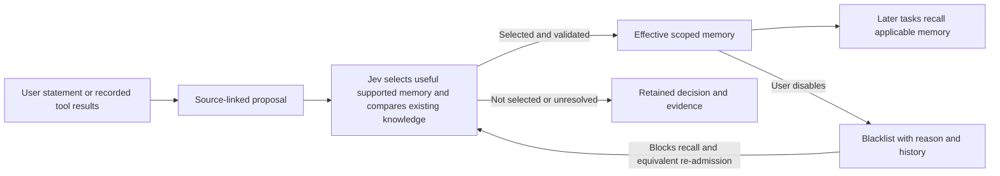

# Memory consolidation and execution experience

The [file memory and Skill design](file-memory-design.md) now owns the target
storage and implementation sequence. Automatic selection, source validation,
independent retry and blacklist policy below carry forward; the SQLite-first
implementation order is superseded. Current database behavior and historical
validation remain unchanged.

Status: revised architecture decision, 2026-10-12. **Jev-selected memory becomes
effective automatically; people disable unsuitable memory afterward through a
blacklist.** There is no required human acceptance step in the target workflow.
The current implementation automatically saves eligible user statements but
still holds execution experience for `memory accept`. Automatic experience
publication and protection against re-admitting blacklisted lessons remain to
be implemented. The 2026-10-10 reviewed loop remains historical validation.
The [local memory workbench](../tools/run-viewer/README.md#memory-workspace) now
supports explicit publication/rejection of existing drafts and disabling saved
memory while the channel is running. This does not complete automatic publication.
See [implementation, transition and validation details](experience-memory-detail.md).

## Goal and usage

Carry useful knowledge and experience into later tasks without making the user
approve each memory. The user can inspect a saved lesson and its evidence, then
disable it if it is wrong, obsolete or unsuitable.

The host keeps three layers: original evidence, extracted proposals and durable
memory. Original requests and tool results remain inspectable. Proposals help
the system decide what to keep; they are processing records, not a human inbox.
Only effective, applicable memory enters a task's context.

Procedural lessons keep the successful path in ordered steps and observed
failed approaches in a separate avoidance list. The workbench can reorganize
an adopted lesson from its original tool evidence, saving a new revision after
Jev screening while preserving the original draft and prior versions.

## Core approach

| Source | How it becomes memory |
| --- | --- |
| User statement | Jev selects the attributed preference, fact or decision; the host saves the source statement automatically. |
| Execution experience | A separate tool-free model extracts conditions and steps from recorded tool results; Jev screens support and usefulness, compares existing memory, and the host publishes automatically. |
| Selected everyday conversations | Future source-specific extraction keeps participant reports and original citations; selected lessons follow the same automatic publication and blacklist policy. |

The host validates evidence links, project/Agent/audience scope and current
memory revisions before committing. Equivalent eligible experience adds
evidence to its existing record. Unresolved conflicts remain excluded with an
explanation; they do not create a mandatory approval queue. Jev selection makes
memory available for reuse, while its original evidence strength stays visible.
It does not certify business success or grant execution permissions.

## Blacklist and later corrections

A blacklist entry disables a memory within its original scope. Keep its ID,
reason, versions and supporting evidence; exclude it from search and future
context assembly. A later extraction of the same lesson must not make it
effective again under a new ID or different wording. Restoration requires an
explicit user action. A distinct corrected lesson can be saved with links to
the old record and its new evidence.

Reuse the existing `memory invalidate --reason 'REASON' MEMORY_ID` operation as
the local disable entry point. Expiration and detected source withdrawal also
exclude memory from recall, with their own reasons. The planned policy applies
to both user statements and execution experience.

Run a task normally, then inspect the memory receipt or saved record as needed.
The target receipt reports saved, merged, excluded or failed, with evidence
links. It does not ask the user to accept a selected lesson. A memory-processing
failure remains visible and can be retried from saved evidence without
repeating the business task.

## Scope and implementation order

1. Move experience comparison and publication into post-run finalization,
   replacing the required `memory accept` step. Keep source inspection and
   independent retry.
2. Enforce the blacklist at admission, deduplication, search and context assembly
   for both memory paths. Verify that an equivalent later proposal stays disabled.
3. Validate automatic save, fresh-task reuse, disable and retry as one complete
   loop. Keep historical manual-review results separate from this new acceptance.

Start with the current local SQLite store, bounded extraction and scoped
retrieval. Everyday-conversation learning remains a separate future extension
in the [source design](knowledge-sources.md). General extraction accuracy,
memory benefit and performance at scale remain unmeasured.

The [personal-assistant proposal](personal-assistant.md) applies this policy to
future DWS-derived knowledge. It retains general memory types, keeps current
matters and recommendations separate, and proposes an explicit owner-private
domain without broadening existing project memory scope.
