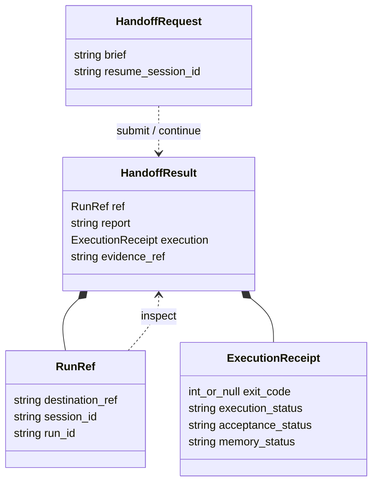

# External-agent handoff implementation notes

Status: design notes, not an implementation contract. Scope and user-facing
decisions live in [the main proposal](external-agent-handoff.md). Choose exact
flags and result fields during implementation; retain compatibility with existing
callers rather than introducing a second task protocol.

## Existing foundation

- `skills/agent-host-tasks/SKILL.md` defines routing and acceptance responsibilities.
- `skills/agent-host-tasks/scripts/chat.py` loads the private destination and
  managed provider environment, forwards a message and optional resume ID, and
  preserves the child exit code. Its default output is currently NDJSON events.
- `chat --resume` starts a new turn. `run show` and `run events` inspect existing
  records. The saved configuration must select the same Host for both operations.
- CLI chat owns a separate state home; it is not a client of the running channel
  service. Keep the dedicated Agent catalog and native profile.
- Installation already links the Skill into supported external clients. Existing
  independent runtime bundles may need an explicit source update.

No new durable business-task entity is necessary for this increment. Session IDs
provide conversation continuity, and Run IDs identify execution attempts. This
does not implement the separate [development workflow](development-workflow.md).

## Skill responsibilities

Make the discovery description explicitly recognize Agent-Host / agh delegation
and clear, authorized work. Keep ambiguous design with the external agent.
Bounded analysis is eligible when its question and deliverable are clear.

Show a short happy path first: submit a brief, wait, read the report, verify.
Move configuration and recovery details into the existing reference. The caller
must not have to assemble runtime flags during normal use.

The receiving agent should execute directly and return a concise report with
outcome, changes, evidence and unresolved decisions. This is an instruction for
the receiving agent, not a parser that labels arbitrary prose as success. The
external agent reads and checks the report before claiming business completion.

Distinguish three causes of a blocker: missing task detail/decision, unavailable
runtime capability, and a tool/account permission denial. Carry the user's
existing authorization into the brief without asserting that it can override
native restrictions. Resolve only the actual gap; do not impose a fresh approval
step solely because the request was delegated.

## Thin launcher boundary

Prefer extending the configured launcher over adding another service or a new
general-purpose task CLI. Provide these behaviors through that entry point:

| Operation | Behavior |
| --- | --- |
| Submit | Run one brief against the saved destination and return a report with evidence references. |
| Inspect | Read existing progress/results without invoking a model or starting work. |
| Continue | Send a resolved decision or bounded follow-up using the observed session identity. |

Retain the process exit, actual IDs, execution/acceptance/memory outcomes and
worker reply separately. Include model, elapsed time and cost only when observed;
missing metrics remain unavailable. Do not derive business success from exit zero,
the final event or the presence of memory records.

Evidence should survive an interrupted caller and be discoverable while work
runs. Reuse Host records where possible; avoid duplicating a full history store.
If a small local launch receipt is needed before a Run ID exists, keep it private
and retain the destination reference. Never persist credentials in receipts.

Use the native result for the final reply when available. Streaming commentary
and memory extraction text must not accidentally become the worker's final
answer. Incomplete output is partial evidence, not a fabricated terminal result.

Inspect before resuming after interruption. A missing final report does not prove
that the child stopped or that no side effects occurred. Runtime lock failures
remain explicit; do not create another home, switch providers or replay work.
Cancellation uses existing process controls; a durable cancellation service is
outside this scope.

## Data structure sketch

These are proposed boundary shapes, expressed in Go for readability; they are
not new runtime entities or a committed wire protocol. The launcher is currently
Python. Keep the task brief and worker report as text in the first increment.



```go
// A nonempty ResumeSessionID continues an observed session with a new turn.
type HandoffRequest struct {
    Brief           string `json:"brief"`
    ResumeSessionID string `json:"resume_session_id,omitempty"`
}

// DestinationRef identifies saved local configuration, never credentials.
// IDs are empty until observed; retain replacement IDs returned by Host.
type RunRef struct {
    DestinationRef string `json:"destination_ref"`
    SessionID      string `json:"session_id,omitempty"`
    RunID          string `json:"run_id,omitempty"`
}

// Copy Host outcomes as observed; unknown values stay absent.
// Host acceptance is not the external agent's independent verification.
type ExecutionReceipt struct {
    ExitCode         *int   `json:"exit_code"`
    ExecutionStatus  string `json:"execution_status,omitempty"`
    AcceptanceStatus string `json:"acceptance_status,omitempty"`
    MemoryStatus     string `json:"memory_status,omitempty"`
}

type HandoffResult struct {
    Ref         RunRef           `json:"ref"`
    Report      string           `json:"report"`
    Execution   ExecutionReceipt `json:"execution"`
    EvidenceRef string           `json:"evidence_ref"`
}
```

`Brief` contains objective, target, context, authorization and completion checks
in natural language. It is assembled by the external agent, not by the user.
`Report` contains the worker's outcome, actual changes, evidence and blocker. Do
not parse a `done` keyword into verified success. Before a final answer exists,
the report can be empty; inspect exposes progress through the evidence reference.

Submit and continue use the same request shape; only continuation includes a
session ID. Inspect takes the observed run reference and reads existing records.
Before a Run ID exists, inspect the local launch evidence instead. Missing exit
code means unobserved, including a still-running or interrupted caller; it does
not mean zero or stopped. Run IDs, session IDs and evidence references are
returned by the system, never invented by the external agent.

No separate `Task`, `Approval` or `Queue` structure is needed in this increment.
The caller's verification remains its responsibility, outside this execution
receipt. Optional metrics can be added when the runtime provides reliable values.

## Focused validation

Exercise the complete caller-to-Host path with a harmless bounded task and a
continuation. Check the changed launcher with fixtures for failure and partial
output before using the configured runtime. Required observations:

- A completed turn containing a blocked report is presented as blocked work.
- Actual changes and permission-denial evidence survive nonzero exits.
- Inspect starts no execution; continuation preserves the destination and uses
  the actual returned identity, even if the runtime replaces a native session.
- An interruption retains evidence and triggers no automatic replay.
- Memory failure does not cause successful business work to execute again.

Test authorization wording with a harmless or simulated action. Do not perform
the screenshot's production disk expansion as validation of this design.
