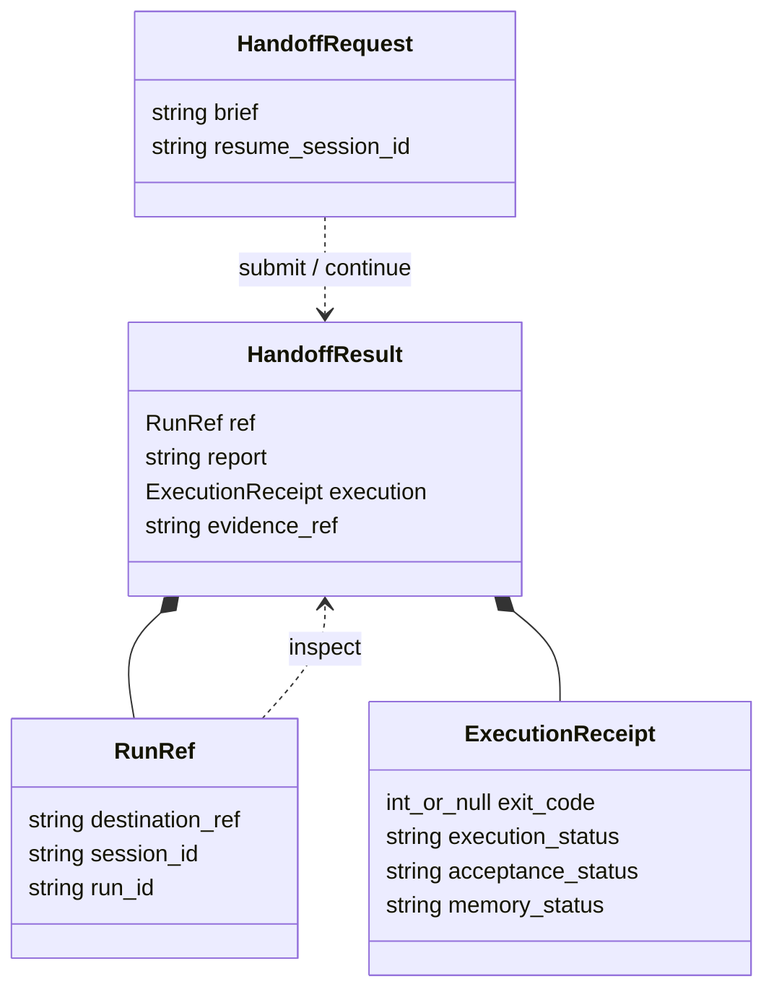

# External-agent handoff implementation notes

Status: implemented launcher boundary. Scope and user-facing decisions live in
[the main guide](external-agent-handoff.md). The
[Skill reference](../skills/agent-host-tasks/references/handoff.md) documents the
flags, output and recovery behavior. Raw callers retain their existing modes.

## Existing foundation

- `skills/agent-host-tasks/SKILL.md` defines routing and acceptance responsibilities.
- `skills/agent-host-tasks/scripts/chat.py` loads the private destination and
  managed provider environment, forwards a message and optional resume ID, and
  preserves the child exit code. Its default output remains NDJSON events;
  `--format result` adds a compact result and private launch evidence.
- `scripts/results.py` projects observed events and canonical `run show` output.
  `--inspect` reads evidence without loading provider credentials or starting a
  model; `--resume-from` checks destination options and the observed process exit.
- `chat --resume` starts a new turn. `run show` and `run events` inspect existing
  records. The saved configuration must select the same Host for both operations.
- CLI chat owns a separate state home; it is not a client of the running channel
  service. Keep the dedicated Agent catalog and native profile.
- Installation already links the Skill into supported external clients. Existing
  independent runtime bundles may need an explicit source update.

No new durable business-task entity is necessary for this increment. Session IDs
provide conversation continuity, and Run IDs identify execution attempts. This
does not implement the separate [development workflow](development-workflow.md).

## Skill responsibilities

Make the discovery description explicitly recognize Agent-Host / agh delegation
and clear, authorized work. Keep ambiguous design with the external agent.
Bounded analysis is eligible when its question and deliverable are clear.

Show a short happy path first: submit a brief, wait, read the report, verify.
Move configuration and recovery details into the existing reference. The caller
must not have to assemble runtime flags during normal use.

The receiving agent should execute directly and return a concise report with
outcome, changes, evidence and unresolved decisions. This is an instruction for
the receiving agent, not a parser that labels arbitrary prose as success. The
external agent reads and checks the report before claiming business completion.

Distinguish three causes of a blocker: missing task detail/decision, unavailable
runtime capability, and a tool/account permission denial. Carry the user's
existing authorization into the brief without asserting that it can override
native restrictions. Resolve only the actual gap; do not impose a fresh approval
step solely because the request was delegated.

## Thin launcher boundary

Prefer extending the configured launcher over adding another service or a new
general-purpose task CLI. Provide these behaviors through that entry point:

| Operation | Behavior |
| --- | --- |
| Submit | Run one brief against the saved destination and return a report with evidence references. |
| Inspect | Read existing progress/results without invoking a model or starting work. |
| Continue | Send a resolved decision or bounded follow-up using the observed session identity. |

Retain the process exit, actual IDs, execution/acceptance/memory outcomes and
worker reply separately. Include model, elapsed time and cost only when observed;
missing metrics remain unavailable. Do not derive business success from exit zero,
the final event or the presence of memory records.

Evidence should survive an interrupted caller and be discoverable while work
runs. Reuse Host records where possible; avoid duplicating a full history store.
If a small local launch receipt is needed before a Run ID exists, keep it private
and retain the destination reference. Never persist credentials in receipts.

Use the native result for the final reply when available. Streaming commentary
and memory extraction text must not accidentally become the worker's final
answer. Incomplete output is partial evidence, not a fabricated terminal result.

Inspect before resuming after interruption. A missing final report does not prove
that the child stopped or that no side effects occurred. Runtime lock failures
remain explicit; do not create another home, switch providers or replay work.
Cancellation uses existing process controls; a durable cancellation service is
outside this scope.

## Caller lifetime implementation

CLI `chat` binds its context to its initial parent process unless `--detach` is
explicit. Parent reparenting cancels the context within roughly one second. The
configured launcher passes its own caller as `--caller-pid`, so both the launcher
and the process that invoked it are monitored. A caller behind a persistent
wrapper can supply an explicit supervising PID instead. Channel service entry
points are unaffected, and closing a Web tab does not close its server process.

The additional caller is pinned to the observed PID and process start time from
`/bin/ps`. A missing/zombie process, changed start identity, or failed bounded
probe cancels execution; an unverifiable caller at startup prevents dispatch.
The direct parent uses the parent relationship, which does not mistake PID reuse
for continuity. Start-time resolution follows the OS `ps` output; this is process
liveness, not a conversation heartbeat. Watching an alive wrapper alone cannot
detect a conversation closing inside it.

Caller loss uses context cancellation, retains its cause in the canceled Run,
and invokes existing native process-tree cancellation. It does not signal the
caller or select other tasks by command text. Already reparented background jobs
and remote daemons are outside that owned tree. Local archives and other partial
effects remain untouched. No automatic replay or resume occurs.

The launcher saves `caller: {policy, pid}` in its launch receipt and result;
read-only inspection exposes it without executing work. Destination comparison
excludes these per-launch values. Continuation defaults back to caller-bound
execution rather than inheriting an earlier `--detach`. If the launcher itself
is killed, Host can still persist cancellation, but the launch exit remains
unobserved until independently established; inspection does not invent an exit.

Regression coverage re-executes real processes, exits and SIGKILLs their parent,
kills an explicit caller without reaping it, and verifies canceled Run evidence,
skipped memory, child-process termination and unrelated-process survival. An
explicit detached worker survives parent loss and finishes normally. Launcher
tests cover policy receipts, raw/result forwarding, continuation and invalid
flag combinations. These use isolated fixtures, not production tasks.

## Caller binding audit (issue #12)

The 2026-10-27 reports name watched PIDs 67311 and 79133. Their original
combined error establishes cancellation after a failed identity check, but does
not distinguish process exit, zombie state, PID reuse or probe failure. Deployment
supervisor 69628 remaining alive does not establish ownership of either handoff.
The historical root cause remains **unverified**: this investigation environment
has no default `~/.config/agent-host/task-handoff.json`, and the referenced private
handoff directories were not located through that configuration. No raw records
are published and no production runtime was operated.

The source establishes this binding for Codex exec / RTK / Python chains:

- Python captures its parent PID and passes it as `--caller-pid` by default.
  There is no Codex or RTK ancestor discovery. An `exec` replacement preserves
  the PID; a wrapper that spawns Python and exits does not preserve ownership.
- Host independently watches its direct parent (normally Python) and the nominated
  caller's `ps lstart` identity. Explicit `--caller-pid` replaces only the second
  binding; it cannot keep work alive after the Python launcher exits.
- A persistent host wrapper must keep the launcher alive, retain the child handle
  and collect its real exit across yields. Supply a verified owning supervisor PID
  only when that process actually retains the execution. A shared app PID or an
  ancestor's name alone is insufficient. This API checks liveness, not ownership
  authorization or a conversation heartbeat.

Cancellation diagnostics now retain the selected PID, binding reason and initial
start identity, distinguishing changed identity from probe failure. Probe failures
separately identify timeout/cancellation, zombie and missing parseable identity;
`ps` exit failure alone is **not proof of process exit**. Parent loss records the
observed parent PID. Diagnostics exclude process arguments, environment values and
raw probe output. Existing one-second polling, timeout and fail-closed cancellation
remain unchanged; start identity still has the OS `ps` time resolution.

Isolated real-process fixtures cover parent exit/SIGKILL, nominated caller loss
with the immediate parent alive, and a live owning ancestor retaining a blocked
execution over multiple poll intervals before collecting successful completion.
Fake probes cover changed identity and transient unverifiability without PID reuse
races. Existing terminal-state and launcher tests cover refusal to resume canceled
work, inspection and partial evidence. These bounded fixtures do not certify a
573-second Codex/RTK observation or identify the historical wrapper chain.
This worktree sandbox denies `/bin/ps`; the real-process lifecycle test therefore
uses its existing explicit skip, and must be run in an environment permitting
process listing before claiming runtime acceptance.

For a future authorized reproduction, retain locally the launcher/Host/caller
PID and PPID, start identity and timestamp at launch and failure, the owning tool
session/child handle and collected exit, plus the precise probe outcome. Correlate
these before proposing policy changes. Inspect canceled runs and any partial
effects independently; never replay deployment or messages to recover observation.

## Data structure sketch

These boundary shapes are expressed in Go for readability; the implementation
uses Python dictionaries, not new Go runtime entities. The task brief and worker
report remain text. The request maps to CLI arguments; the result is JSON.



```go
// A nonempty ResumeSessionID continues an observed session with a new turn.
type HandoffRequest struct {
    Brief           string `json:"brief"`
    ResumeSessionID string `json:"resume_session_id,omitempty"`
}

// DestinationRef identifies saved local configuration, never credentials.
// IDs are null until observed; retain replacement IDs returned by Host.
type RunRef struct {
    DestinationRef string `json:"destination_ref"`
    SessionID      *string `json:"session_id"`
    RunID          *string `json:"run_id"`
}

// Copy Host outcomes as observed; unknown values stay absent.
// Host acceptance is not the external agent's independent verification.
type ExecutionReceipt struct {
    ExitCode         *int   `json:"exit_code"`
    ExecutionStatus  string `json:"execution_status,omitempty"`
    AcceptanceStatus string `json:"acceptance_status,omitempty"`
    MemoryStatus     string `json:"memory_status,omitempty"`
}

type HandoffResult struct {
    Ref         RunRef           `json:"ref"`
    Report      string           `json:"report"`
    Execution   ExecutionReceipt `json:"execution"`
    EvidenceRef string           `json:"evidence_ref"`
}
```

`Brief` contains objective, target, context, authorization and completion checks
in natural language. It is assembled by the external agent, not by the user.
`Report` contains the worker's outcome, actual changes, evidence and blocker. Do
not parse a `done` keyword into verified success. Before a final answer exists,
the report can be empty; inspect exposes progress through the evidence reference.

Submit and continue use the same request shape; only continuation includes a
session ID. Inspect takes the observed run reference and reads existing records.
Before a Run ID exists, inspect the local launch evidence instead. Missing exit
code means unobserved, including a still-running or interrupted caller; it does
not mean zero or stopped. Run IDs, session IDs and evidence references are
returned by the system, never invented by the external agent.

No separate `Task`, `Approval` or `Queue` structure is needed in this increment.
The caller's verification remains its responsibility, outside this execution
receipt. The result also includes `warnings`, observed `model`, measured
`elapsed_ms`, and `cost_usd` (currently null). A local `launch.json` stores the
original inspection destination and process outcome, `events.jsonl` and
`stderr.log` retain launch evidence, and `result.json` is the final snapshot.
Inspection reads fresh Host records and does not rewrite that snapshot. Launch
directories are private and existing directories cannot be overwritten.
Nonzero exits also include a bounded `stderr_tail`, so pre-run errors remain
visible. `requested_session_id` records continuation input separately from
actual returned IDs. The Host may refuse a session whose prior execution is
`unknown`; the launcher retains the error and never starts a replacement turn.

## Focused validation

Exercise the complete caller-to-Host path with a harmless bounded task and a
continuation. Check the changed launcher with fixtures for failure and partial
output before using the configured runtime. Required observations:

- A completed turn containing a blocked report is presented as blocked work.
- Actual changes and permission-denial evidence survive nonzero exits.
- Inspect starts no execution; continuation preserves the destination and uses
  the actual returned identity, even if the runtime replaces a native session.
- An interruption retains evidence and triggers no automatic replay.
- Memory failure does not cause successful business work to execute again.

Test authorization wording with a harmless or simulated action. Do not perform
the screenshot's production disk expansion as validation of this design.

### Validation recorded on 2026-10-19

`make check` passed. The final launcher suite passed 15 tests, including real
subprocess termination, blocked reports, unavailable inspection, changed
destinations, pre-run failures and canonical Host output. Skill validation passed.

The configured CLI was also exercised from an external Codex session. Private
evidence is under the configured `handoffs/` directory; these are local acceptance
records, not a general provider reliability claim:

| Evidence directory | Observed outcome | Exit | Measured launch time |
| --- | --- | --- | --- |
| `handoff-9rp78ger` | Read-only review failed with malformed native JSON; only Read tool activity, no final review report. | 1 | 206.576 s |
| `handoff-i6dv4f39` | Report-only continuation was rejected because the preceding execution was unknown; no new run created. | 1 | 0.124 s |
| `handoff-6bqgwswm` | Harmless word-recall setup completed with no tools and unchanged memory. | 0 | 13.500 s |
| `handoff-70b0_pxt` | Continued the same session and recalled the word with no tools and unchanged memory. | 0 | 16.269 s |

The successful pair used Host session `fc0e9e9e-3be4-45f6-b945-4ce2d6368855`,
with distinct runs `a4a87a15-194d-406d-89b3-e24eaf9ce295` and
`63395397-de5a-4aeb-a8a7-b9c77c63037d`. The failed review used session
`fc787622-1c92-4c65-b89f-17a6b7187687`, run
`015a559e-e435-4416-ae45-2f4451df9888`. Observed execution model was
`claude-sonnet-5`; no model was observed on the rejected pre-run continuation.
Cost was not collected and remains unavailable. Inspection while the first run
was active returned its running state and a null process exit without launching
another task. The native review failure was not accepted as a code review;
local diff review and tests provide the implementation acceptance evidence.
