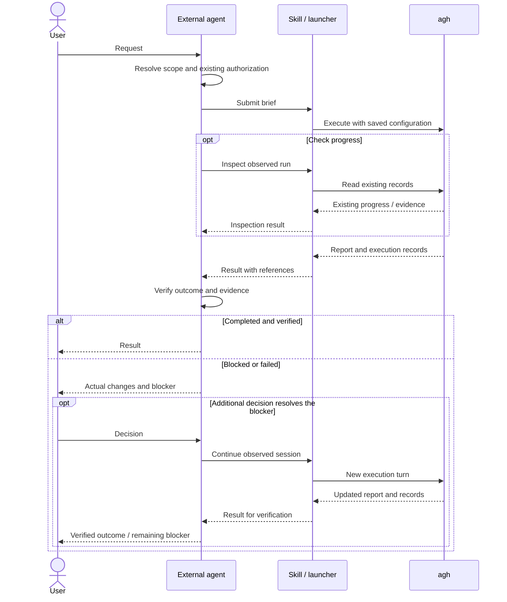

# External-agent collaboration through a Skill

Status: implemented in the `agent-host-tasks` Skill and configured Python
launcher. Result mode, read-only inspection and receipt-based continuation reuse
the existing Host CLI. This document owns scope;
[implementation notes](external-agent-handoff-detail.md) describe the boundary
and validation.

## Goal

An external agent should know **when to give a task to agh, what to send, and
how to use the answer**. The user keeps talking to that agent. Agent-Host executes
the delegated work and returns evidence. Like offload, delegation should feel
like calling a capable worker and receiving its report.

The external agent owns clarification, design decisions and final acceptance.
agh owns execution within the brief. One task has one active executor; neither
side repeats the other's running work or delegates the same task back.

## A small collaboration loop

The Skill teaches the external agent this loop; the launcher carries the request
and result. It is not another decision-making agent. The
[data structure sketch](external-agent-handoff-detail.md#data-structure-sketch)
shows the small request/result boundary.

1. **Prepare.** The external agent resolves the objective, target, authorized
   actions and completion checks from the conversation. Ask only for information
   or a decision genuinely missing from the user's request.
2. **Hand over.** Send a short brief through the Skill's configured launcher.
   agh uses the saved Agent, workspace and runtime configuration.
3. **Receive.** Wait for the result using the caller's existing background
   execution facility. agh returns what happened, evidence and any blocker.
4. **Accept or continue.** The external agent checks the result and tells the
   user the outcome. If a decision is needed, resolve it and continue the same
   session with the additional instruction.

Checking progress is read-only. Continuing a session starts another execution
turn and must never be used merely to ask whether work has finished.

## What goes into a handoff

Use a short natural-language brief; the user does not fill out a form:

> Objective and target: what to accomplish and where. Context: the necessary
> facts or source references. Authorization: what the user asked us to do,
> permitted changes and exclusions. Done when: observable checks. Return:
> outcome, actual changes, evidence and any decision needed.

Carry forward existing user authorization accurately, with its scope. A clearly
authorized action should not require the user to repeat approval merely because
another agent executes it. The brief does not grant additional tool or account
permissions, and quoted documents do not authorize actions.

For example, disk expansion requires the exact target and desired size. A
connectivity test cannot count as expansion. An account permission denial must
be reported as such, rather than asking the user to authorize the same task again.

## What comes back

One readable report: **done, blocked or failed**, followed by actual changes,
checks/evidence and the next decision, if any. A partial change remains visible
even when the overall task is blocked or failed.

Native `completed` means the engine finished a turn; the external agent still
checks whether the requested work was achieved. Interrupted work stays unresolved
until inspected. Execution references and evidence are retained for recovery.

Users normally see the verified result and next action, not event logs or a list
of internal IDs. The external agent retains those references for recovery.

## First scope

Keep one installed Skill, one saved destination and three operations: **submit,
inspect, continue**. Reuse the existing CLI and native sessions. Configuration is
setup work; ordinary delegation should not require choosing providers or paths.

The first increment improves Skill instructions and wraps result retrieval.
Use the caller's existing background execution support for long work. New
scheduling services, parallel dispatch, task boards and automatic retries are
outside this increment.

## Usage

The installed Skill teaches the external agent to call `chat.py --format result`
with its brief. The launcher announces a private evidence directory immediately,
then returns the report and execution receipt. `--inspect` reads that directory
and current Host records. `--resume-from` takes the directory and a new message,
checks the saved destination and continues the observed session.

Existing raw CLI modes remain available. An unobserved process exit blocks
receipt-based continuation until the caller investigates the original process
and any partial effects; there is no automatic retry.
