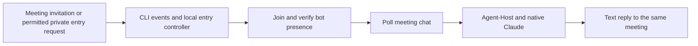

# Feishu meeting text channel

Status: fixed-meeting text chat passed its two-turn live acceptance on
2026-10-12. Opt-in automatic entry passed repository checks; successful live
automatic entry is still pending. [Implementation details](feishu-meeting-channel-detail.md)
record both validation stages and the recovery boundaries.

## Goal and use

Host a visible Feishu meeting bot through Agent-Host. After the bot joins, an
allowed user types `AI: question` or `AI：question` in meeting chat and receives
the final text answer there. Follow-ups share that meeting's conversation;
different meetings have separate context and memory.
Text replies include the actual model and measured execution time when available.

With `auto_join: true`, an allowed user can invite the bot inside a meeting or
send it a meeting card, supported meeting link or nine-digit meeting number in
private chat. The host joins, checks that the bot is present, then starts the
existing meeting-text receiver. Ordinary private messages do not become model
chat. Entry controls use official CLI event delivery; meeting questions still
use polling at an interval of at least five seconds.

Feishu credentials stay in the selected `lark-cli` profile. Agent-Host supplies
routing, context and durable execution; the existing native Claude harness
supplies the model/tool loop. No Node sidecar or additional model server is
needed for this text path.



## Enable and start

Use a Unix host with an authenticated CLI profile, a meeting-bot beta app,
published join, meeting-read and message-write permissions, and a meeting that
allows agents.
Automatic entry also needs the invitation/end events and private-message event
enabled. The [details](feishu-meeting-channel-detail.md#entry-events-and-platform-configuration)
list their exact names and permissions.

Copy [the automatic-entry example](../config/feishu-meeting-auto.example.json)
into a private file with mode `0600`. Fill in the profile, application ID, bot
Open ID, actual tenant ID and permitted human Open IDs. Leave `meeting_id`
absent to wait for invitations. Prepare native Claude authentication and the
existing Jev provider credential, and use a separate state home for this trial.

```sh
rtk make build
rtk ./bin/agent-host feishu-meeting check --config /absolute/path/feishu-meeting.json --home /absolute/path/feishu-host-state --workspace /absolute/path/project
rtk ./bin/agent-host feishu-meeting serve --config /absolute/path/feishu-meeting.json --home /absolute/path/feishu-host-state --workspace /absolute/path/project
rtk ./bin/agent-host feishu-meeting status --home /absolute/path/feishu-host-state
```

`check` validates local prerequisites without API/model calls. After the entry
listener reports connected, invite the bot or send `/join 123456789` privately
(replace the example number). Wait for that meeting's text receiver to report
ready, then send `AI: 请帮我整理本次讨论的待办。` in meeting chat. Replies are
visible to all participants. `AI: /new`, `AI: /status` and `AI: /help` use the
existing Host controls.

To keep manual entry, use [the fixed-meeting example](../config/feishu-meeting.example.json)
with a long `meeting_id` and omit `auto_join`. Join explicitly before serving.
When automatic entry has a `meeting_id`, it is an already-joined seed: the host
verifies it and starts polling without issuing another join.

An independent managed runtime can retain model/provider settings: set
`"channel": "feishu-meeting"` in `ROOT/config/service.json`, put this channel's
configuration in `ROOT/config/feishu-meeting.json`, then use
`./bin/agent-host service check --root ROOT` and `service run --root ROOT`.
The [managed layout](feishu-meeting-channel-detail.md#managed-runtime) reuses the
existing private environment and native profile. Serving remains foreground;
OS installation and automatic startup are separate work.

## Scope and recovery

Automatic entry permits at most four active or uncertain meetings. The sender
allowlist also controls who may invite the bot. A fresh invitation to the same
meeting checks current bot presence: an absent bot joins again, while a present
bot keeps its current receiver. Deduplication does not permanently block a
meeting after the bot exits. Each meeting starts from a
history baseline; chat sent before readiness or while the service was stopped
does not become a new task. Interrupted join attempts and uncertain replies
remain inspectable and are not repeated automatically.

A meeting ending, confirmed bot removal or its polling failure stops that
meeting's local runtime. Other meeting runtimes remain independent. The host
does not end anybody's meeting or automatically eject the bot on service
shutdown. Saved questions, runs and delivery outcomes remain local evidence.

## Voice follow-up

This implements TAT text entry and conversation. Voice still requires Feishu's
enabled bidirectional audio channel and protocol, a streaming voice model or
speech-recognition/synthesis pipeline, and turn/interruption handling. Adding a
model setting alone cannot make this bot audible. The
[official meeting guide](https://github.com/larksuite/channel-sdk-python/blob/main/docs/meeting-channel.md)
also describes pushed meeting activities; this implementation keeps meeting
text on CLI polling.
