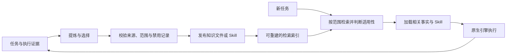

# 文件记忆与经验 Skill

状态：2026-10-13 新架构提案，尚未实现或迁移。本文约定新方案范围；
实现细节见[详细稿](file-memory-design-detail.md)。当前服务仍使用 SQLite 记忆。
目录与 `USER.md` 等上下文文件见[workspace 设计](workspace-layout.md)。
本方案替代旧方案中“SQLite 记忆是权威来源、Skill 只是导出”的目标约定，
已有执行与验证记录继续作为历史基线。

## 目标与使用方式

让 Agent-Host 把有依据的处理经验沉淀成可复用 Skill，把事实、偏好和决策
保存为可阅读、可维护的文件。Host 管理沉淀、检索、适用范围和更新；
Claude Code 等原生执行引擎负责执行。渠道接入、任务路由和交付继续由 Host 管理。

用户照常提交任务。下一次遇到相关问题，Host 找到适用的知识与 Skill，
让执行引擎按需使用。用户可以查看正文、来源和版本，修改内容或禁用不合适的经验；
修改经过校验后生效，不要求用户逐条批准正常沉淀。

例如：一次有实际验证结果的钉钉连接排查，可以沉淀为“连接排查 Skill”；
“用户希望中文回答”保留为偏好；“当前部署使用哪个环境”保留为项目事实。
临时任务进度、消息送达状态和原始日志继续属于运行记录。

## 核心方案

| 内容 | 保存位置与用途 |
| --- | --- |
| 处理方法 | `memory/` 下的 Skill 包，包含适用条件、步骤、失败经验和验证方法 |
| 事实、偏好、决策 | `memory/` 下的知识文件，包含归属、来源和有效状态 |
| 历史版本、禁用记录 | 同一记忆目录内的文件，用于纠正、追溯和防止重新启用 |
| 运行记录与证据 | 现有渠道状态数据库及关联文件，保留任务和来源身份 |
| 检索索引 | Host 管理的 SQLite 派生索引，能从知识文件重建 |
| 外部资料 | 现有 `knowledge/` 和数据源插件，按需搜索与读取 |

配置仍统一放 `.agent-host/config/`，新增知识沉淀放 `.agent-host/memory/`。
沉淀 Skill 的正文保存在 `memory/domains/<domain-id>/skills/<skill-id>/revisions/<revision>/SKILL.md`。
手写 Skill 与 Agent/用户原文放 `config/`，任务上下文视图放 `cache/workspaces/`。
渠道目录保留渠道运行数据，workspace 保存任务文件与产物。
文件存放在同一个根目录，不代表钉钉、飞书、不同 Agent 或群聊自动共享记忆。
首期保留现有项目、Agent、audience 和默认渠道范围；跨渠道共享单独授权与验证。

## 沉淀与检索

事实沉淀保留用户陈述等来源的原始性质。经验沉淀只选择有证据支持的可复用方法，
保留前提、观察到的失败路径和验证结果；执行引擎说“完成”不等于业务成功。
继续采用独立提炼、Jev 选择和 Host 校验，选中内容自动发布；失败可从已有证据重试。
不把每个任务都强行变成 Skill，也不自动把搜索到的外部文档变成执行指令。

检索先限定允许的范围，再用全文、对象、别名与主题索引找候选，最后检查适用条件。
少量适用偏好和关键事实自动进入上下文；Skill 先提供简短说明，选中后再加载正文。
支持执行中继续查询知识与来源，避免只依靠任务开始时的一次召回。
长文档按段索引，并保留完整文件与版本引用。

首期完善中英文全文召回和检索质量评估。向量检索留到明确观察到语义漏召回后加入，
作为候选补充，仍需通过范围与适用性检查。取消当前单范围超过 100 条就阻止运行的
实现限制；新的数量与性能承诺以代表性数据测试为准。

纠正生成新版本；禁用和过期内容不进入后续任务。禁用记录保留原 ID、原因和来源，
也在新内容发布前用于拦截等价经验，无法判断时暂不发布并显示原因。
已运行的任务保留它当时收到的版本，后续任务使用新快照。

## 本期范围与实施顺序

1. **文件存储与可回退迁移**：定义文件格式和版本发布，试迁移现有记忆；保留 ID、
   范围、来源和禁用状态，完成一致性与回退验证。SQLite 继续负责运行状态。
2. **检索与上下文接入**：实现可重建索引，接入现有自动召回、查询工具和查看入口；
   验证纠正、禁用、中英文召回、数据增长及多渠道隔离。
3. **自动经验沉淀与 Skill 使用**：完善发布与禁用拦截，直接生成有依据的 Skill；
   验证 Claude 的原生发现、加载、实际使用和更新后的会话切换。
4. **小范围运行验证与切换**：先使用隔离环境，再迁移实际运行数据；记录保存、
   复用、纠正、禁用和故障恢复的完整证据。

首期不增加自动生成并运行的脚本、Skill 市场、公开发布或跨渠道隐式共享。
Codex 适配、外部文档统一增量索引和日常对话自动学习后续按具体需求推进。
知识存储采用一个内置实现，暂不设计公共存储插件接口。

## 完成标准

一个新会话能使用上次任务的事实和处理方法，并能查看来源；纠正或禁用影响下一次
任务；不同范围之间没有额外泄露。删除派生索引后能够重建，恢复发布无需重跑业务
操作。迁移可核对、可回退。原生 Skill 被发现、被使用和是否改善结果分别验证。
设计完成不代表这些能力已经交付。
