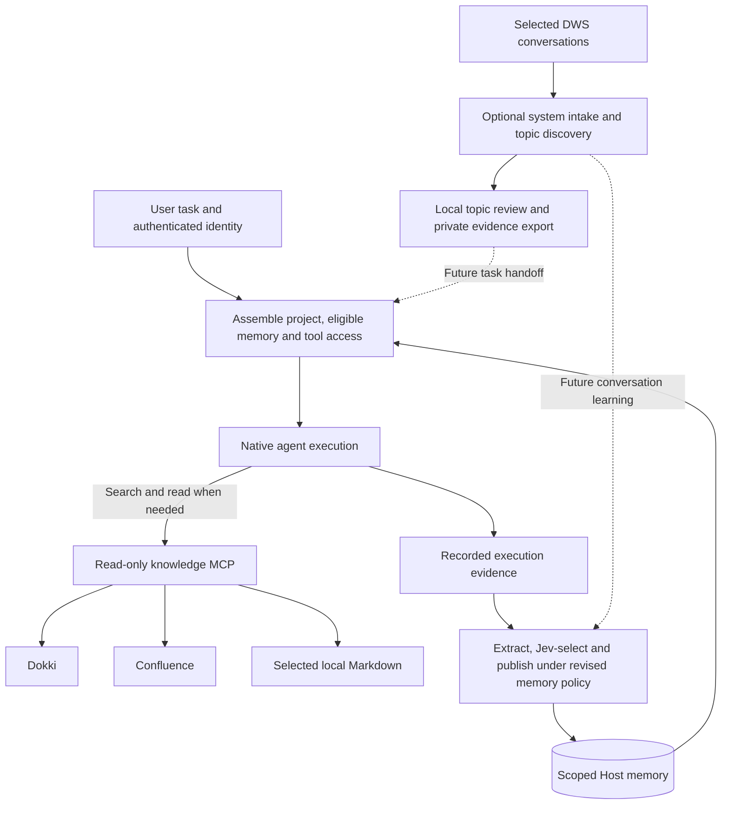

# External knowledge and everyday experience

Status: Dokki and Confluence runtime MCP integration is implemented. The
[local Markdown increment](local-knowledge.md) adds selected project documents
and private retained notes; its acceptance is tracked separately. A bounded
live DWS private-chat retrieval check passed on 2026-10-11. Real selected-DM
collection, native topic extraction and owner-private review/acceptance also
passed that day; the
acceptance report (private validation evidence)
records the bounded result. Conversation-derived learning remains deferred.
Independent
[Host history tools](conversation-history.md) use saved Agent interactions
without DWS. The [architecture](architecture.md) defines ownership;
[implementation notes](knowledge-sources-detail.md) separate offline checks, live
acceptance and remaining scope.

The [built-in DingTalk workspace](dingtalk-workspace.md) adds an optional embedded
official worker for selected-source collection, without installing `dws`.
Historical live evidence above belongs to the external-CLI path; the new
embedded path has separate automated checks and pending live acceptance.

## Goal and usage

Let an agent consult existing company knowledge when needed. Separately, let
the system discover topics and propose reusable lessons from selected daily
problem-solving conversations even when Agent-Host did not execute that work.
Keep the existing memory loop for Host-run tasks.

| Source | How it enters Agent-Host | What the agent receives |
| --- | --- | --- |
| Dokki | Read-only MCP tools provided globally by enabled datasource plugins | Search results and source documents, requested during execution |
| Confluence | Runtime tools with its own source and credentials | Search/read pages and blogs; authorized create/update, preferring the personal blog for managed content |
| Local Markdown | Explicit files/directories under a configured source root, available globally through enabled datasource plugins | Bounded search results and document excerpts with relative references |
| Daily DWS conversations | Optional system collection of explicitly selected conversations and local topic review | Bounded owner-private evidence export after explicit acceptance; learning remains planned; no general DWS task MCP |

Each configured source remains authoritative for its documents. Startup supplies
short source descriptions and available tools; it does not search these sources
or add document bodies to the prompt. The native agent decides when to search
and which result to read. Search does not automatically publish a memory.
When an answer uses relevant external articles found during retrieval, it appends
clickable title links after the supported passage or in a short Sources list.
Local memory files and local knowledge paths remain internal context and receive
no visible citation or attribution to internal notes; their content is used
naturally without naming local note titles. A recorded original external article
URL may be included when it supports the answer. Without one, omit the internal citation silently;
do not add a link-unavailable notice or search only to manufacture a citation.
Long documents are read in bounded excerpts. Continuing a read checks the
previous content digest so a changing document cannot silently mix versions.

The daily-conversation path uses an optional background worker and bounded source
cache to group related messages into topic proposals. Discovery starts no task
and sends no reply; explicit acceptance exports selected, cited owner-private
evidence for the configured project. Automatic task handoff and a separate
automatically selected episode-learning path remain planned. Raw chat history
stays out of automatic task context.
Future learning follows the [memory policy](experience-memory.md): Jev-selected
lessons become effective automatically, with a blacklist for later disabling.
Existing topic acceptance exports source evidence; it is separate from memory
publication and retains its current behavior.

## Core approach



The host assembles **access to knowledge** before execution. The native harness
assembles **document content** into its conversation through tool calls during
execution. Agent-Host continues to own evidence, selection and durable memory; it
does not take over the harness's tool loop.

For example, an agent investigating a deployment issue can search the current
Confluence procedure and read the relevant Dokki explanation. Separately, a
selected DWS discussion may show that a colleague solved a similar issue by
changing a configuration. A selected lesson can retain that procedure with
“reported resolved by the participant” attribution. Later observed test results
can add stronger evidence without rewriting what the original discussion proved.

## Decisions for this extension

- **Mount tools, retrieve content on demand.** Reuse memgov's concrete Dokki and
  Confluence connector logic in Agent-Host's own MCP process. Enabled
  datasource plugins are mounted globally
  at native session startup; tool use happens later. Effective configuration
  changes replace incompatible native sessions.
- **Expose selected local material through the same tools.** Keep business cwd
  separate from source roots. Configured retained notes are available to every
  task audience through an enabled datasource plugin, with originals and
  versions preserved. Reading a note
  does not turn it into learned memory; see [local knowledge](local-knowledge.md).
- **Use a separate DWS intake.** The current application-bot channel only sees
  messages addressed to the bot. Daily communication intake uses the configured
  DWS user's authorized source access and never turns observed messages into
  task requests or automatic replies. It is a system topic-discovery/learning
  path, not a general chat-reading runtime MCP. Agent conversation recall first
  uses the independent built-in [Host history design](conversation-history.md).
- **Retain evidence strength.** A suggestion, a participant's confirmation, and
  an observed tool result are distinct. Silence does not establish resolution.
  Jev selection publishes a useful lesson under the revised policy; it does not
  certify external success.
- **Keep scope explicit.** Begin with one owner, selected conversations and
  explicit project mappings. Unmapped episodes await classification. The owner
  seeing a conversation does not make its lessons available to every project
  or future group audience.
- **Reuse automatic selection and the blacklist.** Background experience has its own
  source and processing job. It must not invent a completed agent run to enter
  memory. Corrections or source withdrawal suspend affected lessons for
  reassessment without requiring human memory acceptance.

## Scope and implementation order

1. Add runtime MCP source selection for Dokki and Confluence. Prove search/read
   from a native Claude task, source attribution, visible failures, and source
   isolation; confirm no document fetch occurs before a tool call. **Implemented;
   validation is recorded in the details.**
2. Add independent Host history and selected-source DWS collection, durable
   evidence, topic proposals and restart-safe processing. **Both routes are
   implemented; setup and validation are in the [history guide](conversation-history.md).**
   Polling reconciles history because the personal incoming stream omits
   self-sent messages. Selected-DM acceptance collected four messages into one
   native topic with four original citations, reviewed before explicit private
   acceptance. Reopened overlap added no duplicates. A partial window retained
   three messages and completed all four after its limits were raised, without
   executing a task, sending a message or publishing memory. Continuous polling,
   group noise quality and account-wide coverage remain unverified.
3. Add conversation-derived candidates to automatic selection and scoped recall.
   Validate a complete discussion-to-lesson-to-fresh-task loop, including corrections
   and exclusion of blacklisted, unresolved or inaccessible sources. **Deferred.**

## Enable the implemented knowledge tools

Copy the [configuration example](../config/data-knowledge.example.json) to a private
file. Unified startup uses `datasource.plugins.<name>.json` with `enabled`
and `settings`; sources need no project, audience, channel or Agent selectors.
All enabled datasource plugins are global. Legacy standalone `knowledge.json`
continues to accept project/audience selectors for compatibility. Provider token
files contain `{"api_key":"..."}` for Dokki or `{"pat":"..."}` for Confluence.
Configuration and token files must be owner-private. Local Markdown sources
use an explicit `root` and relative `paths` instead of an endpoint/token; their
[setup guide](local-knowledge-detail.md#configuration-and-selection) covers
default-workspace discovery and private snapshots.

```sh
agent-host knowledge check --config /absolute/private/path/knowledge.json
agent-host chat --knowledge-config /absolute/private/path/knowledge.json \
  --allowed-tools 'mcp__knowledge_dokki__*,mcp__knowledge_confluence__*' \
  -m 'Find the relevant API documentation and cite the original pages.'
```

The allow rules explicitly permit these two named MCP instances, including
Confluence page and blog creation and updates;
native permissions still govern other tools. `check` validates local configuration,
not remote authentication. The managed service uses the same file through
`knowledge_config` in its private `service.json`. Existing sessions rotate when
the effective source configuration or credential changes. Knowledge results stay
in the run evidence and are excluded from execution-experience publication.

This scope includes source status and review through local inspection first.
Company-wide ingestion, shared group memory, conversation-derived automatic
memory publication, full knowledge-base replication and a general plugin
platform remain outside the delivered source increment.
The [details](knowledge-sources-detail.md) identify reuse seams and acceptance
checks without committing to a public connector API.
