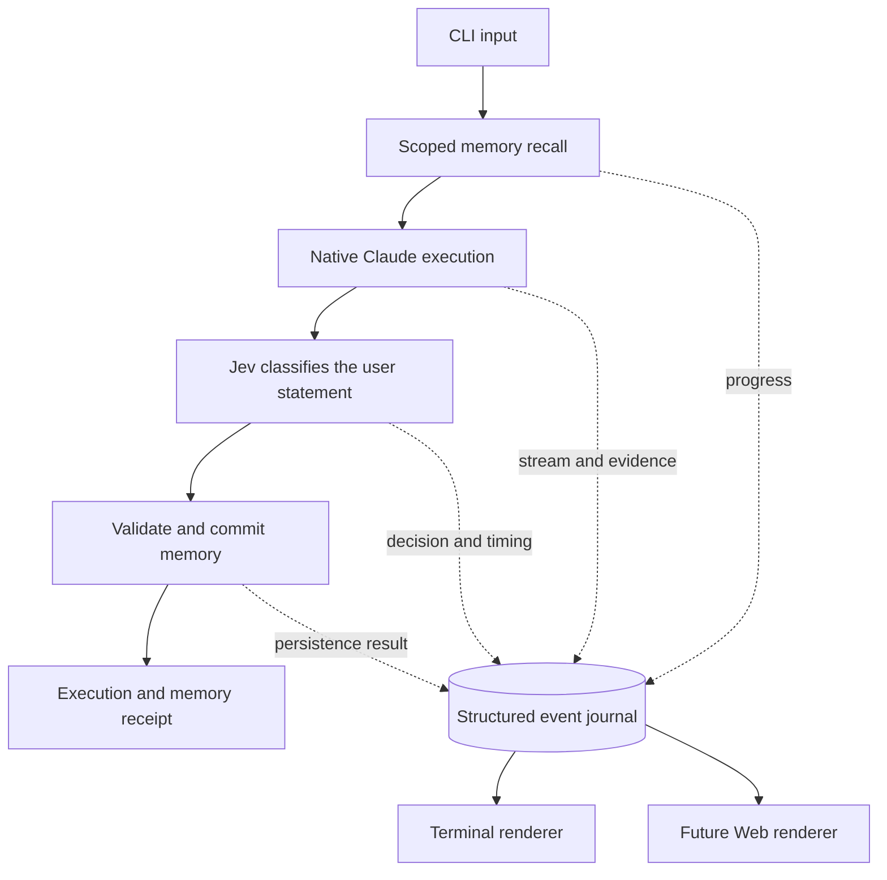

# CLI memory MVP

Historical MVP 1 baseline: narrow user-statement loop verified on 2026-10-10.
The current [reviewed experience extension](experience-memory.md) adds tool
evidence, separate extraction and manual review. Results below describe MVP 1. Four synthetic live
cases passed using native Claude Code and the company Jev gateway: save, fresh
session recall, conflict quarantine, and exclusion of quarantined memory.
This proves the integration path, not production semantic accuracy.

The later [DingTalk owner DM extension](dingtalk-channel.md), implemented on
2026-10-10, adds the first external channel and schema v4 with offline validation.
Its live platform acceptance remains open. Statements below excluding external
channels describe the historical MVP 1 scope, not the current product.

## What this validates

Agent-Host gives native AI work continuity across conversations. The host owns
memory and execution records; Claude Code owns its model/tool loop and native
permissions. The first useful proof is small: save a project-scoped user
statement, start a fresh native conversation, and reuse that statement with its
source identified.

Research supports three choices:

- Native structured events plus the final result and process outcome establish
  observable execution completion. A PID, changed file, or hook alone does not.
- Jev makes bounded typed decisions. The earlier company-gateway experiment
  showed useful classification, but also evidence-support mistakes and no
  demonstrated reranking gain. It is not a truth verifier or text extractor.
- SQLite can provide scoped records, transactions, and indexed recall for this
  local loop. Large-dataset latency has not been measured.

See the [research record](research.md) and [Jev evaluation](jev-evaluation.md)
for evidence and limitations.

## Using the MVP

Build with `make build`, configure native Claude authentication and
`TYPESAFE_API_KEY`, then run:

```sh
bin/agent-host chat
bin/agent-host chat -m "This project's release codename is Cedar."
bin/agent-host chat -m "What is this project's release codename?"
```

Each separate `chat` invocation starts a fresh host/native session unless
`--resume SESSION_ID` is supplied. Keep the same workspace and host state
directory to test cross-session memory. The terminal shows phases, components,
agent/model identity, elapsed time, tool activity, streaming text, and a final
receipt. `--format json` exposes the same events as NDJSON for another renderer.

Jev uses the official TypeSafe API by default. `--jev-provider custom
--jev-endpoint URL` explicitly selects your own gateway and requires
`JEV_API_KEY`. There is no automatic provider switch.

## The loop



Memory preserves the exact user statement and source run. Eligible statements
are single enduring preferences, project facts, adopted decisions, or
constraints. Questions, tasks, hypotheticals, transient progress, quoted
assistant claims, and uncertain eligibility decisions do not become durable
memory. Jev judges eligibility separately from the memory category: uncertainty
between a project fact and a constraint does not by itself discard an otherwise
eligible statement.
This first policy does not generate summaries or claim that external outcomes
were independently verified.

Existing statements are checked before adding a candidate. Duplicates retain
source links; contradictory or uncertain relationships quarantine the affected
statements from recall. The model cannot overwrite a fact or grant permissions.
Execution completion, business acceptance, and memory persistence remain
separate: a completed Claude turn still has acceptance `unverified`.

## Scope and next evidence

Included: one local owner, one Claude agent, interactive/one-shot chat, native
session resume, streaming events and replay, scoped memory inspection, and
explicit memory-only retry. A failed required step is visible; retry never
replays Claude's business operation.

This experiment is deliberately bounded: at most 100 existing scoped memories
per decision, 48 KiB of decision state, and 4 KiB per stored statement. Recall
injects at most eight active memories and 12 KiB of statement text. These are
MVP limits, not SQLite capacity limits. No vector retrieval, entity extraction
service, external channels, Web application, automatic conflict resolution, or
general agent orchestration is included.

The live report (private validation evidence)
records all four passing cases with fresh native configuration directories.
Every run streamed text before exit and persisted contiguous events. Automated
fault tests separately verify cancellation, malformed native results, SQLite
transactions, and memory retry without task replay. Native permission dialogues,
real tool side effects, broad Chinese quality, and scale remain unverified.
Commands, timings, retained failed experiments, and test evidence are in the
[implementation details](mvp-validation-detail.md).
