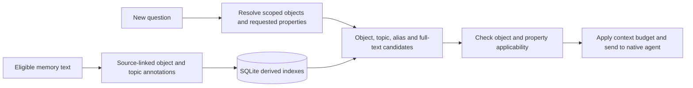

# Object-aware memory retrieval

Status: bounded implementation; validation results are recorded in the
[details](object-retrieval-detail.md). This extends the
[CLI memory loop](cli-memory-design.md), not its whole entity/event roadmap.

## Goal

Recall knowledge about the object and property the user asked for. A shared
word such as “database” must not mix facts about different services. Supported
paraphrases should find relevant knowledge even without literal word overlap.

## How it works

The same versioned Go rules process both saved text and incoming questions.
They identify explicit service names, source-declared aliases and a small topic
vocabulary. Original statements and reviewed evidence remain unchanged.

Object names ignore case. Within the same scope, system/service/tool labels share
one technical identity: `cbs`, `CBS` and `CbS` resolve to **CBS**. Latin letters in
object display names are uppercase, such as **TCCLI**; people retain their names.
People, projects and organizations keep separate identity namespaces. This
changes derived labels and indexes, preserving original commands and quotations.
Use qualified names for distinct technical products that share an acronym.

Every new native or external memory must identify a supported object before it
can be published. Host extracts missing subjects from the admitted statement and
its cited user/tool evidence using an isolated model call. Tools and products are
subjects of procedural lessons; global personal preferences identify their author.
An unresolved subject or extraction failure stops publication explicitly.

An external entry can also retain an explicit subject from source context.
This keeps a statement such as "The namespace is ops"
linked to its object without rewriting the original quote. Recall/read expose
the association and its source. Existing active memories can receive a versioned,
audited correction through `memory associate`; private evidence stays in Host
storage. See the [protocol](../skills/agent-host-memory/references/protocol.md#preserve-the-object).
Existing active records without subjects can be repaired with
`memory extract-objects` using retained evidence; this never reruns their tasks.



On writing, annotations and indexes are saved in the same transaction as the
memory. On reading, the host resolves the question against active knowledge in
the current project before selecting context. Unknown explicit service names
and ambiguous registered aliases remain visible; the host does not substitute
the closest service.

For example, “订单服务的数据库使用 PostgreSQL” links a service identity to the
database property. “订单服务（简称交易）” can supply an explicit alias. A query
about 交易 can then use that same identity. Two services claiming the same alias
remain ambiguous rather than being merged.

Credential rotation is a supported topic family. A broad credential question
may retrieve a digital-key rotation interval, while a specific password or
physical-key question must preserve that distinction. This is a bounded domain
rule, not a global claim that all credentials are equivalent.

## Use and visibility

Existing `chat` and `memory search` commands use the new retrieval path. Chat
shows query analysis and candidate filtering before native execution. JSON
records the source spans, rule version, retrieval routes and rejection reasons.
The same data can support a future Web view.

Run the expanded regression suite from the repository root:

```sh
./bin/agent-host eval --suite evals/memory-v2.json
```

The suite keeps every original label and adds counterexamples for aliases,
project boundaries, multiple objects, unknown objects and distinct properties.
Before/after reports use exactly the same suite fingerprint.

The fixed 26 recall cases improved from **13/26 to 26/26**. This includes the
original wrong-service match and missing credential-rotation result, plus
the added counterexamples. A real five-turn Claude/Jev run also admitted the
three source statements and supplied exactly the expected memory to each of
two fresh query sessions. These are bounded observations, not a general
accuracy or scale measurement. Reports and validation details are in the
[implementation record](object-retrieval-detail.md#validation).

## Scope and limits

This increment supports explicit service names, positive parenthetical aliases,
explicit attributed context associations, several configuration properties and credential rotation. It does not perform
unrestricted entity inference, arbitrary paraphrase understanding, pronoun
resolution without source context or vector search. Object extraction remains
model-dependent. Model-based admission and human experience review
remain separate decisions; Jev thresholds are unchanged.

A bare name that is absent from the current alias registry is not recognized
as an unknown object. For example, after withdrawing every declaration for
交易, “交易 数据库” can still retrieve database-topic records. Explicit
“交易服务” is recognized as an unknown service and does not borrow another
service's facts. Broader object recognition remains future work.

A writable open migrates old databases and derives annotations from existing
text without replaying native tasks. Read-only commands require the database
to have been migrated first. This remains a bounded local MVP; large-memory
performance has not been established.
