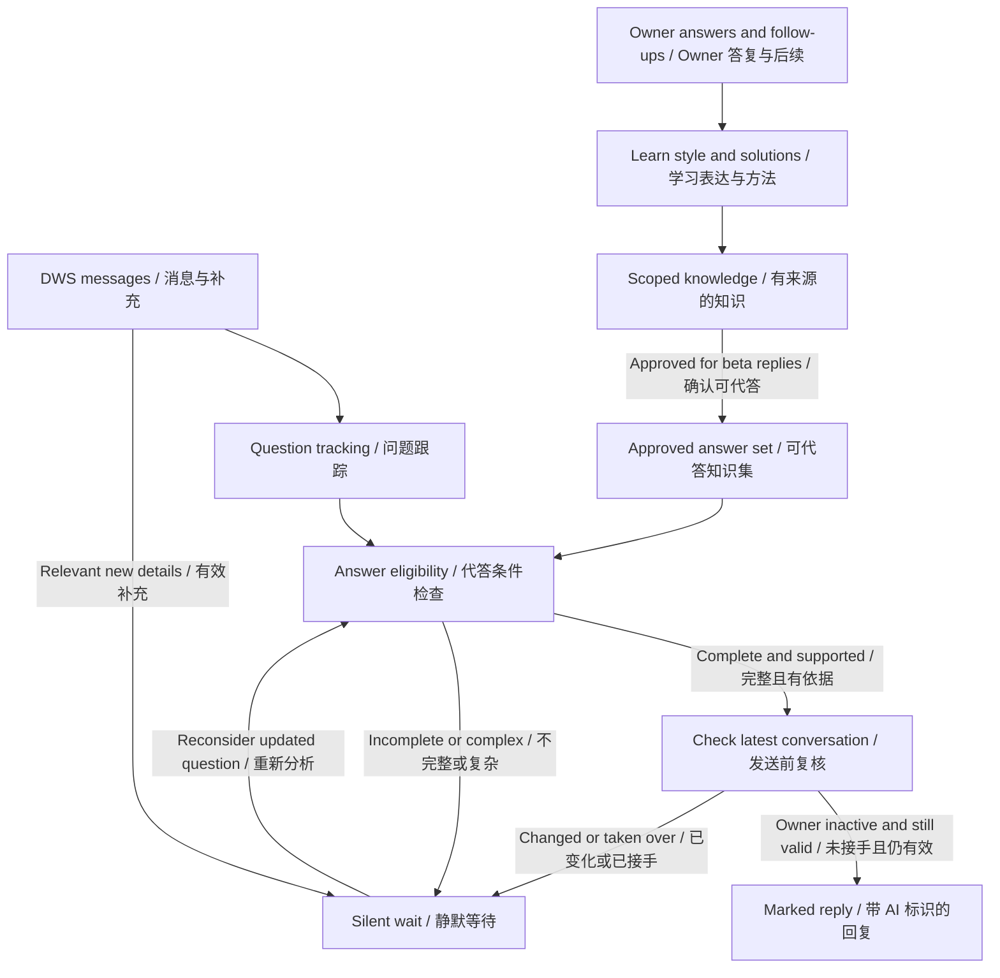

# Owner Answering Beta / Owner 代答 BETA

Status: proposed on 2026-10-16; not implemented or deployed. This design extends
[personal assistance](personal-assistant.md) and [DingTalk workspace](dingtalk-workspace.md).
[Technical notes](owner-answering-beta-detail.md) cover integration and validation.

## Goal / 目标

Treat questions addressed to the owner as opportunities for AI to help first.
Answer routine questions when a complete, current answer is already available.
Stay silent when context is missing, judgment is needed, or the owner is handling it.
Learn from the owner's actual conversations to improve later answers.

例如：同事问“测试环境的文档在哪”，AI 可直接给出已确认的链接；
问“线上报错，帮看一下”但没有环境和日志，AI 静默等待补充或 Owner 接手。

The eventual coverage is all eligible DingTalk questions addressed to the owner.
**The owner selected private-chat pilots first, then groups after validation.**
Each automatic reply carries a short **“AI assistant replying for Owner / AI 代 Owner 回复”**
marker, alongside the platform's existing AI identity marking.

DWS / DingTalk Workspace（钉钉个人工作空间）provides the owner's authorized
personal-chat access, separate from the application bot. The existing integration
polls selected conversations; account-wide real-time coverage is not delivered.

## Key objects / 关键对象

| Object / 对象 | Meaning / 含义 |
| --- | --- |
| Delegation / 代答授权 | The owner's policy allowing automatic replies in selected conversations and topics. Owner 为指定会话和问题范围授予的持续代答权限，无需逐条确认。 |
| Question / 待答问题 | Related messages expressing one request to the owner. 发给 Owner 的同一问题及其补充消息，不能把每条消息都当成独立问题。 |
| Answer set / 可代答知识集 | Versioned answers with sources, applicability, recipients and expiry rules. 经确认可用于代答的知识集合，包含来源、适用条件、可见范围和失效规则。 |
| Silent wait / 静默等待 | Retain the question privately and reconsider it when relevant evidence changes. 私下保留问题，等待补充或 Owner 处理，不发占位回复、追问或进度消息。 |
| Owner takeover / Owner 接手 | Owner activity cancels pending AI replies in that conversation. 观察到 Owner 发出消息后，取消待发 AI 答案，避免抢答和重复回复。 |
| Learning episode / 学习片段 | A cited question, owner response and any observed follow-up outcome. 带来源的问题、Owner 答复及后续结果，用于学习表达方式和解决方法。 |

## What the recipient experiences / 对方会看到什么

| Situation / 场景 | Beta behavior / BETA 行为 |
| --- | --- |
| “Where is the setup guide?” / 查询固定文档 | Reply with the approved current link and a short explanation. 给出已确认且对方可访问的链接。 |
| Known error with all required details / 已知错误且信息完整 | Give the matching approved, low-risk steps. 提供条件完全匹配的低风险处理方法。 |
| Incomplete details or fragmented messages / 描述不全、分段发送 | Briefly collect the message burst, then wait silently if still incomplete. 合并连续消息，仍不完整就静默。 |
| Diagnosis, judgment or an external action is needed / 需要诊断、判断或操作 | Keep a private summary for the owner. 留下私人摘要，等待 Owner 处理。 |
| Owner has replied, or the other person asks for the owner / Owner 已回复或要求本人处理 | Stop automatic replies for that question. 停止该问题的自动代答。 |
| No reliable answer or delivery is uncertain / 答案不可靠或发送结果不明 | Stay silent; retain the reason in the owner's workbench. 保持静默，工作台记录原因。 |

“Silent” applies to the recipient. The owner can inspect why AI waited, the
missing information, and an optional draft. No routine notification is required.
New details update the same question. Waiting does not expire into an automatic
reply. A human-handled question is not reopened by a timer.

## Core design / 核心方案

An automatic reply needs **all** of these conditions:

1. It is an eligible question to the owner in an enabled conversation.
2. The question is complete and matches an approved answer's conditions.
3. The answer is current, supported, and shareable with this recipient.
4. It needs no new diagnosis, consequential commitment or business operation.
5. A fresh check shows no owner takeover, newer conflicting message or prior reply.

Model confidence alone cannot authorize sending. The model proposes an answer;
Host checks these conditions and owns the final send. The owner approves a small
answer set once for the pilot, rather than approving every routine message.

## Learning from the owner / 向 Owner 学习

Use two separate learning outputs:

- **Communication style / 沟通方式:** brevity, language, explanation order and
  how the owner supplies examples. Explicit owner preferences take precedence.
  Style must not invent promises, emotions, personal activity or factual certainty.
- **Solutions / 解决方案:** question conditions, answer or steps, source evidence,
  observed outcome and freshness. “The owner suggested it” and “it was reported
  to work” remain different evidence strengths. No reply does not prove success.

Only selected conversations enter learning. Keep their evidence private; approve
sanitized reusable answers explicitly for the intended recipients. AI-generated
replies are not owner teaching examples or independent proof that a solution works.
Corrections withdraw affected answers before they can be used again.

Learning may improve memory without enabling automatic sending. New learned
answers remain outside the beta answer set until promoted. Later expansion can
relax this promotion policy only after separate evaluation.

## Beta scope and delivery order / 范围与上线顺序

1. **Prepare and verify:** one owner, selected private chats, text questions and a
   small approved answer set. Verify DWS identity, two-way history, message IDs,
   delivery status and actual AI marking with a test contact.
2. **Shadow mode / 影子模式:** collect and propose answers without sending. Compare
   them with later owner responses, using only evidence available at decision time.
3. **Limited automatic replies / 小范围代答:** enable only passing conversations
   and answer topics. Recheck immediately before each send; stop on owner activity.
4. **Expand by evidence:** add more private chats and answer topics. Groups require
   separate @owner/reply targeting and recipient-visibility acceptance.

Initial rollout supports answer-only behavior. It does not execute a requester's
shell commands, change systems, approve requests, or make commitments for the owner.
Observation scope, learning scope and automatic-reply scope are configured separately.
Historical imports train and evaluate; they never trigger replies to old questions.

The owner can pause globally, exclude a conversation, disable an answer and
inspect sent/waiting/failed items. Pause cancels all unsent work. Existing bot
requests continue through their current path.

Release requires zero wrong-recipient, unauthorized-disclosure, duplicate-send or
observed-owner-takeover violations in the agreed acceptance set; any such incident
pauses automatic sending. Useful-answer accuracy, silent-wait quality and owner
correction rate must be measured before expansion. The [test plan](owner-answering-beta-detail.md#rollout-and-tests)
keeps these gates separate from compilation and unit-test success.
