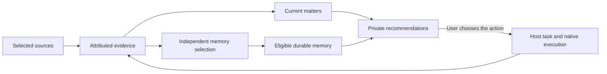

# Personal assistance, contextual recommendations and memory

Status: design approved; P0 is ready for development in the
[release follow-up](release-follow-up.md#p0-contextual-assistance-and-accessible-memory),
2026-10-12. Implementation has not started. [Research and technical notes](personal-assistant-detail.md)
record primary sources, current code, the P0 acceptance boundary and later scope.

## Recommendation

**Use one shared memory foundation, distinguish lifecycles, and keep a few
general content types.** People, projects, customers and meetings should initially
be associations and views, rather than independent memory systems.

This is a core memory capability: the personal assistant should distinguish what
currently needs attention from reusable knowledge, retrieve each appropriately,
and offer a useful next step. Saving more chat history alone does not provide
this behavior.

| Layer | Purpose | Example |
| --- | --- | --- |
| Source evidence | Preserve what was actually observed and where | A colleague shared an integration guide at 14:55 |
| Current matters | Track changing questions, commitments and progress | Three integration questions have no observed answer yet |
| Durable memory | Reuse applicable preferences, facts, decisions and experience | The supported setup procedure and its conditions |
| Recommendations | Offer a timely action with reasons and citations | Prepare a troubleshooting checklist from the available evidence |

Current matters survive restarts but are not automatically reusable knowledge.
Recommendations have their own expiry and feedback. Neither accepting a
recommendation nor finishing a task proves that a lesson should become memory.

## Everyday experience

The owner selects conversations the assistant may observe. It combines related
messages into a current matter, updates it when progress arrives, and presents a
small number of useful suggestions privately. Each suggestion explains what
was observed, why it matters now, the proposed action, and the supporting sources.
The owner can prepare the result, postpone, dismiss, or mark the matter resolved.

For the supplied Feishu example, offer to organize the remaining integration
questions and relevant documentation. Say “No answer to these questions was
found in the collected conversation as of 17:30.” A quiet conversation does
not prove that work has stopped. The displayed two-and-a-half-hour interval is
an example, not a universal reminder rule.

Selecting “Prepare a checklist” starts that preparation task. Sending a follow-up
to colleagues requires an applicable user instruction. Later, supported reusable
findings may enter memory through the existing selection policy; a card does not
automatically become a memory.

## How much to classify memory

Retain the existing general types: preferences, constraints, facts, decisions
and procedures. Add people, projects and topics as source-supported associations
when needed. A past episode can remain a cited source for a fact or procedure;
we do not need a separate episodic-memory product now.

Every reusable record needs ownership and visibility, applicability, source and
evidence strength, and time/version information. A relationship or customer
view can query these dimensions later. Split a type into a dedicated subsystem
only when its permissions, lifecycle or operations differ materially.

Personal context needs an explicit owner-private domain. A project association
does not grant access, and the execution default workspace is not a global
personal-memory bucket. Start with selected sources and authorized owner use;
cross-project synthesis must respect each source's scope.

## Memory within the AI's reach

The AI should be able to find applicable saved memory and current matters during
a task, then inspect their supporting evidence. It should not depend on the user
copying records or knowing their IDs. Supply bounded relevant context and
discoverable read-only tools; distinguish a current status, a reusable lesson
and a source report in the results. Retrieval must preserve scope, freshness and
citations, including in a fresh native conversation.

## P0: ready for development

1. **Distinguish and maintain context.** Extend selected, project-mapped DWS
   conversations into evolving current matters. Keep evidence, matters, existing
   durable memory and recommendations distinct. Start with unanswered questions
   and explicit commitments; preserve citations, progress and collection gaps.
2. **Make it usable by the AI.** Enable scoped, on-demand retrieval of matters,
   applicable existing memory and their cited evidence. Reuse current memory
   types and publication behavior; do not expose a general DWS chat-reading tool.
3. **Complete one assistance loop.** Provide an owner-private recommendation list
   with reasons, refresh, deduplication and postpone/dismiss/resolve. The user
   chooses a preparation action, which enters normal task execution and returns
   a source-linked result. No automatic external message delivery is required.

P0 acceptance requires a fresh conversation to answer what remains open and
retrieve a relevant saved lesson with its sources, then complete a selected
preparation task. New progress must update the matter and suppress stale or
duplicate suggestions. Evidence, inferred status and durable knowledge must stay
distinguishable throughout. This is planned acceptance, not a delivered result.

## Later increments

- **P1: complete the personal memory loop.** Add the explicit personal domain,
   conversation-derived selection, recall of that new knowledge in fresh tasks,
   corrections and disabling.
   Follow the [memory policy](experience-memory.md): publish Jev-selected,
   Host-validated memory automatically, without mandatory human memory approval;
   prevent equivalent disabled lessons from returning. Validate this separately
   from recommendation usefulness.
- **P2: expand after measuring value.** Add opt-in private notifications, selected
   groups and additional event sources, then scenario-specific views and actions.

Meeting preparation, calendar/email/OA/Todo integrations, rich contact profiles,
habit inference, automatic external follow-ups, organization-wide collection,
specialist memory stores and graph infrastructure can follow. The first scope
does not depend on them.

## Research and delivery boundary

The screenshot illustrates a useful combination of action, timing and evidence.
Public Feishu documentation confirms event-triggered Aily tasks; it does not
establish this screenshot's implementation. Comparable product documentation and
memory research support separating context, attention and memory lifecycle;
the [research notes](personal-assistant-detail.md#research-findings) explain the
evidence and its limits.

Agent-Host already has selected-source DWS intake, cited topic proposals and
private evidence export. Evolving matters, recommendations, personal-domain
recall and conversation-derived memory remain planned. Success should mean
useful suggestions with inspectable evidence, few stale or repeated interruptions,
and correct later reuse—not the number of messages collected or memories saved.
