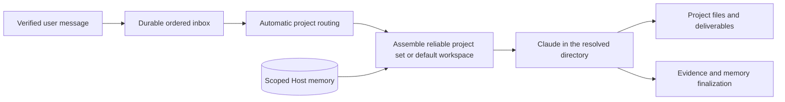

# Project routing and runtime agent assembly

The [agent instance extension](agent-instances.md) selects an Agent and audience
before project assembly. Project scope is unchanged; native sessions and learned
memory additionally belong to that instance/audience. Channel instances use
verified owner/member profiles: owners retain configured execution tools, while
members receive restricted reads and supported owner-approval proposals. See
[authorization](dangerous-operations-design.md); this is not OS access isolation.

Status: local project selection and automatic channel routing are implemented.
The [intelligent routing extension](smart-project-routing.md) adds registered
project sets and automatic selection with default execution when no association
is reliable. Earlier automated checks, seven native multi-project turns and
18 live DingTalk messages remain historical acceptance evidence, separate from
the current policy. See [implementation details](runtime-assembly-detail.md) for
compatibility and validation. Projects within an agent share its Claude execution configuration.

## Goal and usage

Use a reliably associated project's real directory and compatible conversation;
otherwise run in the configured default workspace. Project files retain code, documents,
rules and deliverables. Host memory retains attributed statements and reviewed
experience. Native conversation state stays with Claude.

Local checkout discovery and selected-target enrollment are automatic; see
[project records](development-projects.md). Manual registration remains available,
using the same state home as the service:

```sh
agent-host project add --id api --name 'API project' --workspace /absolute/path/api --home /absolute/path/state
agent-host project list --home /absolute/path/state
agent-host chat --project api --home /absolute/path/state -m 'Inspect the failing test.'
```

Stop the service before adding or updating projects; read-only listing remains
available while it runs. `project update --id api --workspace /new/path` changes
the directory while retaining the project's knowledge. Registration does not
copy a repository, create a branch or create a worktree.

In DingTalk, describe the task directly. Reliable associations select a registered
project set; otherwise the agent executes in its default workspace. An empty
catalog needs no project setup and skips project classification. The Host does
not create new project questions or waiting requests; the native agent asks for
business details when needed. Existing waiting requests remain available only
for their original requester's explicit confirmation or cancellation, without
replay. Project configuration stays local; historical manual selections do not
pin new tasks. See the [routing guide](smart-project-routing.md).

`/new` resets the current compatible native conversation and follow-up context,
retaining memory. The current set is the latest actually executed set, or the
configured default when none exists. `/status` shows a safe conversation summary;
`/help` lists these three Host controls. They do not forward native interactive
commands. A → B → A can resume A's compatible conversation.

Session recovery is automatic for new messages. After an execution failure or
interruption, the Host starts a fresh native conversation in the same project and
briefly explains the change. Saved memory remains available; the previous task
is not repeated. Pending memory processing remains recorded and does not force
users to reset the conversation. `/new` remains an optional deliberate reset.

## Core approach



Project identity and memory scope stay stable when its directory changes. Old
directory-scoped knowledge is linked to the registered project without rewriting
its revisions or source evidence. Joint tasks recall the selected projects'
existing memory with its scope preserved; they do not transfer memory between
projects. Automatic new memory and experience extraction are paused for joint
tasks until their attribution policy is implemented.
Current default-workspace execution uses normal history, memory and experience
processing, including with a populated catalog. Historical unresolved runs retain
their skipped learning outcomes without replay.

A single project uses its cwd. Parallel multi-project work uses `~/workspace`
with the selected project directories added to the native invocation. Naming a
primary project uses its cwd instead. Each project set has a distinct compatible
native conversation. Tasks without a reliable project association keep the configured default workspace;
the installed production default is not automatically relocated.
Default handoff can reuse a compatible session; trusted per-turn instructions
keep unrelated earlier context from defining the new task's target.

Projects within an Agent use its selected Claude configuration; verified sender
authorization further restricts native tools on each turn.
Shared directory access can extend beyond the participating project set through
the [native profile policy](service-install-detail.md#directory-access-policy).
This does not add projects, memories or knowledge sources to the run.
Project `CLAUDE.md` remains the native instruction entry. Older Claude versions
receive root `AGENTS.md` through a source-attributed compatibility path when no
project-root Claude instruction entry exists. Additional project directories
explicitly load their `CLAUDE.md` and use the same attributed `AGENTS.md` fallback.
The host does not edit project rules.
Native auto memory is disabled per invocation; ordinary project rules and native
conversation continuity remain available. Native-loaded permission settings also
participate in session compatibility. A cwd is not an OS sandbox.

Invalid configured project references, missing selected directories and routing
provider failures fail explicitly; uncertainty about a task's project uses the
default workspace without broadening access. A changed directory
or runtime configuration starts a new compatible session; interrupted execution
does not automatically replay. Routing selects only locally registered projects.

## This increment

The implemented [external knowledge extension](knowledge-sources.md) adds selected
Dokki/Confluence MCP tools to runtime assembly. Only source descriptions and
tool access are prepared at startup; document retrieval occurs on demand inside
native execution. Source access also participates in session compatibility.
Provider tokens remain in private local files; prompts and native arguments
contain no token values. Changes rotate the runtime binding. Each source's
project list is explicit; unselected sources and
ambient MCP servers are excluded. Tool-free extraction retains no MCP mounts.

This version includes local registration, descriptions and aliases, automatic
DingTalk routing, default execution, project-set sessions and locally recorded
execution context. The [intelligent routing guide](smart-project-routing.md)
defines the extension. Local/GitHub/GitLab discovery, Codex, per-project
model/tool profiles, multiple current directories per project and automatic
worktrees remain future work.

For the historical explicit-selection increment, `make check` and six real Claude
turns across two isolated projects passed.
Production was upgraded through `make install` and its Stream connection restored.
Real owner private messages sent through dws also passed project switching,
A → B → A continuation, current-project `/new`, fresh scoped memory recall and
missing-directory failure in an isolated Host runtime using the existing bot.
Production was restored afterward; its projects, sessions, runs and memory
records stayed unchanged. The live check also added text-only `richText`
compatibility for dws messages.
See the [details](runtime-assembly-detail.md) for evidence and rollout notes.
