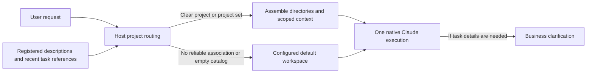

# Intelligent project routing

Status: automatic registered-project routing with default-workspace execution.
Earlier automated checks, seven native-Claude turns and an 18-message DingTalk
private-chat acceptance are preserved separately from the current policy in the
[details](smart-project-routing-detail.md). Bounded local Git checkout discovery
and selected-target enrollment are implemented through the shared
[project runtime](development-projects.md). Remote GitHub/GitLab import remains planned.
The [runtime assembly](runtime-assembly.md) supplies project identity, directories,
scoped knowledge and compatible native sessions.

## Goal and usage

Describe a task naturally. The Host considers registered projects and bounded
local checkout candidates, enrolls the selected local target, and selects a project set
when the association is reliable. Otherwise, the configured agent starts in its
default workspace and handles the request directly. An empty catalog also runs
directly; users do not need to register a project before asking for help.

Conversation comes first. Greetings, capability questions and general requests
do not require a project, even with an empty catalog. Asking what development
help is available or listing and counting local folders under a specified parent
directory can run in the default workspace with existing native permissions.
A directory inventory does not register those folders as projects.
Routing does not grant directory access: native permissions can still block a
requested parent outside the permitted directories. Production separately adds
the owner's `~/github` and `~/gitlab` trees to the
[native directory allowlist](service-install-detail.md#directory-access-policy);
this does not register their repositories or change native command/edit approval.
The Host does not open a project-selection question or create a waiting task for
new requests. Missing recipients, task details or ambiguous targets belong to
the native assistant, which asks a business question when execution actually
needs that information. Users need not label messages as "general" or learn commands.
Natural follow-ups can retain the latest task's project when they change only
the method, information source or output; users need not say "continue".

If Jev returns a choice that contradicts its own probabilities, routing asks the
same service to evaluate once more before starting execution. A valid second
response can proceed; persistent invalid results stop the task. Failure replies
identify the routing stage, state that execution did not start, and explain
whether to resend or ask an operator to check Jev/configuration. Old tasks are
never automatically replayed. See the [recovery details](smart-project-routing-detail.md#inconsistent-provider-response-recovery).

Explaining supplied logs, code snippets or tables can use the default workspace
when the answer needs only those materials and general knowledge. A project name
inside the material does not make it an execution target. Asking the assistant
to fetch live deployment evidence or inspect a project's own files can select
that project when its identity is reliable. Otherwise, the native assistant
handles the request from the default workspace using its existing access and
asks for missing details as needed. Suggesting checks and performing them remain
different actions.

| Request | Behavior |
| --- | --- |
| "Fix the login test in the billing API" | Select the identified registered project. |
| "Continue the task we were just running" | Continue the latest clearly associated task. |
| "Search its documentation instead" after a project investigation | Keep that task's project when the reference is clear. |
| "Compare alpha and beta" | Select both; use `~/workspace` as the neutral cwd. |
| "Work mainly in alpha and integrate beta" | Use alpha as the primary cwd and include beta. |
| "Hi, what can you help me with?" | Answer normally in the default workspace. |
| "Count the repository folders under my local checkout directory" | Route to the default workspace; inspect only with existing native access. |
| "Fix the login test" with uncertain ownership | Start in the default workspace; the native assistant determines what task details it needs. |
| "Draft a general checklist" | Use the configured default workspace. |
| "Explain this pasted log and suggest checks" | Analyze the supplied material without selecting a project solely from names in it. |
| "Fetch the current deployment logs without changing anything" | Select a reliably identified project; otherwise use the default workspace and existing access. |
| An engineering task targets an unregistered repository | Use the default workspace without inventing a registered project or requiring registration. |
| Any task with an empty project catalog | Execute in the default workspace without calling the project classifier. |

Every task uses automatic routing; there is no chat setting for switching projects
or routing modes. Existing manual choices remain in history but do not pin new
tasks. Operators register and configure the available projects locally.

Previously saved waiting requests remain in history and are never automatically
replayed. Only their original requester may explicitly confirm or cancel them;
the [compatibility notes](smart-project-routing-detail.md#existing-pending-request-compatibility)
describe that retained interface. New requests do not enter this waiting state.

Chat offers only three Host controls: `/new` resets the current compatible native
conversation and follow-up routing context while retaining memory; `/status`
shows a safe conversation summary and any legacy pending-task count; `/help` lists
these controls. They do not forward native interactive commands.

## Core approach

Routing receives project descriptions and source-linked recent task references.
It does not combine private memories to infer ownership. Assembly validates every
selected directory, recalls each selected project's existing memory with its
scope, and starts Claude with the actual cwd and additional project directories.
A project set has its own compatible session. Native permissions continue to
apply; cwd selection is not an operating-system sandbox.

An unmapped service address prevents early project selection, even if another
project is named. Routing first determines whether the address is another target
or merely reference material; an unresolved target set uses the default workspace.

Multi-project tasks can read the selected projects' existing knowledge, but
automatic new memory and experience extraction are paused for those tasks until
project attribution has its own policy. Single-project memory behavior continues.
When a populated catalog cannot resolve the project, default handoff uses the
same history and memory flow as an empty catalog. Historical unresolved runs
keep their skipped learning records and remain readable in their saved default
scope. New follow-ups use normal default-memory processing. Default handoff can continue a
compatible native session; per-turn instructions tell the agent not to use
unrelated earlier context as the current task's target.

Default execution does not add project memory, directories or knowledge sources.
The configured instance and its existing access remain authoritative. Missing
selected directories, invalid configuration and routing-provider failures still
fail explicitly. An empty catalog skips the classifier; it is not a provider
fallback. The Host never invents a directory or broadens source permissions.

## Catalog and delivery boundaries

Register an existing local directory and give it a useful description and aliases.
Local registration remains the authority for project identity, assembled
directories and stable memory scope. It is not a prerequisite for default-agent
execution or a filesystem sandbox. Stop the service for catalog writes; automatic task routing
does not require a restart.

This increment preserves the configured default cwd and its memory. The managed
production default remains `~/.agent-host/production/workspace`; it is not moved
automatically. `~/workspace` is the neutral cwd for parallel multi-project work.

Bounded scanning of selected local roots and discovery from selected GitHub/GitLab
accounts or organizations are later increments. Discovery will propose candidates;
activation and preparation of missing local checkouts remain explicit operations.
Remote execution, automatic worktrees, per-project model profiles and multi-agent
orchestration remain outside this increment.

The proposed [development workflow](development-workflow.md) makes worktrees and
PR delivery the next priority for implementation requests, with project binding
and authorization checked before editing. It is not current routing behavior.
