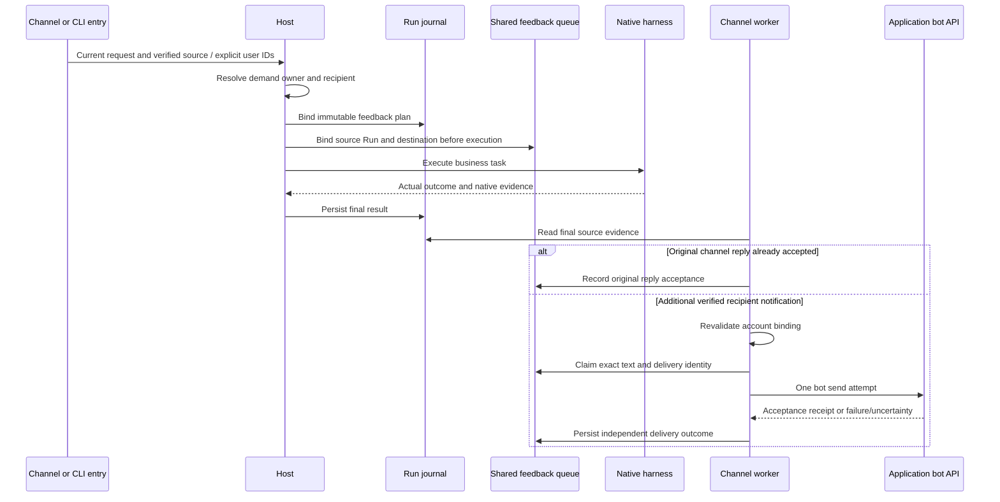

# Task feedback implementation

[User-facing design and flowchart](task-feedback.md).

## Ownership and precedence

Keep submitting sender, demand owner and notification recipient separate.
Explicit CLI user IDs precede semantic attribution. Only the current request
text is interpreted; quotes, attachments, recalled memory and native output
cannot authorize recipients. A semantic choice selects a configured user or
reports an unresolved recipient. Verified account bindings remain operator-owned.
User display names and aliases are lookup labels, not permissions.

`users.json` supports `display_name`, `aliases` and `notify_channel` per user;
the existing `accounts` entries supply application/tenant-scoped identities.
See [the example](../config/users.example.json). Semantic classification uses
the configured Jev provider with a structured verified-user directory, separate
options for self/unresolved and eligible user IDs, and an explicit continuation
option when a previous task has a bound recipient. Names must also match a
directory label in the current request; shared names remain unresolved. No
weaker provider or guessed account is used after a classifier failure.
Only matching directory entries are sent to the classifier; excessive candidate
sets remain unresolved instead of exceeding the provider's choice limit.
Semantic third-party/continuation choices require reported confidence and chosen
probability of at least 0.8; lower-confidence attribution remains unresolved.

Ordinary group members retain authenticated sender/conversation attribution.
The owner and CLI paths interpret explicit on-behalf-of wording. CLI parameters
bypass semantic attribution:

```sh
agent-host chat --home /ROOT/cli-state --agents-config /ROOT/config/agents.cli.json \
  --request-for alice --notify-channel feishu -m 'Check the named service for Alice.'
agent-host notifications list --config-dir /ROOT/config
agent-host notifications show NOTIFICATION_ID --config-dir /ROOT/config
agent-host notifications resolve NOTIFICATION_ID --config-dir /ROOT/config \
  --notify-to alice --notify-channel feishu
```

Replace illustrative paths/IDs with configured values. `--request-for` identifies
demand ownership; `--notify-to` optionally chooses a different verified recipient.
`--feedback-config-dir` supplies the unified directory when no Agent catalog is
selected. A configured local requester account receives automatic CLI feedback;
otherwise ordinary self-owned CLI work retains terminal output. A new request
is attributed independently; an explicitly recognized continuation retains its
prior recipient and revalidates the account binding.

Prefer the source channel/application/tenant when choosing an account. A CLI
request can select a channel; otherwise use the configured notification channel
or the sole unambiguous account. Missing or multiple matching accounts leave a
visible unresolved plan. A channel's ordinary reply still goes to its original
conversation. A transferred request adds a separate bot notification to the
resolved demand owner; it does not silently move the original conversation.

## Durable delivery

Persist the plan on the Run and bind it to a shared, private feedback queue
before native execution. The queue lives beside unified configuration so CLI
and independently locked channel runtimes can share notification work without
writing each other's execution databases. Each queue item fixes its source Run,
source partition, recipient, exact final text and delivery identity.

The shared database is `ROOT/feedback/state.db`. `Run.feedback` and the
`feedback.bound` event retain the initial plan. Queue items use a deterministic
source-home/Run key; receipt/attempt history is inspectable through
`notifications show`. Recipient corrections are recorded as amendments and do
not rewrite the original Run plan. Inspection opens the queue read-only.



Channel workers only consume targets matching their own application and tenant.
They read final source evidence and claim queue items transactionally before
one send attempt. Normal channel replies are observed rather than duplicated.
Business execution is never replayed to repair notification delivery.

Delivery states distinguish awaiting result, recipient needed, sending,
accepted, failed and unknown. Confirmed failures allow bounded retries; ambiguous
or interrupted sends become unknown and require reconciliation. Platform
acceptance does not establish that a person read the notification. Retain attempt
receipts and errors independently from the business outcome.

Original channel replies normally use the existing durable reply path. The
worker observes their acceptance and waits 30 seconds after final evidence
before recovering an unsent or confirmed-failed reply. Both paths claim the
same saved reply, preventing duplicate normal/recovery sends. Failed attempts
use bounded backoff with at most three worker attempts. Unknown sends are not
automatically retried. For CLI execution abandoned without final evidence, a
probe of the existing Host ownership lock can establish that the Host exited;
the notification then reports an uncertain outcome, never verified success or
stopped business side effects. Execution databases remain untouched by that
probe; original-reply recovery uses the owning channel's existing Store.

New direct notifications use the application's bot: DingTalk's
[official robot SDK contract](https://pkg.go.dev/github.com/alibabacloud-go/dingtalk/v2/robot_1_0)
for `BatchSendOTO`, and Feishu's
[`+messages-send` command](https://github.com/larksuite/cli/blob/main/skills/lark-im/references/lark-im-messages-send.md)
with `--as bot`, a verified Open ID and a durable idempotency key. DingTalk
acceptance retains `processQueryKey`; Feishu retains the returned message ID.
Neither establishes recipient reading.

## Recovery and privacy

Read terminal Run evidence after a restart to recover queued results. Source
paths and partitions come from Host composition, never model output. Account
bindings are checked again before sending. Changed or removed bindings block
delivery. Existing channel reply capabilities and audience boundaries remain
authoritative. The native final answer is instructed to be suitable for its
bound feedback recipient; raw provider errors, credentials and private execution
records are excluded from system-generated failure notifications.

Only newly bound Runs are queued; historical tasks are not backfilled. A missing
directory entry or closed/unavailable original channel remains a visible delivery
gap. No fallback personal account or cross-channel identity link is invented.

## Validation

Exercise owner transfer, member mention, explicit CLI recipient, inferred CLI
ownership, ambiguous names, data-subject mentions, duplicate completion,
provider rejection, unknown send outcome and recovery without task replay.
Use fixture transports for deterministic tests. Keep actual platform sends and
their receipt evidence explicitly identified in delivery reports.
