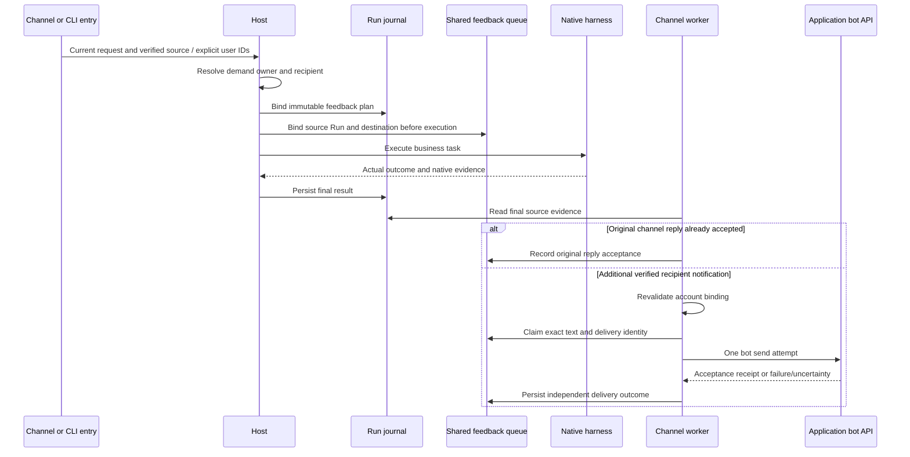

# Task feedback implementation

[User-facing design and flowchart](task-feedback.md).

## Ownership and precedence

Keep submitting sender, demand owner and notification recipient separate.
Explicit CLI user IDs precede semantic attribution. Only the current request
text is interpreted; quotes, attachments, recalled memory and native output
cannot authorize recipients. A semantic choice selects a configured user or
reports an unresolved recipient. Verified account bindings remain operator-owned.
User display names and aliases are lookup labels, not permissions.

`users.json` supports `display_name`, `aliases` and `notify_channel` per user;
the existing `accounts` entries supply application/tenant-scoped identities.
See [the example](../config/users.example.json). Semantic classification uses
the configured Jev provider with a structured verified-user directory, separate
options for self/unresolved and eligible user IDs, and an explicit continuation
option when a previous task has a bound recipient. Names must also match a
directory label in the current request; shared names remain unresolved. No
weaker provider or guessed account is used after a classifier failure.
Only matching directory entries are sent to the classifier; excessive candidate
sets remain unresolved instead of exceeding the provider's choice limit.
Semantic third-party/continuation choices require reported confidence and chosen
probability of at least 0.8; lower-confidence attribution remains unresolved.

Ordinary group members retain authenticated sender/conversation attribution.
The owner and CLI paths interpret explicit on-behalf-of wording. CLI parameters
bypass semantic attribution:

```sh
agent-host chat --home /ROOT/cli-state --agents-config /ROOT/config/agents.cli.json \
  --request-for alice --notify-channel feishu -m 'Check the named service for Alice.'
agent-host notifications list --config-dir /ROOT/config
agent-host notifications show NOTIFICATION_ID --config-dir /ROOT/config
agent-host notifications resolve NOTIFICATION_ID --config-dir /ROOT/config \
  --notify-to alice --notify-channel feishu
```

Replace illustrative paths/IDs with configured values. `--request-for` identifies
demand ownership; `--notify-to` optionally chooses a different verified recipient.
`--feedback-config-dir` supplies the unified directory when no Agent catalog is
selected. Ordinary self-owned CLI work retains terminal output even when the
requester has configured chat accounts. Explicit ownership, recipient or channel
arguments retain their notification behavior. A new request
is attributed independently; an explicitly recognized continuation retains its
prior recipient and revalidates the account binding.

Web Chat always appends `--feedback-other-users-only=true` to its Host launch.
After attribution, a recipient equal to the requester retains local (Web) output
without selecting an IM account or binding a notification queue item. This also
applies to an explicit self recipient and a self-owned continuation. Other verified
recipients retain the normal account validation and delivery path; unresolved
identities remain unresolved. Ordinary CLI defaults and channel replies are unchanged.

Channel requests must use the source channel/application/tenant, regardless of
the recipient's default or a supplied channel option. A CLI request can select
a channel; otherwise use the configured notification channel or the sole
unambiguous account. Defaults apply only when there is no channel origin.
Missing or multiple matching source accounts leave a visible unresolved plan,
without cross-channel fallback. A channel's ordinary reply still goes to its original
conversation. A transferred request adds a separate bot notification to the
resolved demand owner; it does not silently move the original conversation.

## Durable delivery

Persist the plan on the Run and bind it to a shared, private feedback queue
before native execution. The queue lives beside unified configuration so CLI
and independently locked channel runtimes can share notification work without
writing each other's execution databases. Each queue item fixes its source Run,
source partition, recipient, exact final text and delivery identity.

The shared database is `ROOT/feedback/state.db`. `Run.feedback` and the
`feedback.bound` event retain the initial plan. Queue items use a deterministic
source-home/Run key; receipt/attempt history is inspectable through
`notifications show`. Recipient corrections are recorded as amendments and do
not rewrite the original Run plan. Inspection opens the queue read-only.



Channel workers only consume targets matching their own application and tenant.
They read final source evidence and claim queue items transactionally before
one send attempt. Normal channel replies are observed rather than duplicated.
Business execution is never replayed to repair notification delivery.

Delivery states distinguish awaiting result, recipient needed, sending,
accepted, failed and unknown. Confirmed failures allow bounded retries; ambiguous
or interrupted sends become unknown and require reconciliation. Platform
acceptance does not establish that a person read the notification. Retain attempt
receipts and errors independently from the business outcome.

Original channel replies normally use the existing durable reply path. The
worker observes their acceptance and waits 30 seconds after final evidence
before recovering an unsent or confirmed-failed reply. Both paths claim the
same saved reply, preventing duplicate normal/recovery sends. Failed attempts
use bounded backoff with at most three worker attempts. Unknown sends are not
automatically retried. For CLI execution abandoned without final evidence, a
probe of the existing Host ownership lock can establish that the Host exited;
the notification then reports an uncertain outcome, never verified success or
stopped business side effects. Execution databases remain untouched by that
probe; original-reply recovery uses the owning channel's existing Store.

New direct notifications use the application's bot: DingTalk's
[official robot SDK contract](https://pkg.go.dev/github.com/alibabacloud-go/dingtalk/v2/robot_1_0)
for `BatchSendOTO`, and Feishu's
[`+messages-send` command](https://github.com/larksuite/cli/blob/main/skills/lark-im/references/lark-im-messages-send.md)
with `--as bot`, a verified Open ID and a durable idempotency key. DingTalk
acceptance retains `processQueryKey`; Feishu retains the returned message ID.
Neither establishes recipient reading.

## Recovery and privacy

Read terminal Run evidence after a restart to recover queued results. Source
paths and partitions come from Host composition, never model output. Account
bindings are checked again before sending. Changed or removed bindings block
delivery. Existing channel reply capabilities and audience boundaries remain
authoritative. The native final answer is instructed to be suitable for its
bound feedback recipient; raw provider errors, credentials and private execution
records are excluded from system-generated failure notifications.

Only newly bound Runs are queued; historical tasks are not backfilled. A missing
directory entry or closed/unavailable original channel remains a visible delivery
gap. No fallback personal account or cross-channel identity link is invented.

## Validation

Exercise owner transfer, member mention, explicit CLI recipient, inferred CLI
ownership, ambiguous names, data-subject mentions, duplicate completion,
provider rejection, unknown send outcome and recovery without task replay.
Use fixture transports for deterministic tests. Keep actual platform sends and
their receipt evidence explicitly identified in delivery reports.

## 未解析通知的只读分诊

```sh
agent-host notifications triage --config-dir /ROOT/config
agent-host notifications triage --config-dir /ROOT/config --review /PRIVATE/review.json
```

命令只读打开队列与原执行数据库，不启动 worker、不检查或抢占 Host 锁、不调用
模型、不解析身份、不发送通知。输出按年龄、来源和需求所有者分组，隐藏路径、
任务正文、账号、原始错误和审查证据正文；所有者使用稳定的 SHA-256 摘要前缀。
通知 ID 保留用于本地核对，因此报告仍应仅供授权运维人员使用。

`counts.total` 是全保留快照；`unresolved` 单独统计 `needs_recipient`，与以下
互斥分诊类别有重叠，不能相加当作总数：

| 类别 | 含义与处理 |
| --- | --- |
| `actionable` | 有 `run.finished` 或 `execution.ready` 证据，值得核查结果交付；不代表身份已验证、结果成功或获准发送。 |
| `awaiting_result` | 源 Run 可读，但没有上述完成证据；等候原执行结果，不重跑业务。 |
| `historical_test` | 操作者提供证据确认历史或测试用途；不因年龄自动归入此类。 |
| `terminal_only` | 操作者提供证据确认只需终端/Web 输出；保留队列证据，不补发。 |
| `needs_review` | 源数据不可读或 Run 缺失；结果是否完成未知，不能按待发送处理。 |
| `other` | accepted、failed、unknown、sending 等其他队列状态；仍可按原状态核对。 |

年龄优先使用源 Run 创建时间；不可用时采用队列最后更新时间并明确标记
`age_basis=queue_updated_at`，后者不是任务年龄。缺失或未来时间为 unknown。
年龄区间为不足一天、1–7 天、7–30 天和至少 30 天，不代表七日失败率。
无来源账号的记录标为 `cli_or_web`，不从路径猜测测试环境或入口类型。
需求所有者来自保存的 `request_for`；缺失或归属判定失败时明确 unresolved，
不把默认 requester 当作已确认的需求所有者，也不据此推断收件人。

可选审查文件格式如下；键必须是现有 needs_recipient 通知 ID，class 只能是 historical、test
或 terminal_only，evidence 必须非空。它仅影响报告，不写回队列，也不授予权限。
证据应指向已检查的请求、Run 或测试记录，不能只写“记录很旧”。

```json
{"NOTIFICATION_ID":{"class":"test","evidence":"已核对的隔离测试运行证据引用"}}
```

### 每类可处理记录的核验清单

1. 使用 `notifications show ID --config-dir /ROOT/config` 在私有环境核对原始
   计划、attempts、结果来源和已有平台回执。报告中的 actionable 包含已绑定但
   等待 worker 的记录；只对 needs_recipient 使用 resolve。
2. 对 CLI/Web 的明确第三方需求，核对当前请求的需求所有者、授权收件人以及
   users.json 中已验证的用户、channel、application、tenant、sender 绑定。
   使用本文前述单 ID `notifications resolve` 命令指定已验证用户与渠道。
   普通自有 CLI/Web 任务应保留本地输出，不能仅因账号存在而补发通知。
3. 对渠道来源的转交需求，同时验证原渠道、应用、租户匹配；resolve 会保留
   来源限制。其他应用或租户的同名账号不构成证据。对于原会话回复，先核对
   原 channel message 的 reply_status 和回执，避免将已接受的原回复变成额外通知。
4. 缺少身份依据、同名、多个候选、绑定变更或 unknown 发送结果时，保持未解析；
   不猜测映射、不批量 resolve。源不可用时先找回只读证据，不能重建或重跑任务。
5. 在另行授权的生产修复中，resolve 后核对新增 recipient_resolved amendment、
   未改变的源 Run 与原计划；由匹配的现有 worker 处理保存结果。核对唯一平台
   回执及 accepted 状态，重复观察不能新增 attempt 或 Run。平台接受不代表已读。
   resolve 本身不发送，但运行中的 worker 随后可能发送，所以不是只读审查操作。

### 新记录为何仍可能缺少收件人

`attribution` 仅输出允许列表中的诊断码；未知或自由文本不会进入脱敏报告。
按以下顺序核查，而不是看到 users.json 有账号就强制选择：

- `ownership_*`、`demand_owner_*`、候选或姓名错误来自归属判定阶段；模型不可用、
  低置信度或当前请求没有唯一明确姓名时，已有账号也不能替代需求归属证据。
- `notification_user_not_configured` 表示选择的用户不在本次加载的目录；核对实际
  feedback config 路径与经过验证的用户 ID，不修改历史请求来凑匹配。
- `notification_account_missing_or_ambiguous` 表示渠道/应用/租户筛选后不是唯一
  账号；检查来源范围及多账号配置，禁止跨渠道回退。
- 发送前目录不可用、owner 绑定无效、identity removed 或 binding changed 会将
  已计划通知退回 needs_recipient。对照原计划和当前配置定位变更，不隐式重试。

2026-10-26 审计给出的 115 条（86 accepted、29 needs_recipient）仅是历史
全保留快照，不是当前实测值，也不是 29 条已证实丢失的回复。本次交付提供工具、
清单和隔离测试；没有读取生产快照，29 条中的实际分类和根因仍待授权运维审查。
生产身份修复、发送、重启与部署属于单独任务。
