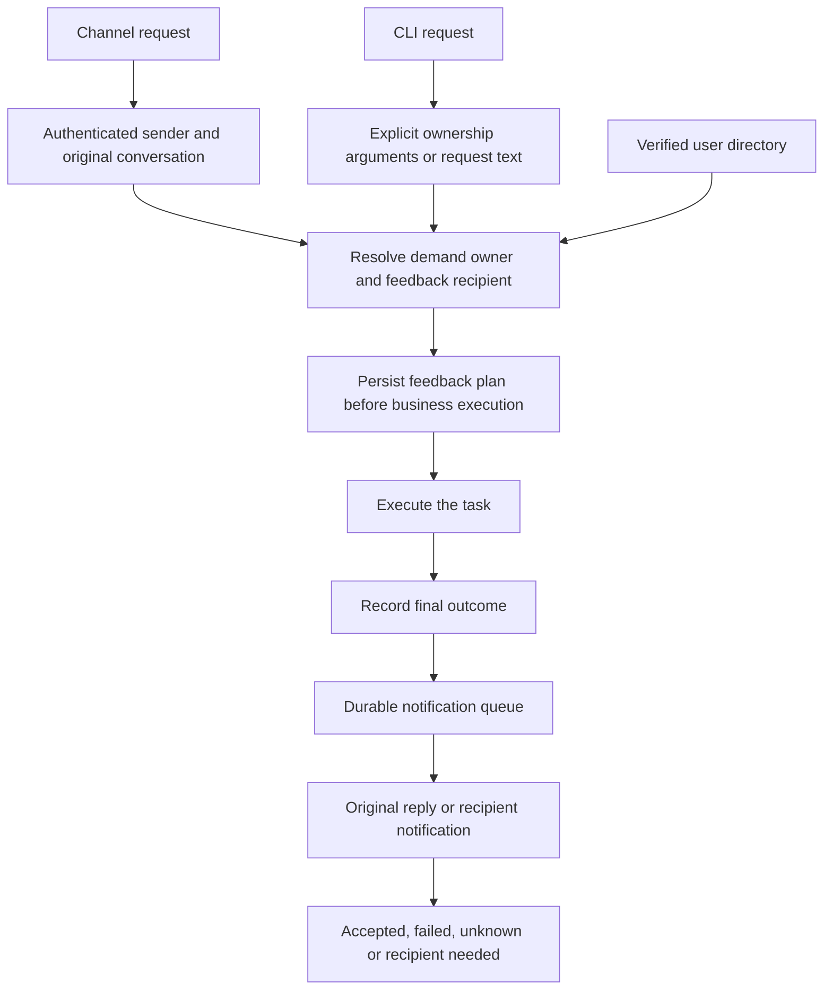

# Task ownership and completion feedback

Every task records who submitted it, whose need it serves, and where its result
belongs. The requester does not need to ask again for the result to be forwarded.
[Implementation details](task-feedback-detail.md) describe storage and delivery.

Implemented for configured CLI chat, DingTalk and Feishu intake. Notification
delivery uses the configured application bot and requires a running channel
worker. Names need verified account bindings in `config/users.json`.

## Expected behavior

| Entry | Ownership and feedback |
| --- | --- |
| A member mentions agh in a group | That member; reply in the original conversation. |
| The owner asks to handle another person's issue | Resolve the named person through verified account bindings; notify that person and retain the original reply. |
| CLI includes ownership or recipient arguments | Use the explicit user IDs and validate their configured accounts. |
| CLI omits those arguments | Interpret the current request like an owner handoff; otherwise retain terminal feedback. |
| A name or destination is ambiguous | Continue independently executable work; record that notification needs a recipient and explain the gap. |

Mentioning a person as a data subject does not automatically make them the
requester. Names select existing identities; model output cannot create account
bindings or supply arbitrary message destinations.

Channel tasks always deliver through their source channel and application.
Only CLI tasks use an explicitly selected notification channel or the recipient's
configured default. A missing account on the source channel remains unresolved;
it does not fall back to another channel.

Success, failure and blocked outcomes all receive feedback. Notifications carry
the result and available usage/cost metadata. Delivery success is recorded
separately from task execution and memory persistence. Service recovery resumes
notification work without repeating business operations; uncertain sends are
never blindly replayed.

## Implementation order

1. Persist ownership and feedback plans at the shared Host entry.
2. Resolve explicit IDs and semantic ownership against the verified directory.
3. Connect the shared queue to channel bot adapters and CLI intake.
4. Verify original replies, owner handoffs, CLI tasks and interrupted delivery.

Live account permissions and platform receipt evidence remain separate from
automated integration checks. This document defines the intended behavior;
the detailed guide records delivered scope and validation limits.
